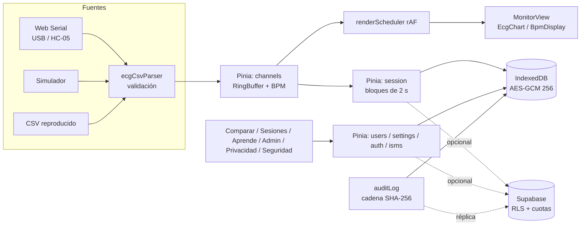

# Monitor ECG (Vue 3)

SPA educativa para visualizar y comparar la señal de un sensor **AD8232** conectado a un **Arduino UNO/Nano o ESP32**,
que emite el CSV `t_ms,ecg_raw,leads_off,bpm` a 250 Hz y 115 200 baudios. **No es un dispositivo médico ni realiza diagnósticos.**

**Demo:** https://monitor-ecg1.vercel.app/ (usa el **Simulador** si no tienes hardware).

Stack: Vue 3 (Composition API, `<script setup>`), Vite 7, Vue Router 4, Pinia 3, uPlot, idb, Supabase (opcional), Vitest, Playwright, ESLint (`eslint-plugin-vue`, `eslint-plugin-security`).

## Cómo ejecutar

Requisitos: Node.js ≥ 20 y npm.

```bash
npm ci                    # instalación reproducible (lockfile)
cp .env.example .env.local  # opcional: solo si usarás la nube
npm run dev               # http://localhost:5173
npm run build             # dist/ sin source maps ni console.*
npm run preview           # sirve dist/ con las MISMAS cabeceras que vercel.json (CSP incluida)
npm test                  # pruebas unitarias (Vitest)
npm run lint              # ESLint
npm run test:e2e:install  # una vez: descarga Chromium para Playwright
npm run test:e2e          # pruebas E2E (construye una copia sin nube en dist-e2e/)
npm run gen:referencia    # regenera public/referencias/ejemplo_referencia.csv
```

Sin variables de entorno la app funciona **100 % local** (IndexedDB cifrado).

## Arquitectura



Detalle en `../docs/ARQUITECTURA_VUE.md` y trazabilidad requerimientos → componentes → pruebas → controles en `../docs/TRAZABILIDAD.md`.
Conexión del hardware: `../docs/esquema_circuito_ad8232.svg`.

## Flujo de uso

1. **Participantes**: crear/elegir "Usuario N" (sin contraseña). Datos opcionales solo con consentimiento.
2. **Monitor**: hasta 5 canales; fuente (puerto serie, simulador o CSV), perfil y participante. Antes de Web Serial se exige el **acuse de seguridad eléctrica** (queda en la auditoría). "Iniciar sesión de medición" para grabar.
3. **Sesiones**: historial, detalle y exportación CSV seudonimizada (portabilidad).
4. **Comparar**: referencia frente a señal simulada, sesión, canal en vivo o CSV; sincronización por pico R, correlación cruzada o manual.
5. **Admin** (`/admin`): PIN local; rangos, sincronización, retención, usuarios, auditoría, panel SGSI.
6. **Privacidad** (`/privacidad`): base legal, derechos y botón **"Eliminar mis datos en la nube"**. **Seguridad** (`/seguridad`): política y reporte de incidentes.

## Configuración de Supabase (opcional)

1. Crear el proyecto y anotar la **región** (se informa en `/privacidad` y en `../docs/sgsi/proveedores.md`).
2. *Authentication → Sign In / Providers*: activar **Allow anonymous sign-ins**. En *Rate Limits* dejar un límite bajo de altas anónimas por IP.
3. *SQL Editor*: ejecutar completo `../supabase/schema.sql` (idempotente; crea tablas, RLS, cuotas, lista blanca de auditoría, `hora_servidor()` y `borrar_mis_datos()`).
4. Crear el administrador: *Authentication → Users → Add user* (correo + contraseña fuerte, auto-confirm) y luego:
   ```sql
   insert into public.administradores (user_id)
   select id from auth.users where email = 'correo-del-admin@ejemplo.cl';
   ```
5. Opcional: activar `pg_cron` y programar la purga (comando al final de `schema.sql`).
6. Variables (en `.env.local` y en Vercel): `VITE_SUPABASE_URL` y `VITE_SUPABASE_PUBLISHABLE_KEY` (solo la clave **publicable**; nunca `service_role`).

### CAPTCHA (opcional, recomendado si la demo es pública)

1. Crear un sitio en Cloudflare Turnstile (o hCaptcha) y obtener la clave de sitio y la secreta.
2. Supabase → *Authentication → Attack Protection → Enable CAPTCHA protection*: elegir el proveedor y pegar la clave **secreta**.
3. Variables públicas: `VITE_CAPTCHA_PROVIDER=turnstile` (o `hcaptcha`) y `VITE_CAPTCHA_SITE_KEY=<clave de sitio>`.
4. Ampliar la CSP de `vercel.json` **solo si se activa**:
   - Turnstile: añadir `https://challenges.cloudflare.com` a `script-src` y agregar `frame-src https://challenges.cloudflare.com`.
   - hCaptcha: añadir `https://hcaptcha.com https://*.hcaptcha.com` a `script-src`, `connect-src` y `style-src`, y `frame-src https://hcaptcha.com https://*.hcaptcha.com`.

Sin estas variables el CAPTCHA queda desactivado y no se carga ningún script externo. Además, el cliente limita la tasa de altas anónimas y de escrituras (`src/utils/rateLimiter.js`) y el servidor impone cuotas por usuario (triggers en `schema.sql`).

## Despliegue (Vercel)

Framework preset Vite; `vercel.json` define el rewrite SPA y las cabeceras (CSP sin `unsafe-eval` ni `unsafe-inline`,
`Permissions-Policy: serial=(self)`, HSTS, nosniff, COOP/CORP). Variables: las de Supabase (y CAPTCHA si se usa).
Si se cambia de proyecto Supabase, actualizar el host en `connect-src` de la CSP.

## Integración continua

`.github/workflows/ci.yml` (lint, unitarias, build, `npm audit --audit-level=high` del código de producción, E2E con Playwright y gitleaks) y `.github/dependabot.yml` (npm y Actions semanal). En GitHub la app está en la **raíz** del repositorio junto a `docs/`, `supabase/` y `legacy/` (versión antigua en HTML/JS, no se entrega).

## Navegadores

| Función | Chrome/Edge escritorio | Chrome Android | Safari / iOS / Firefox |
|---|---|---|---|
| Captura por cable o HC-05 (Web Serial) | Sí | No | No |
| Simulador, CSV, comparación, sesiones, educación | Sí | Sí | Sí |

## Limitaciones

- **No es un dispositivo médico.** Uso solo educativo; seguir las reglas de seguridad eléctrica (portátil a batería, nunca en personas con marcapasos).
- El PIN de admin (PBKDF2, 600 000 iteraciones) y el cifrado local protegen frente al uso casual, no frente a quien controla el navegador y DevTools; las acciones en la nube exigen la cuenta Supabase del administrador.
- La auditoría local detecta alteraciones (cadena SHA-256), no las impide; en la nube la hora y el autor los fija el servidor.
- Sin nube no hay respaldo central. El plan gratuito de Supabase se pausa por inactividad.
- `BleSource` (ESP32 BLE) es un esqueleto; no se probó con hardware real en CI.

Ver `CAMBIOS.md`, `../docs/ISO27001_controles.md` (SoA) y `../docs/sgsi/`.
