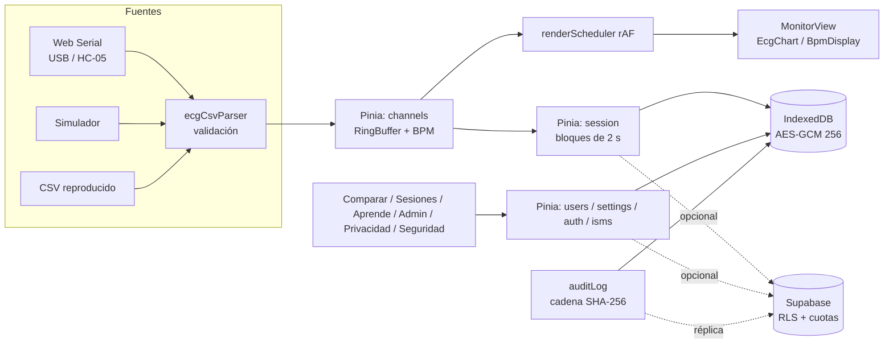

# Monitor ECG (Vue 3)

SPA educativa para visualizar y comparar la señal de un sensor **AD8232** conectado a un **Arduino UNO/Nano o ESP32**,
que emite el CSV `t_ms,ecg_raw,leads_off,bpm` a 250 Hz y 115 200 baudios. **No es un dispositivo médico ni realiza diagnósticos.**

**Demo:** https://monitor-ecg1.vercel.app/ (usa el **Simulador** si no tienes hardware).

Stack: Vue 3 (Composition API, `<script setup>`), Vite 7, Vue Router 4, Pinia 3, uPlot, idb, Supabase (opcional), Vitest, Playwright, ESLint (`eslint-plugin-vue`, `eslint-plugin-security`).

## Cómo ejecutar

Requisitos: Node.js ≥ 20 y npm.

```bash
npm ci                    # instalación reproducible (lockfile)
cp .env.example .env.local  # opcional: solo si usarás la nube
npm run dev               # http://localhost:5173
npm run build             # dist/ sin source maps ni console.*
npm run preview           # sirve dist/ con las MISMAS cabeceras que vercel.json (CSP incluida)
npm test                  # pruebas unitarias (Vitest)
npm run lint              # ESLint
npm run test:e2e:install  # una vez: descarga Chromium para Playwright
npm run test:e2e          # pruebas E2E (construye una copia sin nube en dist-e2e/)
npm run gen:referencia    # regenera public/referencias/ejemplo_referencia.csv
```

Sin variables de entorno la app funciona **100 % local** (IndexedDB cifrado).

## Arquitectura



Detalle en `../docs/ARQUITECTURA_VUE.md` y trazabilidad requerimientos → componentes → pruebas → controles en `../docs/TRAZABILIDAD.md`.
Conexión del hardware: `../docs/esquema_circuito_ad8232.svg`.

## Flujo de uso y rutas

| Ruta | Sección | Qué hace |
|---|---|---|
| `/` | Inicio | Accesos y compatibilidad |
| `/usuarios` | Usuarios | Mantenedor (CRUD): buscar, ordenar, crear, ver, editar alias y datos opcionales (con consentimiento), eliminar (cascada local y nube), contador de monitoreos, "Descargar historial" |
| `/monitor` | Monitor | Elegir usuario → conectar fuente → **Iniciar monitoreo** → **Detener** → **Guardar monitoreo** (nombre, nota, actividad) o **Descartar** |
| `/monitoreos`, `/monitoreos/:id` | Monitoreos | Filtros (usuario, fechas, actividad, estado, texto), selección múltiple, detalle con picos, editar, eliminar, exportar CSV/JSON, informe PDF/CSV, historial. `/sesiones*` redirige aquí |
| `/comparar` | Comparar | A y B desde monitoreos guardados (selector usuario → medición con miniatura), simulador, CSV (incluye CSV exportados por la app) o canal en vivo; informe PDF/CSV |
| `/aprende/:tema`, `/aprende/mis-monitoreos` | Aprende | Teoría y lectura guiada de un monitoreo propio (picos, RR, BPM, actividad, calidad PPG) |
| `/admin*`, `/privacidad`, `/seguridad` | Admin y políticas | Sin cambios |

Un monitoreo detenido es un **borrador** (cifrado, solo local) hasta que se guarda; no aparece en Comparar ni Aprende. Si no se guarda ni descarta, queda como "Borrador" en Monitoreos y un aviso en la cabecera: nunca se pierde por accidente. Los informes y exportaciones van seudonimizados (Usuario N, sin alias ni datos opcionales); los PDF los genera un escritor propio sin dependencias (`src/services/report/pdfWriter.js`).

Si el sensor envía valores fuera del rango del perfil elegido (p. ej. un ESP32 de 12 bits con perfil de 10 bits) el canal muestra "El perfil del dispositivo no coincide: elige ESP32". Análisis y decisiones de interfaz: `../docs/ANALISIS_VISUAL.md`.

## Configuración de Supabase (opcional)

1. Crear el proyecto y anotar la **región** (se informa en `/privacidad` y en `../docs/sgsi/proveedores.md`).
2. *Authentication → Sign In / Providers*: **Email habilitado** (correo + contraseña) con **Confirm email** activo. El inicio de sesión anónimo **ya no se usa** (déjalo desactivado). En *Authentication → Sign In / Providers → Email* fija longitud mínima de contraseña **10** y activa *Leaked password protection* si tu plan lo permite. En *Rate Limits* deja límites bajos de registros y correos por hora.
   - *Authentication → URL Configuration*: **Site URL** = `https://monitor-ecg1.vercel.app`; **Redirect URLs**: `https://monitor-ecg1.vercel.app/acceso`, `https://monitor-ecg1.vercel.app/restablecer` (y `http://localhost:5173/**` solo para desarrollo).
   - *Authentication → Emails*: revisa las plantillas de «Confirm signup» y «Reset password» (en español) y, para producción, configura SMTP propio.
3. *SQL Editor*: ejecutar completo `../supabase/schema.sql` (idempotente; crea tablas, RLS, cuotas, lista blanca de auditoría, `hora_servidor()`, `borrar_mis_datos()`, `pacientes`, las funciones RPC `listar_monitoreos_publicos()` y `monitoreo_publico()` y `eliminar_mi_cuenta()`). Si la base ya existía, basta con ejecutar `../supabase/migracion_cuentas_pacientes.sql` (idempotente).
4. Crear el administrador: el administrador es **una cuenta normal** (se registra en `/registro` o se crea en *Authentication → Users → Add user* con correo + contraseña fuerte). Ejecutar `../supabase/migracion_admin_mfa.sql` (si no usas `schema.sql` completo), habilitar *MFA (TOTP)* en *Authentication → Multi-Factor* y conceder el rol (solo el dueño del proyecto, por SQL):
   ```sql
   insert into public.administradores (user_id)
   select id from auth.users where email = 'correo-del-admin@ejemplo.cl'
   on conflict (user_id) do nothing;
   ```
5. Opcional: activar `pg_cron` y programar la purga (comando al final de `schema.sql`).
6. Variables (en `.env.local` y en Vercel): `VITE_SUPABASE_URL` y `VITE_SUPABASE_PUBLISHABLE_KEY` (solo la clave **publicable**; nunca `service_role`).

### Cuentas, pacientes y visibilidad

- **Rutas:** `/acceso`, `/registro`, `/recuperar`, `/restablecer`, `/pacientes` (antes `/usuarios`, que redirige).
- **Sin cuenta** todo queda cifrado en el dispositivo y no se sube nada. **Con cuenta** los pacientes y monitoreos se sincronizan con Supabase (RLS por propietario) y al iniciar sesión se ofrece vincular los datos locales.
- **Visibilidad:** cada monitoreo es `privado` (por defecto) o `publico` (lectura para cuentas autenticadas, vía las funciones RPC `listar_monitoreos_publicos()` y `monitoreo_publico()`, siempre «Paciente anónimo»). Se elige al guardar y se cambia desde el detalle o la lista.
- El CAPTCHA, si está configurado, se pide al crear la cuenta.

### CAPTCHA (opcional, recomendado si la demo es pública)

1. Crear un sitio en Cloudflare Turnstile (o hCaptcha) y obtener la clave de sitio y la secreta.
2. Supabase → *Authentication → Attack Protection → Enable CAPTCHA protection*: elegir el proveedor y pegar la clave **secreta**.
3. Variables públicas: `VITE_CAPTCHA_PROVIDER=turnstile` (o `hcaptcha`) y `VITE_CAPTCHA_SITE_KEY=<clave de sitio>`.
4. Ampliar la CSP de `vercel.json` **solo si se activa**:
   - Turnstile: añadir `https://challenges.cloudflare.com` a `script-src` y agregar `frame-src https://challenges.cloudflare.com`.
   - hCaptcha: añadir `https://hcaptcha.com https://*.hcaptcha.com` a `script-src`, `connect-src` y `style-src`, y `frame-src https://hcaptcha.com https://*.hcaptcha.com`.

Sin estas variables el CAPTCHA queda desactivado y no se carga ningún script externo. Además, el cliente limita los intentos de acceso/registro y las escrituras (`src/utils/rateLimiter.js`) y el servidor impone cuotas por usuario (triggers en `schema.sql`).

## Despliegue (Vercel)

Framework preset Vite; `vercel.json` define el rewrite SPA y las cabeceras (CSP sin `unsafe-eval` ni `unsafe-inline`,
`Permissions-Policy: serial=(self)`, HSTS, nosniff, COOP/CORP). Variables: las de Supabase (y CAPTCHA si se usa).
Si se cambia de proyecto Supabase, actualizar el host en `connect-src` de la CSP.

## Integración continua

`.github/workflows/ci.yml` (lint, unitarias, build, `npm audit --audit-level=high` del código de producción, E2E con Playwright y gitleaks) y `.github/dependabot.yml` (npm y Actions semanal). En GitHub la app está en la **raíz** del repositorio junto a `docs/`, `supabase/` y `legacy/` (versión antigua en HTML/JS, no se entrega).

## Navegadores

| Función | Chrome/Edge escritorio | Chrome Android | Safari / iOS / Firefox |
|---|---|---|---|
| Captura por cable o HC-05 (Web Serial) | Sí | No | No |
| Simulador, CSV, comparación, sesiones, educación | Sí | Sí | Sí |

## Limitaciones

- **No es un dispositivo médico.** Uso solo educativo; seguir las reglas de seguridad eléctrica (portátil a batería, nunca en personas con marcapasos).
- Con nube, el administrador es una cuenta con rol y segundo factor TOTP: los privilegios los impone el servidor (`es_admin()` exige `aal2`). Sin nube queda el administrador local con PIN (PBKDF2, 600 000 iteraciones), que protege frente al uso casual, no frente a quien controla el navegador y DevTools. Concesión, retiro y recuperación: `../docs/sgsi/recuperacion_acceso_admin.md`.
- La auditoría local detecta alteraciones (cadena SHA-256), no las impide; en la nube la hora y el autor los fija el servidor.
- Sin nube no hay respaldo central. El plan gratuito de Supabase se pausa por inactividad.
- `BleSource` (ESP32 BLE) es un esqueleto; no se probó con hardware real en CI.

Ver `CAMBIOS.md`, `../docs/ISO27001_controles.md` (SoA) y `../docs/sgsi/`.
