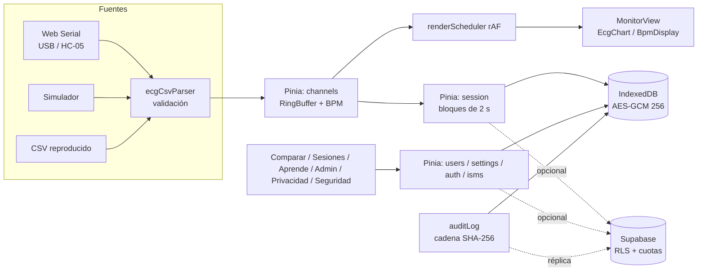

# Monitor ECG (Vue 3)

SPA educativa para visualizar y comparar la señal de un sensor **AD8232** conectado a un **Arduino UNO/Nano o ESP32**,
que emite el CSV `t_ms,ecg_raw,leads_off,bpm` a 250 Hz y 115 200 baudios. **No es un dispositivo médico ni realiza diagnósticos.**

**Demo:** https://monitor-ecg1.vercel.app/ (usa el **Simulador** si no tienes hardware).

Stack: Vue 3 (Composition API, `<script setup>`), Vite 7, Vue Router 4, Pinia 3, uPlot, idb, Supabase (opcional), Vitest, Playwright, ESLint (`eslint-plugin-vue`, `eslint-plugin-security`).

## Cómo ejecutar

Requisitos: Node.js ≥ 20 y npm.

```bash
npm ci                    # instalación reproducible (lockfile)
cp .env.example .env.local  # opcional: solo si usarás la nube
npm run dev               # http://localhost:5173
npm run build             # dist/ sin source maps ni console.*
npm run preview           # sirve dist/ con las MISMAS cabeceras que vercel.json (CSP incluida)
npm test                  # pruebas unitarias (Vitest): 343 en 28 archivos
npm run lint              # ESLint
npm run test:e2e:install  # una vez: descarga Chromium para Playwright
npm run test:e2e          # pruebas E2E (75 en 16 archivos; construye copias sin nube y con nube simulada en dist-e2e/ y dist-e2e-nube/)
npm run gen:referencia    # regenera public/referencias/ejemplo_referencia.csv
```

Sin variables de entorno la app funciona **100 % local** (IndexedDB cifrado). Aun con Supabase configurado, **la nube es opcional y está apagada por defecto**: cada cuenta decide en `/cuenta` si guarda sus datos en la nube.

## Arquitectura



Detalle en `../docs/ARQUITECTURA_VUE.md` y trazabilidad requerimientos → componentes → pruebas → controles en `../docs/TRAZABILIDAD.md`.
Conexión del hardware: `../docs/esquema_circuito_ad8232.svg`.

## Flujo de uso y rutas

| Ruta | Sección | Qué hace |
|---|---|---|
| `/` | Inicio | Accesos y compatibilidad |
| `/pacientes` | Pacientes | Mantenedor (CRUD): buscar, ordenar, crear (con declaración de mayoría de edad), ver, editar alias (solo en el dispositivo) y datos opcionales (con consentimiento 2.0), eliminar (cascada local y nube), contador de monitoreos, "Descargar historial". `/usuarios` redirige aquí |
| `/acceso`, `/registro`, `/recuperar`, `/restablecer` | Cuenta | Iniciar sesión (casilla «Estoy en un equipo compartido»), crear cuenta (mayor de 18 años), recuperar y fijar contraseña |
| `/cuenta` | Mi cuenta | Interruptor «Guardar mis datos en la nube» (apagado por defecto), qué se envía y qué no, vincular datos del dispositivo, borrar mis datos de la nube y eliminar mi cuenta (piden la contraseña), accesos del administrador a mis datos |
| `/monitor` | Monitor | Elegir usuario → conectar fuente → **Iniciar monitoreo** → **Detener** → **Guardar monitoreo** (nombre, nota, actividad) o **Descartar** |
| `/monitoreos`, `/monitoreos/:id` | Monitoreos | Filtros (usuario, fechas, actividad, estado, texto), selección múltiple, detalle con picos, editar, eliminar, exportar CSV/JSON, informe PDF/CSV, historial. `/sesiones*` redirige aquí |
| `/comparar` | Comparar | A y B desde monitoreos guardados (selector usuario → medición con miniatura), simulador, CSV (incluye CSV exportados por la app) o canal en vivo; informe PDF/CSV |
| `/aprende/:tema`, `/aprende/mis-monitoreos` | Aprende | Teoría y lectura guiada de un monitoreo propio (picos, RR, BPM, actividad, calidad PPG) |
| `/admin` | Administración | Requiere cuenta con rol de administrador y TOTP reciente. Pestañas: parámetros, sincronización, nube, administradores (conceder y retirar el rol), **Soporte y moderación** (reportes de contenido público, acceso excepcional con motivo) y SGSI (incidentes, evidencias de auditoría y revisión, indicadores) |
| `/admin/auditoria`, `/admin/mfa` | Auditoría y segundo factor | Auditoría local y pestaña **Nube** (filtros, exportación, «Verificar cadena»); inscripción y verificación del TOTP |
| `/privacidad`, `/seguridad` | Políticas | Aviso de privacidad (lo que se hace de verdad: nube opcional, plazos, derechos, responsable) y política de seguridad con formulario de incidentes |

Un monitoreo detenido es un **borrador** (cifrado, solo local) hasta que se guarda; no aparece en Comparar ni Aprende. Si no se guarda ni descarta, queda como "Borrador" en Monitoreos y un aviso en la cabecera: nunca se pierde por accidente. Los informes y exportaciones van seudonimizados (Usuario N, sin alias ni datos opcionales); los PDF los genera un escritor propio sin dependencias (`src/services/report/pdfWriter.js`).

Si el sensor envía valores fuera del rango del perfil elegido (p. ej. un ESP32 de 12 bits con perfil de 10 bits) el canal muestra "El perfil del dispositivo no coincide: elige ESP32". Análisis y decisiones de interfaz: `../docs/ANALISIS_VISUAL.md`.

## Configuración de Supabase (opcional)

1. Crear el proyecto y anotar la **región** (se informa en `/privacidad` y en `../docs/sgsi/proveedores.md`).
2. *Authentication → Sign In / Providers*: **Email habilitado** (correo + contraseña) con **Confirm email** activo. El inicio de sesión anónimo **ya no se usa** (déjalo desactivado). En *Authentication → Sign In / Providers → Email* fija longitud mínima de contraseña **10** y activa *Leaked password protection* si tu plan lo permite. En *Rate Limits* deja límites bajos de registros y correos por hora.
   - *Authentication → URL Configuration*: **Site URL** = `https://monitor-ecg1.vercel.app`; **Redirect URLs**: `https://monitor-ecg1.vercel.app/acceso`, `https://monitor-ecg1.vercel.app/restablecer` (y `http://localhost:5173/**` solo para desarrollo).
   - *Authentication → Emails*: revisa las plantillas de «Confirm signup» y «Reset password» (en español) y, para producción, configura SMTP propio.
3. *SQL Editor*. **Instalación nueva:** ejecutar solo `../supabase/schema.sql` (idempotente; integra todo: tablas, RLS, cuotas con hora del servidor, `tipos_evento` y auditoría encadenada, `hora_servidor()`, `borrar_mis_datos()`, `eliminar_mi_cuenta()`, administradores con TOTP, funciones públicas, moderación, incidentes y la TANDA 2). **Base existente:** ejecutar, en este orden y solo las que falten: (1) `migracion_cuentas_pacientes.sql`, (2) `migracion_endurecimiento.sql`, (3) `migracion_admin_mfa.sql`, (4) `migracion_admin_roles.sql`, (5) **`migracion_endurecimiento_2.sql`**, (6) **`migracion_tanda2.sql`** (aplicar antes de publicar el cliente nuevo). Las migraciones 1 a 4 se abortan solas si ya se aplicó la 5; `migracion_eventos_camara.sql` es un no-op. **Haz primero una copia (esquema privado temporal) y prueba en un proyecto de pruebas.**
4. Crear el administrador: el administrador es **una cuenta normal** (se registra en `/registro` o se crea en *Authentication → Users → Add user* con correo + contraseña fuerte) y habilitar *MFA (TOTP)* en *Authentication → Multi-Factor*. El **primer** administrador (o si no queda ninguno) se concede por SQL del dueño del proyecto; los siguientes los concede **otro administrador desde Administración → Administradores** (pide un código TOTP nuevo; máximo 5). Se recomiendan al menos dos:
   ```sql
   insert into public.administradores (user_id)
   select id from auth.users where email = 'correo-del-admin@ejemplo.cl'
   on conflict (user_id) do nothing;
   ```
5. Activar `pg_cron` (las migraciones programan `purga-ecg`, 365 días, y `purga-auditoria`, 2 años) y comprobar con `select jobname, schedule, active from cron.job;`.
6. Variables (en `.env.local` y en Vercel): `VITE_SUPABASE_URL` y `VITE_SUPABASE_PUBLISHABLE_KEY` (solo la clave **publicable**; nunca `service_role`); `VITE_CAPTCHA_PROVIDER` y `VITE_CAPTCHA_SITE_KEY` (opcionales); **`VITE_RESPONSABLE_NOMBRE` y `VITE_RESPONSABLE_CORREO`** (responsable del tratamiento que muestra `/privacidad`; si faltan, el aviso dice que no está configurado).
7. En el panel: desactivar «Allow anonymous sign-ins» (la app ya no usa inicios anónimos), SMTP propio, protección de contraseñas filtradas y *time-box*/*inactivity timeout* si el plan lo permite (ver `../docs/PENDIENTES_MANUALES.md`).

### Probar las políticas RLS (`supabase/pruebas_rls.sql`)

`../supabase/pruebas_rls.sql` son 101 casos que se ejecutan en el SQL Editor **de un proyecto de pruebas** con tres cuentas de prueba (A, B y un administrador): cada fila debe dar `ok = true`. El caso 0 comprueba que el JWT real trae una entrada `totp` reciente en `amr` (de lo que depende `es_admin()`). Hasta hoy el archivo solo se ha ejecutado en PGlite (PostgreSQL embebido, 0 fallos), **no** con cuentas reales. No lo ejecutes contra la base de producción con datos reales.

### Cuentas, pacientes, nube y visibilidad

- **Rutas:** `/acceso`, `/registro`, `/recuperar`, `/restablecer`, `/cuenta`, `/pacientes` (antes `/usuarios`, que redirige) y `/monitoreos` (antes `/sesiones`).
- **Sin cuenta** todo queda cifrado en el dispositivo y no se sube nada. **Con cuenta** la nube es **opcional y está apagada por defecto**: solo si la activas en `/cuenta`, y solo al pulsar «Guardar monitoreo», se suben el seudónimo «Paciente N», la declaración de mayoría de edad, el perfil opcional (con consentimiento 2.0) y la señal; los borradores, el alias, el nombre, las notas, los parámetros y los datos del dispositivo **nunca salen** del equipo. Vincular datos del dispositivo a la cuenta es con selección por paciente.
- **Equipo compartido:** la casilla de `/acceso` (marcada por defecto en pantallas de escritorio) guarda el token en `sessionStorage` y, al cerrar sesión, quita los datos de la cuenta del equipo; la sesión se cierra tras 15 min de inactividad.
- **Visibilidad:** cada monitoreo es `privado` (por defecto) o `publico`. Publicar exige nube activa, paciente con declaración de mayoría de edad y consentimiento de publicación 2.0 del monitoreo (lo exige el servidor). Lo público solo lo ven **cuentas registradas** (vía `listar_monitoreos_publicos()`, `monitoreo_publico()` y `senal_publica()`), como «Paciente anónimo», con el día (sin hora) y la duración; cualquier cuenta puede reportarlo y el administrador retirarlo.
- **Retención y región:** en el equipo 30 días por defecto (configurable por el administrador, máx. 180); en la nube 365 días desde el inicio del monitoreo y 2 años para la auditoría; cuentas sin acceso en 24 meses: aviso y eliminación manual. El proyecto de Supabase está en la región us-east-1 (Estados Unidos): hay transferencia internacional de datos de salud seudonimizados solo si la persona activa la nube. Las solicitudes de derechos se atienden en un máximo de 30 días corridos.
- **Administrador:** no lee datos de salud ajenos; el acceso excepcional (`admin_leer_sesion`) exige motivo escrito y queda visible para el titular.
- El CAPTCHA, si está configurado, se pide al crear la cuenta (hoy no se envía en el inicio de sesión).

### CAPTCHA (opcional, recomendado si la demo es pública)

1. Crear un sitio en Cloudflare Turnstile (o hCaptcha) y obtener la clave de sitio y la secreta.
2. Supabase → *Authentication → Attack Protection → Enable CAPTCHA protection*: elegir el proveedor y pegar la clave **secreta**.
3. Variables públicas: `VITE_CAPTCHA_PROVIDER=turnstile` (o `hcaptcha`) y `VITE_CAPTCHA_SITE_KEY=<clave de sitio>`.
4. Ampliar la CSP de `vercel.json` **solo si se activa**:
   - Turnstile: añadir `https://challenges.cloudflare.com` a `script-src` y agregar `frame-src https://challenges.cloudflare.com`.
   - hCaptcha: añadir `https://hcaptcha.com https://*.hcaptcha.com` a `script-src`, `connect-src` y `style-src`, y `frame-src https://hcaptcha.com https://*.hcaptcha.com`.

Sin estas variables el CAPTCHA queda desactivado y no se carga ningún script externo. Además, el cliente limita los intentos de acceso/registro y las escrituras (`src/utils/rateLimiter.js`) y el servidor impone cuotas por usuario (triggers en `schema.sql`).

## Despliegue (Vercel)

Framework preset Vite; `vercel.json` define el rewrite SPA y las cabeceras (CSP sin `unsafe-eval` ni `unsafe-inline`,
`Permissions-Policy: serial=(self)`, HSTS, nosniff, COOP/CORP). Variables: las de Supabase, `VITE_RESPONSABLE_NOMBRE` y `VITE_RESPONSABLE_CORREO` (y CAPTCHA si se usa). Falta confirmar en Vercel que las `VITE_RESPONSABLE_*` están definidas.
Si se cambia de proyecto Supabase, actualizar el host en `connect-src` de la CSP.

## Integración continua

`.github/workflows/ci.yml` (lint, unitarias, build, `npm audit --audit-level=high` del código de producción, E2E con Playwright y gitleaks) y `.github/dependabot.yml` (npm y Actions semanal). En GitHub la app está en la **raíz** del repositorio junto a `docs/`, `supabase/` y `legacy/` (versión antigua en HTML/JS, no se entrega).

## Navegadores

| Función | Chrome/Edge escritorio | Chrome Android | Safari / iOS / Firefox |
|---|---|---|---|
| Captura por cable o HC-05 (Web Serial) | Sí | No | No |
| Simulador, CSV, comparación, sesiones, educación | Sí | Sí | Sí |

## Limitaciones

- **No es un dispositivo médico.** Uso solo educativo; seguir las reglas de seguridad eléctrica (portátil a batería, nunca en personas con marcapasos).
- Con nube, el administrador es una cuenta con rol y segundo factor TOTP: los privilegios los impone el servidor (`es_admin()` exige `aal2` y un TOTP de ≤ 15 min; `es_admin_reciente(300)` en acciones sensibles). **Pendiente de verificar con un JWT real** que el claim `amr` trae el TOTP reciente (caso 0 de `pruebas_rls.sql`). Sin nube queda el administrador local con PIN (PBKDF2, 600 000 iteraciones), que protege frente al uso casual, no frente a quien controla el navegador y DevTools. Concesión, retiro y recuperación: `../docs/sgsi/recuperacion_acceso_admin.md`.
- La auditoría local detecta alteraciones (cadena SHA-256), no las impide; en la nube la hora y el autor los fija el servidor y la cadena se verifica desde `/admin/auditoria`.
- El cifrado local protege la lectura casual de los archivos del navegador, **no** a quien controle el equipo ni frente a XSS (la clave vive en el mismo navegador; bóveda con frase diferida). La reautenticación con contraseña es del cliente; el servidor aún no la exige.
- Aún no se puede restaurar en otro equipo los monitoreos propios desde la nube, ni exportar «todo lo mío» en una sola acción (`exportar_mis_datos()` diferido).
- Verificado el 2026-10-20: 343 pruebas unitarias, 75 E2E (nube simulada), 0 vulnerabilidades de producción. **No verificado:** RLS con cuentas reales, claim `amr`, configuración del panel de Supabase.
- Sin nube no hay respaldo central. El plan gratuito de Supabase se pausa por inactividad.
- `BleSource` (ESP32 BLE) es un esqueleto; no se probó con hardware real en CI.

Ver `CAMBIOS.md`, `../docs/ISO27001_controles.md` (SoA) y `../docs/sgsi/`.
