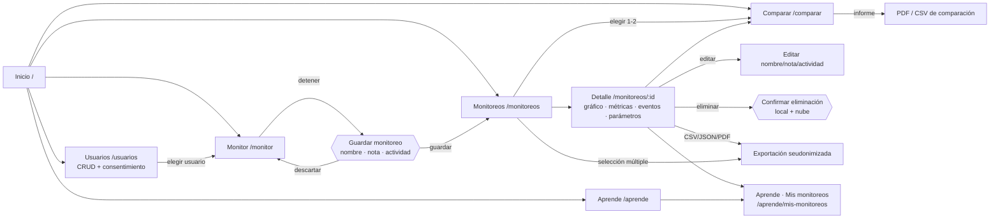
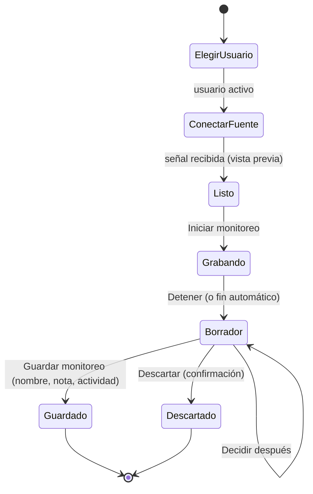

# Análisis visual y funcional de la interfaz — Monitor ECG/PPG (Vue 3)

Versión 1.0 · oct-2026 · Alcance: `monitor-ecg-vue/` (solo frontend). Antes de este cambio la app tenía 7 pantallas de usuario más administración.

## 1. Qué hay hoy (antes del rediseño)

| Pantalla | Ruta | Qué hace | Problemas de UX detectados |
|---|---|---|---|
| Inicio | `/` | Tarjetas de acceso y compatibilidad del navegador | No explica el orden del flujo (usuario → fuente → iniciar → detener → guardar); no muestra el usuario activo con acción |
| Participantes | `/usuarios` | Crear alias, elegir usuario, consentimiento y datos opcionales, "Eliminar mis datos" | Mezcla alta + selección + detalle + derechos en una sola vista; sin búsqueda, orden, edición del alias ni contador de monitoreos; solo existe el usuario activo como "detalle" |
| Monitor | `/monitor` | Hasta 5 canales, grabación con "Iniciar/Detener sesión" | Al detener, la sesión se **guarda siempre** y no se pide nombre, nota ni actividad; no hay "Descartar"; el flujo es un párrafo de texto; si el perfil de 10 bits recibe datos de un ESP32 (12 bits) solo aparece "señal perdida" |
| Sesiones | `/sesiones` | Tabla con filtro único (actividad), exportar CSV (1 por vez), eliminar solo admin | Sin nombres, notas, edición, filtros de usuario/fecha/estado, selección múltiple ni JSON; el participante no puede borrar sus propios registros salvo "Eliminar mis datos" completo |
| Detalle de sesión | `/sesiones/:id` | Resumen, actividad, eventos, "Ver señal grabada" | El gráfico no se muestra por defecto; sin picos R, sin informe; sin editar/eliminar/exportar desde el detalle |
| Comparar | `/comparar` | Referencia vs. señal simulada/CSV/sesión/canal vivo | La sesión se elige por fecha (sin nombre) y solo como "experimental"; no se puede usar un monitoreo como referencia; sin informe descargable |
| Aprende | `/aprende/:tema` | 6 temas estáticos | Sin vínculo con los datos propios de la persona |
| Admin | `/admin*` | PIN, parámetros, auditoría, SGSI | Fuera del alcance visual de este cambio |

Cabecera: enlaces "Participantes, Monitor, Sesiones, Comparar, Aprende, Admin" y chip del participante activo (solo si existe). Accesibilidad ya buena (foco visible, `aria-live` en BPM/rango, trampa de foco en diálogos, enlace "Saltar al contenido").

## 2. Qué falta (necesidades de la usuaria)

1. Mantenedor de usuarios (CRUD) aislado del monitoreo.
2. Guardado explícito del monitoreo (nombre, nota, actividad) con "Descartar" y vista previa mientras no se guarda.
3. Gestión de monitoreos: filtros, detalle, edición, eliminación (local + nube) y exportación múltiple (CSV, JSON).
4. Que lo guardado alimente **Comparar** (como señal A o B) y **Aprende** ("Mis monitoreos"), con informes PDF/CSV seudonimizados.
5. Navegación por secciones claras con indicador del usuario activo, responsiva y accesible (WCAG AA).
6. Diagnóstico de perfil incorrecto (valores fuera del rango del ADC) en lugar de solo "señal perdida".

## 3. Decisiones de diseño

| # | Decisión | Motivo |
|---|---|---|
| D1 | "Monitoreo" = una sesión guardada (`session:<id>`). Se añaden campos opcionales `guardado`, `nombre`, `notas`, `actividadPrincipal`. Una sesión sin `guardado` (anterior al cambio) se considera **guardada** | Retrocompatibilidad con datos ya cifrados en IndexedDB |
| D2 | Mientras se graba, los bloques se cifran y escriben igual que antes (protege ante cierre de pestaña), pero la sesión nace como **borrador** (`guardado:false`). "Guardar monitoreo" la confirma; "Descartar" borra sesión y bloques (local y nube) | La grabación sigue incremental sin perder datos; el borrador no aparece en Comparar ni Aprende |
| D3 | Un borrador no resuelto no bloquea nada, pero el Monitor impide iniciar otro hasta guardar/descartar, y tras recargar aparece en Monitoreos con el estado "Borrador" | Evita registros huérfanos sin nombre |
| D4 | Ruta `/monitoreos` y `/monitoreos/:id` (antes `/sesiones`); `/sesiones*` redirige para no romper enlaces | Vocabulario de la usuaria |
| D5 | Control de acceso sin cambios: un participante solo ve/edita/exporta sus monitoreos; el admin (sin usuario activo) ve todos. En el mantenedor, editar/eliminar un usuario exige que sea el usuario activo o sesión de admin ("Elegir" equivale a identificarse, igual que antes) | A.9.4.1 y SEC-43 |
| D6 | Eliminar usuario reutiliza `deleteUserData` (cascada de sesiones locales y nube). Eliminar un monitoreo usa `deleteSession` + `deleteCloudSessions`; el participante puede borrar solo monitoreos donde es el único participante | SEC-30; derecho de supresión |
| D7 | Nuevos eventos de auditoría: `USER_UPDATED`, `SESSION_SAVED`, `SESSION_UPDATED`, `SESSION_DISCARDED`, `SESSION_DELETED`, `EXPORT_REPORT`. Añadidos a la lista blanca de `supabase/schema.sql` y verificados por `tests/schema.spec.js`. Nunca se registran nombre ni nota | Trazabilidad A.12.4.1 sin datos personales |
| D8 | Texto libre (nombre ≤ 60, nota ≤ 500) validado, con aviso "no escribas datos personales"; la **actividad sigue siendo una lista cerrada** (SEC-20) | Minimización |
| D9 | Informes PDF con un escritor PDF propio y mínimo (`src/services/report/pdfWriter.js`, Helvetica estándar, JPEG del canvas): **cero dependencias nuevas**, sin superficie de CVE y probable sin DOM. Contienen solo "Usuario N" (nunca alias), nombre del monitoreo, fecha UTC, parámetros, métricas, clasificación y aviso de no dispositivo médico. La nota se incluye solo si se marca | Pide "librería pequeña empaquetada"; CSP `img-src 'self' data: blob:` no se toca |
| D10 | Comparar admite monitoreos guardados como A o B (referencia o experimental) reutilizando `prepareSignal`, `computeLag`, `computeMetrics` | Sin duplicar el pipeline |
| D11 | Aprende → "Mis monitoreos": análisis puro (`services/monitoreos/analysis.js`) con picos, RR, BPM, variabilidad y calidad de señal PPG; texto didáctico generado desde plantillas (sin `v-html`) | Conecta teoría con datos propios |
| D12 | Diagnóstico: el parser cuenta líneas rechazadas por rango y emite `profile-mismatch`; el canal muestra "El perfil del dispositivo no coincide: elige ESP32". No se cambia el perfil ESP32 de 12 bits ni el protocolo | Pedido 6 |
| D13 | Tokens: se reutiliza `tokens.css` (tema oscuro/claro). Solo clases utilitarias nuevas en `base.css` (barra de herramientas, pasos, tabla ordenable); sin estilos en línea, compatibles con `style-src 'self'` | CSP estricta |

## 4. Mapa de pantallas

## 5. Flujo principal del monitoreo

## 6. Navegación

`Inicio · Usuarios · Monitor · Monitoreos · Comparar · Aprende · Admin`. A la derecha: chip del **usuario activo** (enlace a `/usuarios`, o "Sin usuario · Elegir") con `aria-live`, "Grabando" mientras hay sesión y "Admin" si hay sesión de administrador. Menú hamburguesa bajo 1100 px, objetivos de 44 px, `aria-current="page"` automático de `RouterLink`.

## 7. Accesibilidad (WCAG 2.1 AA)

- Tablas con `<caption>` oculta, `scope`, columnas ordenables como botones con `aria-sort`.
- Resultados de filtros anunciados en una región `aria-live="polite"`; errores con `role="alert"`.
- Diálogos con trampa de foco y `Escape` (reuso de `BaseDialog`); acciones destructivas siempre con confirmación y botón explícito.
- Estados con icono + texto (no solo color); contraste de tokens ya validado en ambos temas.
- Gráficos con alternativa textual (resumen numérico visible junto al gráfico).

## 8. Estados vacíos y errores

Cada pantalla tiene estado vacío con acción siguiente (p. ej. "Aún no hay monitoreos → Ir al monitor"; "No hay usuarios → Crear usuario"; "Sin resultados para los filtros → Limpiar filtros"). Los errores indican causa y acción ("Perfil incorrecto: elige ESP32", "El nombre admite solo letras, números y . , : ( ) / _ -").

## 9. Riesgos y pendientes de diseño

- Con identificación sin contraseña, "elegir usuario" no es autenticación fuerte (limitación ya documentada en ISO27001_controles.md).
- Los informes PDF no incluyen firma ni cifrado: se etiquetan como datos sensibles seudonimizados y se advierte antes de descargar.
- Pendiente de hardware real: validar el mensaje de perfil con un ESP32 + MAX30100 físico.
