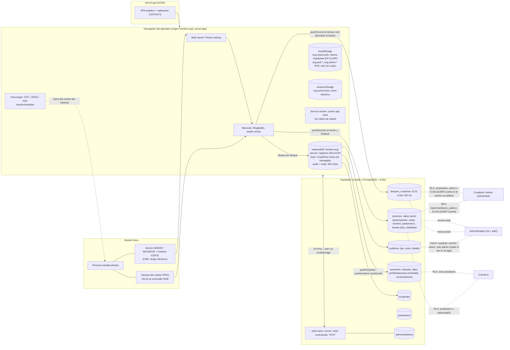

# Auditoría del sistema "Monitor ECG" frente a ISO/IEC 27001:2013

> **Código:** SGSI-AUD-02 (informe de auditoría de sistema) · **Fecha:** 2026-10-20 · **Clasificación:** Interno
> **Tipo:** revisión independiente de solo lectura (A.18.2.1, cláusula 9.2). No se modificó ningún archivo salvo este informe.
> **Base:** código en `monitor-ecg-vue/src`, `supabase/*.sql`, `vercel.json`, `.github/`, `public/sw.js` y documentos `docs/` y `docs/sgsi/`. Se contrastó lo que **hace el código** con lo que **declaran** la SoA (`docs/ISO27001_controles.md`) y el SGSI. Se ejecutaron `vitest` (232 pruebas, 20 archivos: todas pasan), `npm audit` y consultas HTTP de solo lectura a las cabeceras del sitio publicado.
> **Fuera de alcance / no verificable:** no se tocó la base real de Supabase ni los paneles de Supabase, Vercel y GitHub. Todo lo que dependa de la configuración real (SMTP, MFA, CAPTCHA, política de contraseñas, inicios anónimos, backups, protección de rama, si las migraciones están aplicadas) se marca **[VERIFICAR]**. Las pestañas de administradores, `AppHeader` y `migracion_admin_roles.sql` estaban siendo editadas por otro agente y solo se mencionan.
> **Convención de evidencia:** `archivo:línea` relativo a `monitor-ecg-vue/` salvo `supabase/…` y `docs/…`.

---

## Parte A. Resumen ejecutivo y veredicto

### A.1 Veredicto honesto

**¿Es acorde a ISO/IEC 27001:2013? Parcialmente.** El sistema tiene una base técnica de nivel claramente superior al de un proyecto académico típico: CSP estricta sin `unsafe-inline` y verificada en producción, cero `v-html`, RLS en todas las tablas, funciones `security definer` con `search_path` fijo y `REVOKE`, cuotas en el servidor, administrador con TOTP validado por el servidor (`aal2`), cifrado local AES-GCM, parser serial estricto, 232 pruebas verdes y 0 vulnerabilidades en dependencias de producción.

**¿Es ideal? No.** Un auditor externo levantaría no conformidades mayores por cuatro razones de fondo, ninguna es "falta de un control", sino **desajuste entre lo declarado y lo real**:

1. **Los documentos de privacidad y la SoA afirman cosas que el código desmiente.** El consentimiento informado que firma el paciente dice "solo en este equipo… no se envían a ningún servidor" (`src/components/users/ConsentDialog.vue:20`), pero con cuenta el perfil (edad, peso, actividad), el consentimiento y **toda** la señal ECG —incluidos los borradores que aún no se guardaron— se suben automáticamente a Supabase en us-east-1 (`src/stores/session.js:89-97`, `src/stores/users.js:117-118`). Esto afecta el control central del sistema (A.18.1.4) y la base legal (Ley 19.628 / 21.719, vigente desde diciembre de 2026).
2. **Varios controles marcados "Implementado" funcionan solo en el cliente o no se pueden usar.** La sesión privilegiada de "15 minutos" es un estado de la interfaz; el servidor acepta `aal2` mientras la sesión exista. La auditoría en la nube puede ser falsificada por cualquier cuenta y **ninguna pantalla la lee**. Los incidentes que reporta un participante nunca llegan a la pantalla del administrador.
3. **"Público" significa "cualquier persona que se registre"** (registro abierto, sin CAPTCHA activo), con la señal ECG cruda legible directamente de la tabla de bloques. Es divulgación de datos de salud efectivamente abierta e irreversible, apoyada en una casilla que marca el operador, no el titular.
4. **Las cláusulas 4-10 existen en papel pero sin evidencia de operación**: auditoría interna y revisión por la dirección "planificadas", política y plan de tratamiento sin firma, no conformidades "corregidas — pendiente de verificación", indicadores que miden eventos del PIN local que ya no se usan en producción.

**Lo que habría que cambiar primero** (detalle en la Parte E): alinear consentimiento y aviso con la realidad, hacer la nube opt-in y no subir borradores, cerrar el modelo "público", acotar la frescura de `aal2` en el servidor, quitar al administrador la lectura masiva de señales, rehacer el canal de auditoría e incidentes, y ejecutar y firmar los ciclos 9.2/9.3.

### A.2 Conteo de hallazgos

| Severidad | Cantidad | Hallazgos |
|---|---|---|
| Crítica | 0 | No se encontró una vía demostrable de fuga entre cuentas ni de escalada de privilegio **dentro de lo que se puede leer sin probar contra la base**. La prueba real de RLS con dos cuentas (R15, MC-04) sigue pendiente y es condición para sostener esta afirmación. |
| Alta | 8 | H-01 a H-08 |
| Media | 15 | H-09 a H-23 |
| Baja | 7 | H-24 a H-30 |

Nota de honestidad: no se asigna "Crítica" porque no se pudo probar contra el servidor real; si la prueba de dos cuentas (Parte E, C-01) o la revisión de la configuración confirman que los inicios anónimos siguen habilitados o que las migraciones no se aplicaron, H-02 y H-18 deberían subir a Crítica.

### A.3 Qué se evaluó y con qué método

| Área | Método |
|---|---|
| Datos y minimización | Lectura de formularios, `users.js`, `cloudSync.js`, `session.js`, `visibilidad.js`, esquema SQL |
| Autenticación y sesiones | `authService.js`, `supabaseClient.js`, `account.js`, `auth.js`, `adminMfa.js`, `guards.js`, `es_admin()` |
| Autorización | Todas las políticas RLS, funciones y triggers de `schema.sql` y migraciones; razonamiento de ataque caso por caso (Parte C) |
| Cifrado local | `secureStorage.js`, `db.js`, `index.js`, `wipe.js`, `linkLocal.js` |
| Transporte y web | `vercel.json` (contrastado con cabeceras reales), `sw.js`, `vite.config.js`, `grep` de `v-html`, `innerHTML`, `console`, almacenamiento |
| Auditoría | `auditLog.js`, `auditService.js`, `cloudSync.js`, `stores/isms.js`, `AuditView.vue` |
| Dispositivos | `SerialSource.js`, `ecgCsvParser.js`, `CameraSource.js`, firmware `.ino` |
| Continuidad y proveedores | `ci.yml`, `dependabot.yml`, `sgsi/proveedores.md`, `plan_continuidad.md`, `PENDIENTES_MANUALES.md`, repositorio público |
| SGSI | `docs/sgsi/*`, SoA, registro de no conformidades |

---

## Parte B. Mapa del sistema

### B.1 Flujo de datos

### B.2 Quién crea cada dato, dónde vive y quién lo puede leer

| Dato | Nace en | Dónde se guarda | Quién puede leerlo (real, no declarado) | Clasificación real |
|---|---|---|---|---|
| Correo y contraseña | Formulario de registro | Supabase Auth (hash bcrypt); el correo también está visible para el admin vía `admin_listar_administradores()` solo si es admin | El propio usuario; el dueño del proyecto Supabase; los administradores solo para cuentas con rol | Personal |
| Etiqueta "Paciente N" y **alias** (≤20 caracteres libres) | `createUser` (`users.js:77`) | IndexedDB cifrada + `pacientes` (**texto claro en Postgres**) | Propietario de la cuenta; dueño del proyecto Supabase. El admin no tiene política sobre `pacientes` | Seudónimo, pero el alias puede ser un nombre real |
| Perfil (rango de edad, **peso exacto en kg**, nivel de actividad) | `OptionalDataForm` tras consentimiento | IndexedDB cifrada + `pacientes.perfil` (claro) | Propietario; si se marca "compartir", **cualquier cuenta** (copia en `sesiones.datos.perfilCompartido`) | Salud sensible |
| Consentimiento (versión 1.0, fecha) | `giveConsent` | IndexedDB + `pacientes.consentimiento` | Propietario | Evidencia |
| Señal ECG/PPG cruda + BPM | Sensor/cámara | Memoria → IndexedDB cifrada **y** `bloques_muestras` en claro, en tiempo real, también para borradores | Propietario, **cualquier administrador (todas las cuentas)**, y **cualquier cuenta si la sesión es pública** (lectura directa de la tabla) | Salud sensible (además biométrico) |
| Metadatos de sesión (inicio/fin exactos, actividad, resumen BPM, parámetros, `fuente.info` con VID/PID USB) | `session.js` | IndexedDB + `sesiones.datos` | Propietario, administradores; en público: fecha exacta, actividad y resumen vía RPC | Salud |
| Nombre y nota del monitoreo (texto libre ≤60 / ≤500) | `SaveMonitoringDialog` | IndexedDB + `sesiones.datos` (claro) | Propietario y administradores | Potencialmente identificable |
| Auditoría local | `auditLog.log` | IndexedDB `audit` (**sin cifrar**, cadena SHA-256 sin clave) | Quien use ese navegador; admin local vía UI | Registro |
| Auditoría en la nube | `pushAudit` | `auditoria` | Insertable por cualquier cuenta; legible solo por admin (pero ninguna pantalla la consulta) | Registro |
| Incidentes | `isms.report` | IndexedDB + `incidentes` | Reportante y admin en la base; **la UI del admin solo ve los de su propio navegador** | Registro |
| Tokens de sesión | supabase-js | `localStorage['ecg-cloud-auth']` en claro | Cualquier script del origen; cualquiera con el perfil del navegador | Secreto |
| CSV/JSON/PDF exportados | Usuario | Disco | Quien los tenga; cabecera de clasificación sin cifrado | Salud seudonimizada |

---

## Parte D (adelanto). Lo que SÍ está bien resuelto

Se pone primero para que el balance sea honesto; los hallazgos siguen en la Parte C.

1. **CSP estricta y desplegada**: `script-src 'self'`, `style-src 'self'` (sin `unsafe-inline`), `object-src 'none'`, `frame-ancestors 'none'`, `connect-src` limitado a un único proyecto Supabase, HSTS con preload, COOP/CORP, `Permissions-Policy` con `camera=(self)`, `serial=(self)` y el resto cerrado (`vercel.json:11-18`). **Verificado con `curl -I` en producción: las cabeceras reales coinciden con el archivo.**
2. **Cero superficie de inyección de HTML**: `grep` de `v-html|innerHTML|outerHTML|insertAdjacentHTML|eval|new Function|document.write` sin coincidencias reales; sin `console.*` en `src`; sin `window.open` ni redirecciones abiertas (lista blanca en `router/guards.js:6-14`). El QR del TOTP se acepta solo como `data:image/svg+xml` en `` (`adminMfa.js:50`).
3. **RLS habilitado en todas las tablas** y políticas por defecto-denegar con `(select auth.uid())`; ninguna tabla permite escribir `propietario` ajeno (`WITH CHECK propietario = auth.uid()`); el trigger `tg_sesion_paciente` impide asociar un paciente de otra cuenta (`schema.sql:608-628`).
4. **Funciones `security definer` bien construidas**: todas con `set search_path = public`, `REVOKE ... FROM public, anon`, `GRANT` solo a `authenticated`; los triggers de cuota no son invocables; `purgar_sesiones` solo para el rol del cron.
5. **El rol de administrador no se puede obtener desde la aplicación**: `administradores` sin `INSERT/UPDATE/DELETE` para `anon`/`authenticated` y `es_admin()` exige `aal2` en el JWT (`schema.sql:40-55`); el límite de 5 administradores y el "mínimo uno" se aplican con bloqueo de tabla.
6. **Mensajes genéricos** en login, registro, recuperación y concesión de rol (no se revela si un correo existe); la sesión anónima se eliminó y `sesionActual` la descarta.
7. **Redirecciones tras login por lista blanca**; `emailRedirectTo` usa `window.location.origin` (requiere que la lista de redirecciones de Supabase esté acotada: C-12).
8. **Parser serial robusto**: línea ≤64, buffer ≤1024, regex anclada con cuantificadores acotados, rangos por perfil, reinicio de tiempo, tasa de datos inválidos (`ecgCsvParser.js`). Cámara: solo 16×16 píxeles promediados, sin `toDataURL`/`toBlob`, se apaga en `visibilitychange`/`pagehide`.
9. **Cifrado local bien aplicado en lo que cubre**: AES-GCM 256, IV aleatorio por registro, AAD = nombre de la clave (ata registro a ranura), fallo seguro con borrado y evento `INTEGRITY_ERROR`; borrado total con destrucción de clave (*crypto-shredding*).
10. **Exportaciones**: seudonimizadas, línea de clasificación, neutralización de fórmulas, nombre de archivo sin identificadores, y auditadas.
11. **Cuotas y CHECKs en el servidor** (tamaño de JSON, 2000 muestras por bloque, lista blanca de tipos de auditoría, `ts` y `usuario` fijados por trigger en `auditoria`).
12. **Derecho de supresión implementado de extremo a extremo** (`borrar_mis_datos`, `eliminar_mi_cuenta`, borrado de paciente con réplica a la nube, retiro de consentimiento que limpia monitoreos públicos).
13. **Cadena de suministro**: sin CDN, dependencias fijadas con `~` y `package-lock`, `npm audit --omit=dev` = 0 en producción, Dependabot semanal, CI con lint + pruebas + build + E2E + gitleaks, `.env` ignorado (solo valores públicos).
14. **Transparencia sobre limitaciones**: la SoA sección 5.0 y `/privacidad` reconocen honestamente que los controles del cliente no detienen a quien controla el navegador.

---

## Parte C. Hallazgos

Escala: **Crítica** (explotable ya, daño grave), **Alta** (incumple un control central o expone datos de salud con poca dificultad), **Media** (debilidad real que requiere condiciones o afecta un control secundario), **Baja** (endurecimiento, higiene). Cada hallazgo remite al cambio que lo resuelve (Parte E). Los razonamientos de ataque sobre RLS están en C.1 (tras los hallazgos). Lo que sí está bien resuelto está en la Parte D (adelantada arriba).

### H-01 · La nube recibe datos de salud sin opt-in, y el consentimiento dice lo contrario — **Alta**
- **Control:** A.18.1.4, A.18.1.1, A.13.2.1, A.8.2.3 · SEC-16/17 · cláusula 7.4.
- **Evidencia:**
  - `ConsentDialog.vue:20` "solo en este equipo y navegador… No se envían a ningún servidor" y `:22` "Quién accede: el administrador del curso desde este equipo". `CONSENT_VERSION = '1.0'` sigue igual (`users.js:11`) aunque el tratamiento cambió, de modo que SEC-17 ("cambio de versión ⇒ se vuelve a pedir") nunca se activó.
  - Con cuenta, `giveConsent` y `updateProfile` llaman a `pushPaciente` (`users.js:118`, `:152`) que sube `perfil` y `consentimiento` en claro (`cloudSync.js:224-232`).
  - Cada monitoreo sube su metadato al iniciar (`session.js:15-18`, `:97`) y **cada bloque de 2 s en tiempo real** (`session.js:89-92`), antes de que la persona elija "Guardar" o "Descartar". El "borrador" ya está en us-east-1.
  - `PrivacyView.vue:46` afirma "no se piden… correo" (con cuenta sí se pide) y `:78` informa de la nube: el aviso general y el consentimiento específico se contradicen entre sí.
- **Escenario:** una persona mide a un voluntario creyendo que "no sale del equipo" (texto que el propio voluntario aceptó); la operadora tiene sesión iniciada, y su ECG y su peso quedan en Estados Unidos, accesibles a cualquier administrador. Ante una reclamación, la base legal (consentimiento informado, Ley 21.719 una vez vigente) no se sostiene porque la información entregada fue falsa.
- **Por qué no es ideal:** la subida es una consecuencia implícita de "tener sesión". Debe ser una decisión explícita y granular (por cuenta y/o por paciente), con información veraz, y los borradores no deberían salir del equipo hasta ser guardados. → **C-02, C-03**

### H-02 · "Público" equivale a "cualquiera que se registre", y lo público se puede extraer en bloque — **Alta**
- **Control:** A.9.4.1, A.13.2.1, A.18.1.4, A.14.2.5.
- **Evidencia:**
  - La política de bloques permite a **cualquier** rol `authenticated` leer los bloques de una sesión pública directamente: `schema.sql:666-673` (`public.sesion_es_publica(sesion_id) or …`). No pasa por las RPC de "columnas permitidas": `select * from bloques_muestras` devuelve el ECG crudo de **todas** las sesiones públicas, paginable y sin el límite de 100 filas.
  - `sesion_es_publica` solo mira `visibilidad = 'publico'`, no `estado = 'finalizada'` (`schema.sql:654-662`), distinto de las RPC (`:718`, `:759`).
  - Las RPC y la política solo exigen `auth.uid() is not null` (`schema.sql:719-720`, `:760`). Los usuarios **anónimos** de Supabase también tienen `auth.uid()` y rol `authenticated`; el código solo los descarta en el cliente (`authService.js:92`, `cloudSync.js:44`). **[VERIFICAR]** que "Allow anonymous sign-ins" esté apagado en el panel; si estuviera encendido, "público" sería literalmente "cualquier visitante".
  - El registro es abierto y no usa CAPTCHA en producción (`.env.production` no define `VITE_CAPTCHA_*`; `captcha.js:38`): obtener una cuenta cuesta un correo desechable.
  - Se publica la fecha/hora exacta de inicio y fin y la actividad (`schema.sql:686-723`), y opcionalmente edad/peso: cuasi-identificadores que, sumados a una señal ECG (rasgo biométrico), permiten reidentificar a alguien que sepa cuándo midió.
  - La casilla que habilita publicar la marca quien opera (`VisibilityDialog.vue:44`: "Entiendo y acepto publicar…"); el consentimiento **del paciente** solo se pide para compartir el perfil (`:49`), no para publicar su ECG. Un paciente que retira el consentimiento no retira sus monitoreos públicos (`users.js:123-141` solo limpia el perfil).
  - Sin función de reporte/moderación del contenido público ni forma de que un tercero pida su baja.
- **Escenario A (extracción):** un atacante crea 3 cuentas con correos desechables, ejecuta `select … from bloques_muestras` y descarga todo el ECG público; las copias son irrevocables. **Escenario B (contenido):** un cliente modificado publica una sesión cuyo `resumen`/`perfilCompartido` contiene texto arbitrario o datos personales reales (H-19), visible para todos y sin moderación.
- **Por qué no es ideal:** el modelo de amenaza real es "público en Internet", pero el diseño, el texto y el consentimiento lo tratan como "comunidad cerrada". La reversibilidad es solo hacia adelante. → **C-04, C-12, C-20**

### H-03 · El privilegio de administrador no caduca en el servidor — **Alta**
- **Control:** A.9.4.2, A.9.2.3, A.9.2.6 · riesgo R27.
- **Evidencia:** `es_admin()` solo comprueba rol + `auth.jwt() ->> 'aal' = 'aal2'` (`schema.sql:40-49`). La inactividad de 15 min, el tope de 60 min, `logout()` y `expire()` (`auth.js:220-243`, `lockout.js`) únicamente cambian variables de la interfaz (`modoCerrado`, `role`). Una vez que la sesión llegó a `aal2`, **el refresco del token conserva `aal2`**, de modo que el límite no es "JWT expiry (1 h)" como dicen R27, `ISO27001_controles.md` §5.14c y `recuperacion_acceso_admin.md` §7, sino **la vida de la sesión** (indefinida sin time-box). La reautenticación TOTP (`auth.js:152-159`) es una barrera de pantalla: quien tenga el token puede llamar directamente a PostgREST (borrar sesiones, leer todo, escribir `parametros`).
- **Escenario:** el administrador abre el modo admin en un PC del laboratorio, "sale del modo admin" y se va (el token sigue en `localStorage`, H-05). Cualquier persona o script con acceso al origen usa `supabase.rpc`/`from('sesiones')` con privilegios completos sin ningún código TOTP. Tampoco se invalidan otras sesiones al cambiar la contraseña (`authService.js:74-82`, **[VERIFICAR]** comportamiento por defecto de GoTrue).
- **Por qué no es ideal:** se declara "Implementado" un control cuyo alcance real es cosmético. → **C-05, C-07**

### H-04 · El administrador lee y borra los datos de salud de todas las cuentas — **Alta**
- **Control:** A.9.4.1, A.9.2.3, A.18.1.4 (minimización), A.12.4.3.
- **Evidencia:** `sesiones` SELECT y DELETE incluyen `public.es_admin()` (`schema.sql:214-216`, `:226-228`); `bloques_muestras` SELECT idem (`:248-253`, `:668-673`). No existe función de resumen ni registro de lectura; el acceso privilegiado de lectura no deja rastro en `auditoria`. `control_acceso.md` §3.1 lo justifica como "soporte" y `/privacidad` lo declara, pero ninguna función de la aplicación lo necesita (la UI del admin trabaja solo con el almacenamiento local, `admin.js:43-53`).
- **Escenario:** una cuenta de administrador comprometida (H-03) o un administrador curioso descarga todo el ECG, nombres de monitoreo y notas de todas las personas, sin evidencia. El plan de "mínimo dos administradores" duplica la superficie.
- **Por qué no es ideal:** mínimo privilegio y necesidad de conocer exigen que el acceso a contenido sea excepcional, motivado y auditado ("romper el cristal"), no permanente. → **C-06**

### H-05 · Las sesiones de las cuentas no expiran y el token vive en claro en `localStorage` — **Alta**
- **Control:** A.9.4.2, A.11.2.8, A.9.2.6, A.10.1.1 · R01.
- **Evidencia:** `supabaseClient.js:19` (`persistSession: true`, `autoRefreshToken: true`, almacenamiento por defecto = `localStorage['ecg-cloud-auth']`). No existe bloqueo por inactividad para cuentas normales (el temporizador de `auth.js:91-97` solo corre si `role === 'admin'`). Un `SIGNED_OUT` espontáneo conserva los datos locales (`account.js:76` → `cerrarLocal(false)`), y el cierre manual ofrece "Cerrar y conservar copia cifrada" (`AccountMenu.vue`). `wipeAllData` no elimina el token (`wipe.js`).
- **Escenario:** equipo compartido de laboratorio (el propio caso de uso del SGSI): una persona se va sin cerrar sesión; la siguiente abre el navegador, ya está dentro de la cuenta ajena con sus pacientes y puede publicar, borrar o exportar. Un XSS (improbable por la CSP, posible vía dependencia) o un perfil de navegador copiado exfiltra el refresh token.
- **Por qué no es ideal:** para datos de salud en equipos compartidos, la sesión debería ser corta, con bloqueo por inactividad y una opción de "equipo compartido" que no persista nada. → **C-07**

### H-06 · La auditoría en la nube es falsificable, no se consulta y pierde eventos — **Alta**
- **Control:** A.12.4.1, A.12.4.2, A.12.4.3, A.16.1.7, A.18.1.3 · R11.
- **Evidencia:**
  - Falsificable: la política permite a cualquier cuenta insertar cualquier `tipo` de la lista blanca con **`actor` a su elección** (`'admin'`, `'participant'`, `'system'`) y `detalle` libre ≤2 KB (`schema.sql:268-285`, `:413-414`). El servidor solo fija `ts` y `usuario` (`:462-480`). Cualquiera puede registrar `ADMIN_LOGIN_OK`, `ADMIN_ROLE_REVOKED` o `ACCESS_REVIEW_DONE` falsos, o consumir su cupo de 200/h para que el resto de sus acciones queden sin registro.
  - No se consulta: no hay ningún `select` sobre `auditoria` ni `incidentes` en toda la aplicación (solo `insert`/`upsert` en `cloudSync.js`). La vista `/admin/auditoria` lee **solo el log local del navegador del administrador** (`admin.js:22-25`, `AuditView.vue:21`). La "réplica protegida" de SEC-38 nunca se revisa salvo entrando al panel de Supabase.
  - Se pierde: `pushAudit` es "dispara y olvida" con cola serie en memoria (`cloudSync.js:157-165`), `audit()` traga cualquier excepción (`auditService.js:44-49`) y el limitador del cliente descarta sin aviso (`:20-24`). Sin sesión o sin red, el evento queda solo en el log local y **nunca se replica después**.
  - Sin retención: ninguna tarea purga `auditoria`, a diferencia de lo que dice `control_acceso.md` ("180 días… réplica").
- **Por qué no es ideal:** A.12.4.2 pide proteger el registro frente a manipulación y acceso no autorizado; aquí el registro central es escribible por todos y leído por nadie. La SoA declara A.12.4.1/2/3 "Implementado". → **C-08**

### H-07 · La gestión de incidentes no cierra el ciclo — **Alta**
- **Control:** A.16.1.2–A.16.1.6, 10.1.
- **Evidencia:** `report()` guarda el incidente en el almacenamiento cifrado **del navegador del reportante** y lo replica a `incidentes` (`stores/isms.js:52-63`, `cloudSync.js:193-210`). `load()` y `update()` operan solo sobre `secureStorage 'isms:incidentes'` local (`stores/isms.js:37-41`, `:66-79`). El panel del administrador **no ve** los incidentes reportados desde otros navegadores y la respuesta del administrador no llega al reportante. Las heurísticas anti-PII (`incidents.js`) existen solo en el cliente; el servidor valida únicamente la longitud.
- **Escenario:** una participante reporta un acceso indebido; nadie lo ve. En un incidente con datos personales, el plazo de notificación a la Agencia (Ley 21.719) correría sin que el responsable lo sepa.
- **Por qué no es ideal:** un canal de notificación que no llega a quien decide no cumple A.16.1.2/16.1.4 aunque exista la pantalla. → **C-09**

### H-08 · Las cláusulas 9 y 10 no tienen evidencia de operación; aprobaciones en blanco — **Alta** (para certificación)
- **Control:** 5.1, 5.2, 6.1.3 f, 9.1, 9.2, 9.3, 10.1 · A.5.1.1, A.18.2.1.
- **Evidencia:** `docs/sgsi/auditoria_interna_y_revision.md` §3: AI-01 y RD-01 "(planificada, hito 3) — —". Registro de no conformidades: NC-01…NC-05 "Corregida — pendiente de verificación"; NC-06/07 abiertas. `politica_criptografica.md` "Aprobada por: docente supervisor (pendiente de firma)"; `plan_tratamiento_riesgos.md` §3 con la aprobación del dueño de riesgos **en blanco** (la aceptación de riesgos residuales, 6.1.3 f, no existe). La auditoría "interna" la prepara el mismo equipo que desarrolla. Indicadores (9.1): `ADMIN_LOGIN_FAIL` y `ADMIN_LOCKED` (`isms.js:55-56`, OBJ-3) son eventos del PIN local, que **no ocurren en producción** (con nube el PIN no interviene, `auth.js:14-18`); los fallos reales (`ADMIN_MFA_FAILED`, fallos de login de cuenta, accesos denegados) no se miden. No hay objetivos medibles sobre lo nuevo: disponibilidad, RPO/RTO, % de cuentas admin con MFA, tiempo de respuesta a incidentes.
- **Por qué no es ideal:** una certificación (o un auditor de curso exigente) pide registros de que el ciclo PDCA se ejecutó, no solo plantillas. → **C-10**

---

### H-09 · Cuotas y retención dependen de campos que controla el cliente; no hay tope de almacenamiento — **Media**
- **Control:** A.12.1.3, A.13.1.1, A.18.1.3.
- **Evidencia:**
  - La cuota de sesiones/día cuenta por `inicio` (`schema.sql:430-431`), que envía el cliente (`cloudSync.js:79-86`): un cliente modificado usa un `inicio` antiguo y no consume cupo. `sesiones` no tiene columna `creado_en` del servidor.
  - La cuota de bloques/min cuenta por `creado_en` (`:450-451`), columna con `default now()` **pero insertable por el cliente** (ningún trigger la fuerza).
  - `purgar_sesiones` borra por `inicio` (`:341`): una sesión con `inicio` en el año 2100 **nunca se purga** (retención de 365 días eludida) y una con `inicio` antiguo se borra al día siguiente.
  - Peor caso de volumen: un bloque admite 2000 muestras (`schema.sql:242`) ≈ 20 KB; 300 bloques/min ≈ 6 MB/min por cuenta, es decir, el límite de 500 MB del plan gratuito se agota en pocas horas con una sola cuenta, y las cuentas son ilimitadas (H-10). La cuota no es por bytes totales.
  - Las cuotas hacen conteo sin bloqueo: ráfagas paralelas las superan levemente.
- **Por qué no es ideal:** una cuota que se burla modificando un campo del propio cliente no es un control de capacidad. Una cuenta maliciosa basta para dejar la base inoperante (pausa o cierre del plan gratuito = indisponibilidad total, H-21). → **C-11**

### H-10 · Registro e inicio de sesión sin protección anti-automatización efectiva — **Media**
- **Control:** A.9.4.2, A.13.1.2, A.12.1.3 · R16.
- **Evidencia:** el límite de intentos vive en la memoria del cliente (`authService.js:14-18`, `rateLimiter.js`): recargar la página lo reinicia y un atacante usa la API directamente. CAPTCHA solo en el registro y desactivado en producción; `signInWithPassword` (`:38`) y `resetPasswordForEmail` (`:70`) no envían `captchaToken`: si algún día se activa CAPTCHA en Supabase, **el login y la recuperación dejarían de funcionar** (acople silencioso). `signUp` ignora el resultado (`:56-61`): los errores del servidor (contraseña rechazada, SMTP sin cupo) quedan ocultos tras "Te enviamos un mensaje", y la persona no sabe que no se creó la cuenta. **[VERIFICAR]** SMTP propio y límites de Auth (PENDIENTES §1): el SMTP por defecto de Supabase admite muy pocos correos por hora.
- **Escenario:** relleno de credenciales o fuerza bruta distribuida contra `/auth/v1/token`; creación masiva de cuentas para H-02 y H-09.
- **Por qué no es ideal:** la defensa real depende de una configuración del panel no evidenciada. → **C-12**

### H-11 · Contraseñas y acciones críticas de usuarias comunes sin reautenticación — **Media**
- **Control:** A.9.4.3, A.9.2.4, A.9.4.2.
- **Evidencia:** regla solo cliente "≥10, letras y números, sin el correo" (`validation.js:27-36`); sin verificación de contraseñas filtradas (pendiente en el panel; esa función puede requerir plan de pago **[VERIFICAR]**). `eliminar_mi_cuenta()` y `borrar_mis_datos()` solo exigen un JWT válido (`schema.sql:766-803`; `account.js:157-167`, `PrivacyView.vue:17-30`): quien tenga el token elimina la cuenta y todos los datos sin conocer la contraseña. Publicar un monitoreo tampoco la pide. El cambio de contraseña no cierra otras sesiones (`authService.js:74-82`). La SoA mapea A.9.4.3 solo a la calidad del PIN local (que en producción no se usa).
- **Por qué no es ideal:** un token robado (H-05) basta para destruir o publicar datos. → **C-13**

### H-12 · El cifrado local protege menos de lo que la documentación sostiene — **Media**
- **Control:** A.10.1.1, A.10.1.2, A.18.1.5, A.11.2.7 · SEC-24…29.
- **Evidencia:**
  - **Una única `CryptoKey` por navegador** (`index.js:11`, `secureStorage.js:20-37`), guardada en el mismo IndexedDB que los datos. "No extraíble" impide leer los bytes desde JS, pero **cualquier código que corra en el origen puede llamar `decrypt`** (XSS, extensión con acceso al sitio, consola). Además el navegador persiste el material de la clave en el perfil junto al texto cifrado, así que una copia del perfil del navegador contiene datos y clave: "protege frente a copias o volcados del almacenamiento" (`secureStorage.js:12`, SoA §5.0 punto 2) solo es cierto para volcados parciales, no para quien copia el perfil del usuario del SO. Sin contraseña, PIN ni clave derivada de la cuenta, no hay barrera criptográfica contra otra persona que use el mismo perfil.
  - La separación por cuenta (`acct:<uid>:`) es **solo un prefijo** (`index.js:25-33`): lógica, no criptográfica. El borrado selectivo al cerrar sesión elimina registros pero no destruye clave alguna (el *crypto-shredding* solo ocurre en "Borrar todo").
  - **Sin cifrar:** almacenes `audit` y `meta` (`db.js:19-22`), preferencias y credencial PBKDF2 en `localStorage`, tokens de Supabase. SEC-28 ("se cifran… incidentes") es cierto para incidentes, pero la auditoría local, que contiene "Paciente N" e ids de sesión, queda en claro.
  - Sin cifrado a nivel de columna en la nube: `pacientes.alias`, `perfil`, `sesiones.datos.notas/nombre` y las muestras están en claro; el cifrado en reposo del proveedor protege del disco, no del dueño del proyecto, de un administrador ni de un error de RLS.
- **Por qué no es ideal:** el control es útil como defensa en profundidad pero se presenta como cifrado de datos de salud "por cuenta". → **C-14, C-17**

### H-13 · El espacio "sin cuenta" es compartido y "vincular a mi cuenta" permite apropiarse de datos ajenos — **Media**
- **Control:** A.9.4.1, A.8.2.3, A.18.1.4, A.11.2.7.
- **Evidencia:** en modo sin cuenta, todos los pacientes y monitoreos del navegador están en el mismo espacio `''` (`index.js:25`). Elegir un paciente no requiere autenticación (`users.js:101-105`, RF02); `participantesVisibles` filtra por esa elección (`catalog.js:110-113`), por lo que "el participante solo ve lo suyo" (SoA A.9.4.1, "Implementado") es una convención de interfaz, no un control. Al iniciar sesión en ese equipo aparece el banner de vinculación (`LinkLocalBanner.vue`): `vincularDatosLocales` sube **todo** el espacio sin cuenta a la nube de la cuenta que acaba de entrar, renumera a "Paciente N", marca los datos como suyos y **borra la copia local** (`linkLocal.js:17-65`). Esos datos se habían prometido "solo en este dispositivo".
- **Escenario:** en un PC de laboratorio, una estudiante inicia sesión y pulsa "Vincular": se queda con (y sube a Supabase) los pacientes y ECG que otras personas midieron sin cuenta; los dueños originales los pierden.
- **Por qué no es ideal:** la propiedad de los datos locales no está definida; la acción es irreversible y no distingue a quién pertenecen. → **C-15**

### H-14 · Retención y supresión incompletas — **Media**
- **Control:** A.18.1.3, A.8.3.2, A.18.1.4, A.12.3.1.
- **Evidencia:** solo `sesiones` tiene purga programada (`migracion_endurecimiento.sql:107-123`, **pendiente/no verificada** según `PENDIENTES_MANUALES.md` §0 y NC-06). `pacientes` (perfil, consentimiento), `auditoria` e `incidentes` no tienen plazo; `PrivacyView.vue:82` dice que las cuentas inactivas 24 meses "se avisan y después se eliminan", pero el propio SGSI admite que es manual y no existe (`control_acceso.md`, SEC-32). La purga local (30 días por defecto) no borra la copia en la nube (`main.js:41-45`): la persona ve desaparecer su dato del equipo mientras sigue 365 días en Supabase; además la purga local solo corre sobre el espacio de la cuenta activa, no sobre otros espacios del mismo navegador. Los respaldos del proveedor conservan datos ya borrados durante su ventana (no documentado). `borrar_mis_datos` no elimina las filas de `auditoria` del usuario.
- **Por qué no es ideal:** la retención declarada es mayor que la efectiva para algunas tablas y menor que la real para el resto. → **C-16**

### H-15 · Se piden y envían más datos de los necesarios — **Media**
- **Control:** A.18.1.4 (minimización), A.8.2.3.
- **Evidencia:**
  - **Alias libre**: `^[A-Za-z0-9 _-]{1,20}$` (`users.js:13`, `schema.sql:561`) solo valida el alfabeto, no impide "Juan Perez 12" ni un RUT sin puntos; el aviso "No uses tu nombre real" (`QuickUserDialog.vue:43`) es un texto. Se envía en claro a la nube.
  - **Peso exacto** (30-250 kg con un decimal, `users.js:24-27`) cuando un rango bastaría para la finalidad docente; junto con rango de edad y fecha de la medición forma un cuasi-identificador.
  - **Nombre y notas de monitoreo (≤60/≤500 caracteres libres)** viajan a la nube (`cloudSync.js:88-95`) aunque la comunidad no los usa; el admin los puede leer (H-04).
  - `fuente.info` (VID/PID USB, `session.js:67`, `SerialSource.js:66`) y `parametrosAplicados` completos suben con cada sesión; sirven para soporte pero no son necesarios.
  - Marca de tiempo exacta (ms) también en lo público.
  - **Menores:** la UI limita el rango de edad a mayores de 18 (`activities.js`, `OptionalDataForm.vue:57`) pero no hay barrera: se puede crear un paciente, medirlo, subir su ECG y hacerlo público sin ninguna declaración sobre edad. Los menores tienen régimen reforzado en la Ley 21.719 (**[VERIFICAR con asesoría legal]**).
- **Por qué no es ideal:** minimización exige no recoger lo que no se usa y hacer cumplir técnicamente lo que la política promete. → **C-17, C-18**

### H-16 · Consentimiento: lo marca el operador, no el titular; evidencia insuficiente — **Media**
- **Control:** A.18.1.1, A.18.1.4 · SEC-16/17.
- **Evidencia:** `giveConsent` registra `userId, version, acceptedAt, scope` (`users.js:112-120`) sin quién lo dio, desde qué cuenta, ni cómo se comprobó que era la persona medida. El texto cubre solo edad/peso/actividad y no la nube, la transferencia a EE. UU., la lectura por administradores ni la publicación del ECG (que se consiente aparte y por el operador, H-02). El registro de cuenta usa un "he leído el aviso" (`RegisterView.vue:61`) que no es consentimiento para datos de salud. El responsable es "el equipo de estudiantes" (`PrivacyView.vue:39`), sin entidad jurídica ni canal real de contacto (no hay correo ni formulario de derechos fuera de la app).
- **Por qué no es ideal:** si se quiere sostener "consentimiento expreso, informado, específico", el texto, el registro y el responsable deben corresponder a lo que se hace. → **C-02, C-18**

### H-17 · Integridad y completitud de la copia en la nube — **Media**
- **Control:** A.14.1.3, A.12.3.1, A.17.2.1.
- **Evidencia:** los bloques se envían con `upsert` (`cloudSync.js:106`, `:325`) pero `bloques_muestras` **no tiene política UPDATE** (`schema.sql:246-265`, `:674-681`). Un reintento sobre una fila ya existente entra por la rama de conflicto y, con RLS, falla por política (**[VERIFICAR con una prueba]**); por tanto la "idempotencia" que declara la SoA (A.14.1.3) no se cumple y un corte de red a mitad de subida no se puede reanudar limpiamente (`subirBloquesConReintento` solo reintenta el error `P0001`). Además el cliente descarta sin aviso sesiones y bloques cuando supera sus propios límites (`permitir()`; `cloudDescartes` no se muestra en ninguna pantalla) y su límite de bloques (400/min, `rateLimiter.js:68`) es **mayor** que el del servidor (300/min), al contrario de lo que dice el comentario. Resultado: la copia en la nube puede estar incompleta sin que nadie lo sepa, y se vende como "respaldo" (R10).
- **Por qué no es ideal:** una réplica que no garantiza completitud no es una copia de seguridad. → **C-19**

### H-18 · Gestión de migraciones inconsistente; estado real de la base desconocido — **Media**
- **Control:** A.12.1.2, A.14.2.2, A.12.5.1, A.18.2.3.
- **Evidencia:**
  - `migracion_admin_mfa.sql:48-59` crea `admin_listar_administradores()` devolviendo 2 columnas sin `drop function`; `schema.sql:58-76` la define con 3. Ejecutar la migración después del esquema actual falla (`cannot change return type`) y viceversa.
  - `migracion_eventos_camara.sql` está marcada "OBSOLETA" pero **reemplaza la lista blanca por una versión incompleta** (sin `ACCOUNT_*`, `ADMIN_*`…): si alguien la ejecuta, los eventos de cuentas empiezan a fallar y la auditoría en la nube se rompe sin avisos (el error se traga).
  - `migracion_cuentas_pacientes.sql:165-166` concede `select` sobre una vista que `migracion_endurecimiento.sql` elimina: el orden de ejecución importa y no está formalizado.
  - Estado desconocido: `schema.sql:542` dice "Endurecimiento… aplicado 2026-10-15", mientras NC-06/07, R24, SEC-32, A.8.3.2 y `PENDIENTES_MANUALES.md` §0 dicen "pendiente de aplicar". No se puede comprobar desde el repositorio qué versión corre.
  - No hay pruebas automáticas de RLS (MC-04 pendiente); `tests/schema.spec.js` solo comprueba la lista blanca.
- **Por qué no es ideal:** el control de cambios de la base (la parte de más riesgo) es manual y sin versión; es fácil romper o reabrir un control sin notarlo. → **C-01, C-22**

### H-19 · El servidor no valida la forma de `sesiones.datos`; lo público lo controla el cliente — **Media**
- **Control:** A.14.1.3, A.14.2.5, A.18.1.4.
- **Evidencia:** `datos jsonb` solo tiene `CHECK` de tamaño (≤64 KB, `schema.sql:208`, `:388`). Las RPC públicas devuelven `p -> 'resumen'`, `p -> 'actividad'` y `s.datos -> 'perfilCompartido'` tal cual (`schema.sql:707-716`, `:748-758`), y `compartir_perfil` solo se limpia cuando la sesión es privada (`:619-622`). Un cliente modificado puede incluir en `resumen`/`perfilCompartido` cualquier estructura o texto (identificadores, contenido ofensivo, HTML) que se entrega a todos los lectores; hoy la interfaz lo muestra como texto (Vue lo escapa), pero cualquier consumidor futuro heredaría el riesgo. `perfilCompartido` no se contrasta con `pacientes.perfil` ni con el consentimiento: es una copia sin verificar.
- **Por qué no es ideal:** la lista de columnas permitidas protege el nivel de columna, no el contenido. → **C-20**

### H-20 · Cobertura de eventos incompleta y cadena de hash local sin clave — **Media**
- **Control:** A.12.4.1, A.12.4.2, A.12.4.3.
- **Evidencia:**
  - Sin evento: inicio de sesión **fallido** de cuenta (`account.js:91-99` solo audita el éxito), accesos denegados por RLS/cuota, fallos de MFA fuera del panel admin, cambios de contraseña desde sesión (solo se audita el flujo de recuperación), lecturas de datos ajenos por el admin, expiración de sesión de usuarias, descartes por cuota, errores de sincronización. Los eventos `ADMIN_ROLE_GRANTED/REVOKED` se emiten **dos veces** (la función SQL inserta uno en `schema.sql:124`, `:164` y la app inserta otro en `admin.js:90`, `:101`), contaminando indicadores y consumiendo cupo.
  - Cadena local: `SHA-256` sin secreto (`auditLog.js:58-62`) y `reset()` (`:142-146`) permiten a quien controle el navegador recalcular o vaciar el log; el último hash no se ancla fuera del equipo (p. ej. en la nube). La rotación a 5000 entradas/180 días conserva solo el último hash como ancla en `meta` (editable). Es coherente con el riesgo residual R11 aceptado, pero el "Implementado" de la SoA sugiere más.
  - `audit()` falla en silencio si el evento no está en la lista (`auditService.js:44-49`): un evento nuevo sin registrar en `AUDIT_EVENTS` desaparece sin error visible.
- **Por qué no es ideal:** sin detección de intentos fallidos y accesos denegados no se detectan ataques (A.12.4.1) ni se reconstruyen incidentes (A.16.1.7). → **C-08**

### H-21 · Continuidad, proveedores y contratos sin evidencia — **Media**
- **Control:** A.15.1.1, A.15.1.2, A.15.2.1, A.12.3.1, A.17.1.3, A.17.2.1 · R10, R13, R18.
- **Evidencia:** `proveedores.md` §1: aceptación de términos/DPA "pendiente de registrar fecha", región "verificar… anotar aquí". El plan gratuito de Supabase pausa proyectos inactivos y tiene 500 MB (lo reconoce el mismo documento); **[VERIFICAR]** que no incluye copias descargables ni recuperación a un punto en el tiempo: "respaldo de Supabase según plan" (SoA A.12.3.1) sería entonces ninguno. Restauración nunca probada (PENDIENTES §9). Sin RPO/RTO. Un único dueño de proyecto/repositorio (`recuperacion_acceso_admin.md` §2) es un punto único de fallo y de abuso. Transferencia internacional a us-east-1 de datos de salud justificada con "seudonimización", que H-15 relativiza. El plan Hobby de Vercel es de uso no comercial (**[VERIFICAR]** términos si la app se abre más allá de la docencia).
- **Por qué no es ideal:** la nube se presenta como mitigación de pérdida (R10) sin garantía de copia ni de restauración. → **C-25**

### H-22 · La documentación contradice el código en varios puntos — **Media**
- **Control:** 7.5.2, 7.5.3, 9.2, A.18.2.2.
- **Evidencia (afirmación → realidad):**

| Documento | Afirma | Realidad |
|---|---|---|
| `ConsentDialog.vue:20,22` | No se envía a ningún servidor; accede el admin del curso desde este equipo | H-01 |
| `PrivacyView.vue:46`, SEC-14 | No se pide correo | Con cuenta se pide |
| `PrivacyView.vue:82` | Cuentas inactivas se avisan y eliminan | Manual, no existe |
| `PrivacyView.vue:16-17` | "identidad (anónima) de este navegador" | La sesión anónima se eliminó |
| `control_acceso.md` §3 A.9.2.1 | "En la nube, sesión anónima por navegador" | Eliminada; la propia §3.1 dice lo contrario |
| `control_acceso.md` retención | Auditoría local y réplica 180 días | La réplica no se purga |
| SoA A.12.4.1/2/3 y A.16.1.x | Implementado | H-06, H-07 |
| SoA A.9.4.5, SEC-58 | `main` protegida | Falta (pendiente manual); la propia SEC-58 lo reconoce |
| SoA A.9.4.1 | El participante solo ve lo suyo | Convención de interfaz (H-13) |
| SoA A.9.4.3 | Calidad de contraseña = PIN | Producción usa contraseñas de cuenta |
| SEC-31 / `wipe.js` | Borra también sesiones en la nube | `wipeAll` borra las del espacio activo; el resto no |
| R27, §5.14c, recuperación §7 | Límite = JWT expiry (1 h) | Es la vida de la sesión (H-03) |
| `recuperacion_acceso_admin.md` §2-3 | Solo el dueño del proyecto concede/retira el rol | `admin_conceder_rol/retirar_rol` (trabajo del otro agente) lo permite a cualquier admin: actualizar el documento |
| Checklist §5.15 y plan de auditoría | "dos sesiones anónimas" | Ya no existen |
| `INFORME_FORMAL.md` | 212 pruebas/18 archivos, 26 riesgos | Hoy 232/20 y R01-R27 |
| R24 vs `schema.sql:542` | Pendiente vs aplicado | Estado desconocido |
| `VisibilityDialog.vue:48` | "datos del paciente (edad, actividad…)" | También incluye el peso exacto |

- **Por qué no es ideal:** un auditor externo basa sus conclusiones en esta contradicción; en una reclamación, el texto publicado en `/privacidad` es el que obliga. → **C-26**

### H-23 · Error de expresión regular: etiquetas "Paciente N" duplicadas — **Media** (integridad de identificación)
- **Control:** A.14.1.3, A.14.2.5, A.18.1.4.
- **Evidencia:** `cloudSync.js:257` usa `/(d+)$/` (falta `\d`) y `users.js:39` usa `/^Usuario d+$/`. El primero devuelve siempre `numero: 0` para los pacientes bajados de la nube; en un navegador nuevo el contador local parte de 0 y el siguiente paciente recibe "Paciente 1", **duplicando la etiqueta** de uno ya existente. El segundo nunca renombra los "Usuario N" antiguos.
- **Escenario:** dos pacientes distintos con la misma etiqueta; se asocia un ECG a la persona equivocada. En un sistema que usa el seudónimo como único identificador, es un riesgo de integridad de los datos del titular.
- **Por qué no es ideal:** no hay restricción de unicidad `(propietario, etiqueta)` en la base ni prueba que cubra la rama de descarga. → **C-21**

---

### H-24 · Endurecimiento pendiente en la base — **Baja**
- **Control:** A.9.4.1, A.14.2.5.
- **Evidencia:** `revoke all … from anon` solo se aplica a `pacientes` (`schema.sql:585`); en el resto, el rol `anon` conserva los privilegios por defecto de Supabase y depende solo de RLS; `authenticated` conserva `TRUNCATE/REFERENCES/TRIGGER` (RLS no cubre TRUNCATE; PostgREST no lo expone, pero cualquier función futura o conexión directa sí). `public.cuota(text)` es ejecutable por `anon` (inofensivo). Las políticas llaman `public.es_admin()` sin envolverla en `(select …)` (`schema.sql:216`, `:228`, `:252`…): se evalúa fila a fila (rendimiento) y el asesor de Supabase lo suele señalar. `sesion_es_publica` es invocable por cualquier autenticado (permite comprobar si un UUID es público; UUID aleatorio, riesgo despreciable). → **C-22**

### H-25 · Service worker, CSP y cabeceras: ajustes finos — **Baja**
- **Control:** A.13.1.1, A.14.1.2, A.17.2.1.
- **Evidencia:** `sw.js:29-37` guarda en `/index.html` **cualquier** respuesta de navegación (sin comprobar `r.ok`): una respuesta 404/5xx transitoria se serviría después sin conexión. `PRECACHE` no incluye los `/assets/*` con hash (`sw.js:7`), por lo que "la app abre sin conexión" solo se cumple tras haber visitado cada ruta (**[VERIFICAR]** con `e2e/pwa.spec.js`). `connect-src` autoriza `wss://…supabase.co` pero el código no usa Realtime (no hay `channel(`): permiso innecesario. El servidor responde `Access-Control-Allow-Origin: *` (valor por defecto de Vercel para estáticos; inocuo porque no hay secretos, pero conviene restringirlo). No hay `Trusted Types` ni `report-to` para recibir violaciones de CSP. No existe `security.txt` (la ruta devuelve el `index.html` por la reescritura SPA). → **C-23**

### H-26 · Cadena de suministro y CI: mejoras — **Baja**
- **Control:** A.12.6.1, A.14.2.4, A.14.2.8, A.15.1.3.
- **Evidencia:** acciones de GitHub referenciadas por etiqueta móvil (`actions/checkout@v4`, `gitleaks/gitleaks-action@v2`; `ci.yml:168,214,218`). `npm audit` completo con `|| true` (`:181`): hoy reporta 2 críticas y 1 moderada en `tinypool`/`vitest` (solo desarrollo; aceptadas en `proveedores.md` §2 sin fecha de revisión). Quedan versiones nuevas (`@supabase/supabase-js` 2.117.3, `vite` 7.3.7, `vue` 3.5.44). Sin análisis estático (CodeQL), sin `npm audit signatures`, sin SBOM. Protección de rama `main` pendiente (SEC-58). El repositorio es **público** (`mariajose920/monitor-ecg`) y contiene la documentación de seguridad completa y `.env.production` (solo valores públicos, por diseño), sin `SECURITY.md` ni canal de divulgación responsable. → **C-24**

### H-27 · Modo PIN local residual — **Baja**
- **Control:** A.9.2.1, A.9.4.2.
- **Evidencia:** `auth.js:22-23` y `adminAuth.js`: si una copia se despliega sin variables `VITE_SUPABASE_*` (previews de Vercel sin variables, bifurcaciones), `cloudEnabled` es falso, **el primer visitante crea el PIN de administrador** (`setupOnlyOnce`, sin canal de confianza) y ve los datos locales del equipo. El código sigue empaquetado en el sitio de producción aunque no se use. El hash del PIN y el bloqueo viven en `localStorage` y pueden restablecerse. → **C-27**

### H-28 · Higiene del repositorio y del entorno de desarrollo — **Baja**
- **Control:** A.14.2.6, A.12.1.4, A.9.4.5.
- **Evidencia:** `e2e/zz_tmp.nube.spec.js` es una copia temporal de `admin-cuenta.nube.spec.js` con un `test.beforeEach` pegado dentro de un comentario (líneas 4-7): archivo huérfano que ensucia la suite. Carpetas `dist-e2e`, `dist-e2e-nube`, `test-results` dentro del árbol del proyecto (ignoradas por git). El proyecto completo, incluido `.env.local`, está bajo OneDrive (`...\OneDrive\Escritorio\dario\software`): se sincroniza con la nube de Microsoft (hoy solo claves públicas; cualquier secreto futuro correría la misma suerte). `.gitignore` marca `!.env.production`: intención correcta, exige la disciplina de no agregar nunca una clave secreta. → **C-24**

### H-29 · Relojes y marcas de tiempo del cliente — **Baja**
- **Control:** A.12.4.4.
- **Evidencia:** `inicio`, `fin` y `actualizado_en` de `sesiones` los fija el navegador (`cloudSync.js:79-98`); la comprobación de desfase contra `hora_servidor()` solo ocurre cuando el administrador abre el panel (`stores/isms.js:98-108`). Las marcas de auditoría en la nube sí las pone el servidor (`tg_auditoria_servidor`). La fecha de una medición publicada puede ser falsa y se usa para cuotas y retención (H-09). → **C-11**

### H-30 · Dispositivos y seguridad física: dependencia de procedimiento — **Baja**
- **Control:** A.11.2.1, A.11.2.2, A.14.1.3, A.12.2.1.
- **Evidencia:** el parser es robusto (Parte D), pero cualquier dispositivo serie puede presentarse como sensor: no hay identidad ni autenticación del dispositivo (`SerialSource.js:51` acepta el puerto que elija la persona) y los datos no van firmados; el firmware no autentica al host. La seguridad eléctrica (R14) depende de un aviso (`SafetyBanner`) y de una confirmación auditada, no de una medida de ingeniería: el diseño admite conexión USB directa a electrodos sobre una persona. Un dispositivo hostil podría inundar muestras plausibles falsas (el sistema declara no ser diagnóstico). Cámara: correcto (solo 16×16 px promediados, sin imágenes). → **C-29**

---

### C.1 Razonamiento de ataque sobre autorización (casos concretos)

Se tomó cada tabla y función de `schema.sql` y se razonó el ataque contra el código. Resultado:

| # | Ataque | Resultado según el código | Nota |
|---|---|---|---|
| 1 | Cuenta B lee `sesiones`/`pacientes` de A (`select *`) | **Bloqueado**: políticas por `propietario = (select auth.uid())`; `pacientes` no tiene política de admin | A confirmar con la prueba real de dos cuentas (C-01) |
| 2 | B inserta/actualiza una sesión con `propietario` = A | **Bloqueado** por `WITH CHECK propietario = auth.uid()` | |
| 3 | B hace `upsert` con el `id` de una sesión de A para sobrescribirla | **Bloqueado**: la rama `ON CONFLICT DO UPDATE` exige `USING propietario = auth.uid()`; error de política | Filtra solo la existencia de un UUID aleatorio |
| 4 | B asocia a su sesión el `paciente_id` de A | **Bloqueado** por `tg_sesion_paciente` (`42501`) | |
| 5 | B inserta bloques en una sesión de A | **Bloqueado** por la política de INSERT | |
| 6 | B lee bloques de una sesión **privada** de A | **Bloqueado** (subconsulta a `sesiones` bajo RLS; `sesion_es_publica` falso) | |
| 7 | B lee bloques de una sesión **pública** sin conocer el id | **Permitido**: `select * from bloques_muestras` los devuelve todos | H-02 |
| 8 | Cualquiera pone `visibilidad='publico'` sin consentimiento | **Permitido** (es dato propio); la casilla es solo de la interfaz | Problema legal si son datos de un paciente que no consintió |
| 9 | B llama `eliminar_mi_cuenta()` en nombre de A | **Bloqueado**: usa `auth.uid()` del token | Con un token robado de A procede sin más (H-11) |
| 10 | B modifica `administradores` | **Bloqueado**: sin INSERT/UPDATE/DELETE; las funciones exigen `es_admin()` | |
| 11 | B sin `aal2` llama funciones `admin_*` | **Bloqueado** por `es_admin()` | Con un `aal2` viejo se acepta (H-03) |
| 12 | B fuerza `aal2` inscribiendo un TOTP propio | **Depende de Supabase**: GoTrue debería exigir `aal2` para inscribir otro factor cuando ya existe uno verificado. **[VERIFICAR]**: con una sesión `aal1` de un administrador, `mfa.enroll` + `challengeAndVerify` no debe producir `aal2` sin un código del factor existente | Si fallara, sería una escalada completa |
| 13 | B inserta filas de `auditoria` con `actor='admin'` | **Permitido** | H-06 |
| 14 | B agota su cupo de auditoría y luego actúa | **Permitido** (los eventos siguientes se rechazan) | H-06 |
| 15 | B sube sesiones/bloques con fechas falsas para burlar cuotas | **Permitido** | H-09 |
| 16 | B crea miles de cuentas para extraer lo público y saturar el almacenamiento | **Permitido** si el registro no tiene CAPTCHA y los límites de Auth son laxos | H-02, H-09, H-10 |
| 17 | Usuario anónimo de Supabase (si está habilitado) usa las RPC públicas | **Permitido** (`auth.uid()` no nulo) | H-02 **[VERIFICAR]** |
| 18 | B llama `purgar_sesiones` o triggers | **Bloqueado** por `REVOKE` | |
| 19 | B enumera administradores/correos | **Bloqueado**: `admin_listar_administradores()` exige `es_admin()`; `admin_conceder_rol` responde con mensaje genérico | |
| 20 | Inyección SQL | No hay SQL dinámico alcanzable por el usuario (`_agregar_check` está revocada y solo la usa el script) | |

---

## Parte E. Plan de cambios (priorizado)

**Leyenda.** Esfuerzo: S (≤1 día), M (2-5 días), L (más de una semana). **[MANUAL]** = requiere una acción de la usuaria en un panel externo (Supabase, Vercel, GitHub) o una reunión; el resto es cambio de código/SQL. "Criterio" es lo que debe poder demostrarse para dar el cambio por hecho. Todos los cambios SQL deben ir como migración versionada (C-01), probados primero en un **proyecto Supabase de pruebas**, nunca directamente sobre el real.

### E.0 Orden recomendado

| Prioridad | Cambios | Meta |
|---|---|---|
| **P0** (antes de volver a medir personas reales) | C-01, C-02, C-03, C-04, C-05 | La información entregada es veraz; lo que sale del equipo lo decide la persona; "público" no es "mundo"; el privilegio de admin caduca de verdad |
| **P1** (próximas 2-4 semanas) | C-06, C-07, C-08, C-09, C-10, C-11, C-12, C-26 | Control real de privilegios, auditoría e incidentes que funcionan, evidencia de las cláusulas 9-10 |
| **P2** | C-13 a C-21, C-25, C-28 | Minimización, retención, integridad de la copia, continuidad |
| **P3** | C-22, C-23, C-24, C-27, C-29 | Endurecimiento y higiene |

---

### C-01 · Línea base de la base de datos, migraciones versionadas y prueba real de RLS — P0 · M · [MANUAL]
- **Resuelve:** H-18 (y confirma/refuta C.1, H-02, H-24).
- **Qué hacer:**
  1. Crear `supabase/verificar_estado.sql` **solo con `SELECT`**: políticas (`pg_policies`), privilegios por rol (`information_schema.role_table_grants`), funciones (`prosecdef`, `proconfig`, `proacl`), triggers, restricciones (`pg_constraint`), extensiones y `cron.job`. Ejecutarlo en el SQL Editor del proyecto real y archivar la salida con fecha en `docs/evidencias/`.
  2. Pasar a la estructura del CLI: `supabase/migrations/0001_base.sql … 000N_*.sql`, una sola fuente para la lista blanca de eventos (tabla `tipos_evento`, ver C-08). Corregir `migracion_admin_mfa.sql` (`drop function if exists public.admin_listar_administradores()` antes de crear) o retirarla; **eliminar o vaciar** `migracion_eventos_camara.sql` (reemplaza la lista blanca por una incompleta); reordenar `migracion_cuentas_pacientes.sql` (el `grant` a la vista eliminada).
  3. Crear un proyecto Supabase de pruebas y escribir `supabase/tests/rls.test.sql` (pgTAP) o un spec de Playwright con cuentas reales de prueba que ejecute los 20 casos de C.1 más los nuevos de este plan.
- **Criterio:** `verificar_estado.sql` coincide con lo esperado (cron `purga-ecg` activo, ninguna vista `monitoreos_publicos`, `anon` sin privilegios, funciones con `search_path`); los 20 casos de C.1 dan el resultado indicado; Advisors de Supabase (Security y Performance) sin avisos nuevos; la prueba corre en CI contra Supabase local.
- **Manual:** ejecutar el script y archivar la evidencia; comprobar en Authentication → Sign In / Providers: **"Allow anonymous sign-ins" desactivado**, "Confirm email" activo.

### C-02 · Consentimiento, aviso de privacidad y registro de consentimiento veraces — P0 · S-M
- **Resuelve:** H-01, H-16, H-22 (parcial).
- **Qué hacer:**
  - `ConsentDialog.vue`: reescribir los ítems "Dónde se guardan" (equipo y, **si hay cuenta y activó la nube**, Supabase en EE. UU.), "Quién accede" (propietario; administradores del proyecto solo con acceso excepcional y registrado, ver C-06; proveedor), "Retención" (plazos reales de C-16) y añadir "Transferencia internacional", "Publicación" y "Derechos y contacto". Subir `CONSENT_VERSION` a `'2.0'` (`users.js:11`): `consentimientoVigente` (`users.js:33`) ya obliga a repetir el consentimiento; además `filaPaciente` (`cloudSync.js:228`) debe enviar `perfil` **solo si `consentimientoVigente(u)`** (hoy basta que exista cualquier consentimiento).
  - Ampliar el objeto `consentimiento` (`users.js:115`): `otorgadoPor` (uid de la cuenta), `canal`, `declaraMayorEdad` (C-18) y `alcance` (nube sí/no, publicación sí/no). Ajustar el `CHECK` de tamaño (1 KB, `schema.sql:568`) si hace falta.
  - `PrivacyView.vue`: corregir líneas 16, 46, 78 y 82; indicar responsable real (docente/universidad), correo de contacto y plazo; separar claramente "sin cuenta" (todo local) de "con cuenta" (nube).
  - Prueba `tests/privacy.spec.js` que falle si el texto contiene "No se envían a ningún servidor" mientras `cloudEnabled`, o si `PrivacyView` menciona una funcionalidad inexistente (lista de frases vigiladas).
- **Criterio:** revisión por el docente (y asesoría legal, Q9); todo paciente con consentimiento 1.0 vuelve a ver el diálogo antes de capturar o subir su perfil; ningún texto afirma "solo local" cuando hay cuenta.
- **Dependencia:** C-03 (el texto debe describir el comportamiento final).

### C-03 · La nube es opt-in y los borradores no salen del equipo — P0 · M
- **Resuelve:** H-01, parte de H-02/H-09.
- **Qué hacer:**
  - Ajuste por cuenta `sincronizarNube` (por defecto **apagado**, guardado en `settingsRepository` cifrado) y, opcionalmente, por paciente (`u.nube`). Primera vez que se inicia sesión: pantalla "¿Guardar tus datos en la nube?" con el resumen de C-02.
  - `cloudSync.js`: `pushSession`, `pushChunk`, `pushPaciente`, `pushAudit` (excepto eventos de seguridad mínimos), `pushIncident` comprueban `permitirNube(contexto)` antes de encolar.
  - `session.js:89-97` y `saveSession` (`:15-18`): **no** llamar a `pushChunk`/`pushSession` mientras `guardado === false`. En `monitoreoService.guardar` (`:39-49`), si la nube está activa, subir sesión + bloques desde IndexedDB con `subirBloquesConReintento` y progreso; `descartar` ya no necesita borrar nada en la nube.
  - Diálogo de guardar (`SaveMonitoringDialog.vue`): casilla "Guardar también en la nube (Supabase, EE. UU.)" sin marcar por defecto cuando el ajuste está apagado.
- **Criterio:** iniciar un monitoreo con cuenta y **sin** guardarlo no genera ninguna petición a `/rest/v1/sesiones` ni `/bloques_muestras` (spec Playwright con `page.route`); al guardar con la casilla se suben todos los bloques y la conciliación de C-19 da cero faltantes.
- **Dependencia:** decisión Q1; C-19 para la subida diferida.

### C-04 · Rediseñar lo "público" (cerrar la extracción masiva y la exposición del titular) — P0 · L · [MANUAL]
- **Resuelve:** H-02, H-19 (parte), H-16 (parte).
- **Qué hacer (conjunto mínimo hasta que se responda Q2):**
  1. SQL: eliminar la política `"dueño, admin o público lee bloques"` y recrearla **sin** `sesion_es_publica` (propietario o admin con C-06). Crear `public.senal_publica(p_id uuid, p_canal smallint, p_desde integer default 0, p_limite integer default 60)` (`security definer`, `search_path = public`, `REVOKE … FROM public, anon`, `GRANT … TO authenticated`) que lea bloques solo si la sesión es `visibilidad='publico' and estado='finalizada'`, máx. 60 bloques por llamada. Cambiar `fetchSenalNube` (`cloudSync.js:285`) para usarla cuando la sesión no es propia.
  2. Excluir cuentas anónimas en `listar_monitoreos_publicos`, `monitoreo_publico` y `senal_publica`: `coalesce((auth.jwt() ->> 'is_anonymous')::boolean, false) = false`.
  3. Reducir identificabilidad: devolver `inicio` truncado al día (`date_trunc('day', s.inicio)`), duración en lugar de `fin`, y nunca el peso exacto (C-17).
  4. Consentimiento de publicación del **titular**: nueva casilla "La persona medida me autorizó a publicar su ECG" que guarda `datos.consentPublicacion = {version, fecha, por}`; trigger en `sesiones` que rechaza `visibilidad='publico'` sin ese objeto vigente; `consentimiento.alcance.publicar` en el paciente (C-02); bloquear si el paciente no declara mayoría de edad (C-18).
  5. Retiro: `withdrawConsent` (`users.js:123-141`) pasa a **privado** todos los monitoreos públicos del paciente, no solo limpia el perfil.
  6. Moderación: tabla `reportes_contenido` (insert por cualquier autenticada, `motivo` ≤200, cuota 5/día), botón "Reportar este monitoreo" en el detalle público, y RPC de administrador `admin_retirar_publicacion(p_id, p_motivo)` (C-06) que lo pasa a privado y lo audita.
  7. Si la respuesta a Q2 es "comunidad cerrada": exigir correo institucional (hook de Auth "before user created" o validación al conceder `publico`) y/o lista de invitación.
- **Criterio:** como cuenta B, `select * from bloques_muestras` sobre una sesión pública de A devuelve 0 filas; `rpc('senal_publica')` con token anónimo falla; el `inicio` público no contiene hora; guardar `publico` sin `consentPublicacion` falla en el servidor (spec SQL); botón Reportar crea una fila y el admin puede retirar la publicación con motivo.
- **Manual:** desactivar "Allow anonymous sign-ins" en el panel de Supabase (C-01).

### C-05 · El privilegio de administrador debe caducar en el servidor — P0 · M · [MANUAL]
- **Resuelve:** H-03 (y R27).
- **Qué hacer:**
  - SQL: en `es_admin()` añadir una condición de **frescura del segundo factor** sobre la claim `amr` del JWT: existe un elemento con `method = 'totp'` y `timestamp` dentro de los últimos 15 min (`exists (select 1 from jsonb_array_elements(coalesce(auth.jwt() -> 'amr', '[]'::jsonb)) a where a ->> 'method' = 'totp' and (a ->> 'timestamp')::bigint > extract(epoch from now())::bigint - 900)`). Crear `es_admin_reciente(p_segundos int default 300)` para acciones destructivas (borrar sesiones, escribir `parametros`, conceder/retirar roles). **[VERIFICAR]** decodificando un JWT real que `amr[].timestamp` se actualiza tras cada `challengeAndVerify`.
  - Cliente: ante `42501`/"Privilegios insuficientes" en cualquier operación de administrador, abrir el diálogo de TOTP (`PinPrompt`), llamar `mfa.challengeAndVerify` y reintentar. `auth.js` ya no tiene que "fingir" la caducidad: la caducidad real la dicta el servidor.
  - `authService.fijarNuevaPassword`: tras `updateUser({password})` llamar `supabase.auth.signOut({ scope: 'others' })`.
  - Actualizar R27, SoA §5.14c y `recuperacion_acceso_admin.md` §7 con el comportamiento real.
- **Criterio:** con un token `aal2` cuyo último TOTP tiene >15 min, `rpc('es_admin')` devuelve `false` y `select` sobre `sesiones` ajenas devuelve 0 filas; tras ingresar un código nuevo vuelve a funcionar (pgTAP simulando `request.jwt.claims`, y spec E2E con servidor local).
- **Manual (Supabase):** Authentication → Sessions: activar *time-box* (p. ej. 24 h) y *inactivity timeout* si el plan lo permite; JWT expiry ≤ 3600 s.

### C-06 · Mínimo privilegio del administrador — P1 · M
- **Resuelve:** H-04.
- **Qué hacer:**
  - SQL: quitar `or public.es_admin()` de los SELECT de `sesiones` y `bloques_muestras` y del DELETE de `sesiones`. Crear funciones `security definer` (todas con `es_admin_reciente`, `REVOKE … FROM public, anon`): `admin_resumen_cuentas()` (nº de sesiones, bytes aproximados, última actividad por cuenta, sin contenido), `admin_leer_sesion(p_id uuid, p_motivo text)` (exige motivo de 10-300 caracteres, **inserta primero** `ADMIN_DATA_ACCESS` con `{sesion, motivo}` y devuelve solo `datos`, sin señal), `admin_borrar_sesion(p_id uuid, p_motivo text)` y `admin_retirar_publicacion` (C-04). Añadir los tipos a `tipos_evento` y a `AUDIT_EVENTS`.
  - UI del admin: pestaña "Soporte" con resumen por cuenta y solicitud de acceso con motivo; el contenido nunca se muestra sin motivo.
  - `PrivacyView` y `control_acceso.md`: describir "acceso excepcional, motivado y registrado".
- **Criterio:** un administrador con `aal2` vigente que hace `select` directo a `sesiones` ajenas obtiene 0 filas; `admin_leer_sesion` sin motivo falla; con motivo deja una fila visible en la auditoría de nube (C-08).
- **Dependencia:** C-05, C-08. Decisión Q6.

### C-07 · Sesiones de las cuentas: expiración, "equipo compartido" y borrado del token — P1 · M · [MANUAL]
- **Resuelve:** H-05, parte de H-03 y H-11.
- **Qué hacer:**
  - `supabaseClient.js:19`: adaptador `storage` seleccionable. En `LoginView.vue` casilla "Estoy en un equipo compartido" (marcada por defecto si no hay `ecg.pref.dispositivoPersonal`): usa `sessionStorage` (el token muere al cerrar la pestaña) y, al cerrar sesión, borra los datos de la cuenta del equipo sin preguntar.
  - Composable `useIdleLock(minutos)` (15 por defecto, 5-60 configurable en Ajustes) montado en `App.vue`: tras la inactividad, bloqueo con reingreso de contraseña (`signInWithPassword`) o cierre de sesión con borrado local; no actúa durante un monitoreo activo (advierte antes).
  - `account.js:76` (`SIGNED_OUT` espontáneo): aplicar el mismo criterio de "equipo compartido" (borrar el espacio de la cuenta).
  - `wipe.js`: además de `clearPrefs`, `supabase.auth.signOut()` y eliminar `ecg-cloud-auth`.
- **Criterio:** con "equipo compartido", cerrar la pestaña deja `localStorage` sin `ecg-cloud-auth`; tras 15 min de inactividad la app queda bloqueada o cerrada y el espacio local de la cuenta se elimina; "Borrar todo" también cierra la sesión en la nube.
- **Manual:** *time-box* e *inactivity timeout* en Supabase (plan Pro); si el plan gratuito no lo permite, registrarlo como riesgo residual aceptado en el plan de tratamiento.

### C-08 · Auditoría de nube confiable, consultable y con retención — P1 · L
- **Resuelve:** H-06, H-20.
- **Qué hacer:**
  - **Servidor.** Tabla `tipos_evento(tipo pk, origen text check in ('cliente','admin','servidor'))` como **única** lista blanca (reemplaza las tres copias del `CHECK`). `revoke insert on public.auditoria from authenticated` y eliminar la política "autenticados registran auditoria". Función `registrar_evento(p_tipo text, p_detalle jsonb default '{}')` (`security definer`, `search_path = public`): calcula `actor` en el servidor (`admin` solo si `es_admin()`, si no `participant`), rechaza los tipos `origen = 'admin'|'servidor'` a quien no sea admin, aplica un cupo separado para tipos de seguridad, y deja `usuario`/`ts` fijos. Triggers `before insert` que calculan `prev_hash` y `hash` (cadena global bajo `pg_advisory_xact_lock`) y función `verificar_cadena_auditoria()`. Tarea `pg_cron` `purgar_auditoria(730)`.
  - **Cliente.** `cloudSync.pushAudit` usa la RPC y una **cola persistente** en IndexedDB (`outbox:audit`) con reintento exponencial y vaciado al iniciar sesión (los eventos generados sin red no se pierden). Quitar el doble registro de `ADMIN_ROLE_*` en `admin.js:90,101` (ya lo hace la función SQL). `auditService.audit`: si el evento no existe, lanzar en desarrollo y registrar `INTEGRITY_ERROR` en producción.
  - **Eventos nuevos:** `ACCOUNT_LOGIN_FAILED` (local; los intentos remotos se revisan en los registros de Auth, ver abajo), `ACCOUNT_PASSWORD_CHANGED`, `ADMIN_DATA_ACCESS`, `ADMIN_CONTENT_REMOVED`, `CLOUD_SYNC_FAILED`, `QUOTA_EXCEEDED`, `SESSION_EXPIRED`, `CONTENT_REPORTED`, `CONSENT_UPDATED`.
  - **UI.** `AuditView.vue`: segunda pestaña "Nube" con `rpc('admin_listar_auditoria', …)` (filtros, paginación, exportación) y botón "Verificar cadena". Anclar en la nube el último hash local cada N eventos.
  - Revisión trimestral de los registros de Auth del panel de Supabase (inicios fallidos) exportada como evidencia **[MANUAL]**.
- **Criterio:** una cuenta común no puede insertar `actor='admin'` ni tipos de administrador (pruebas SQL); un evento generado sin red aparece en `auditoria` tras reconectar; el administrador ve eventos de otras cuentas en la UI; `verificar_cadena_auditoria()` da OK y falla tras editar una fila con el rol de servicio (proyecto de pruebas); la tarea de purga figura en `cron.job`.

### C-09 · Gestión de incidentes de extremo a extremo — P1 · M
- **Resuelve:** H-07.
- **Qué hacer:** `cloudSync.fetchIncidentes()` (SELECT con RLS: reportante o admin) y `stores/isms.js:load()` que fusiona local y nube por `id` (gana el `actualizado_en` mayor); el administrador ve **todos**, el reportante ve estado y respuesta. Política INSERT con `WITH CHECK (respuesta is null and leccion is null)` para quien no sea admin; trigger que rechace en el servidor patrones de RUT y correo (`~`) como ya hace el cliente. Contador de incidentes abiertos en la cabecera del admin. Añadir al procedimiento el plazo y la plantilla de notificación a la Agencia de Protección de Datos Personales (**[VERIFICAR]** con asesoría legal).
- **Criterio:** un incidente creado en el navegador A aparece en el panel del administrador del navegador B en ≤1 min; la respuesta aparece para el reportante; el alta con `respuesta` informada por una no-administradora es rechazada.
- **Manual (opcional):** Database Webhook / correo al responsable cuando entra un incidente de severidad alta.

### C-10 · Ejecutar y firmar el ciclo del SGSI (cláusulas 5, 6.1.3 f, 9, 10) — P1 · M · [MANUAL]
- **Resuelve:** H-08, parte de H-22.
- **Qué hacer:** (1) usar este informe como entrada de la auditoría interna AI-01 con un auditor ajeno al equipo y archivar el acta firmada (`docs/sgsi/evidencias/AI-01.md`); (2) realizar RD-01 con el docente: **firmar** política, política criptográfica y plan de tratamiento, y registrar la aceptación explícita de los riesgos residuales; (3) abrir una NC por cada H-xx Alta y Media y verificar la eficacia de NC-01…NC-05; cerrar NC-06/NC-07 con la evidencia de C-01; (4) rehacer los objetivos medibles (`objetivos_seguridad.md` e `isms.js:evaluateObjectives`): OBJ-3 pasa a `ADMIN_MFA_FAILED + ACCOUNT_LOGIN_FAILED` (nube); nuevos: OBJ-7 restauración de respaldo ≤90 días, OBJ-8 % de pacientes con consentimiento vigente, OBJ-9 incidentes cerrados en ≤15 días, OBJ-10 `npm audit` de producción = 0 en CI, OBJ-11 revisión de accesos admin cada 90 días con datos de nube.
- **Criterio:** existen actas firmadas con fecha; el panel SGSI calcula los objetivos con datos de producción; cada NC se puede rastrear hasta su cierre.

### C-11 · Cuotas y retención basadas en el servidor — P1 · M
- **Resuelve:** H-09, H-29.
- **Qué hacer:** `alter table sesiones add column creado_en timestamptz not null default now()` (relleno previo `creado_en = least(inicio, now())`); trigger `before insert` en `sesiones` y `bloques_muestras` que fuerza `new.creado_en := now()` (y `actualizado_en`); `CHECK` de coherencia `inicio between creado_en - interval '1 day' and creado_en + interval '5 minutes'`; `tg_cuota_sesiones` cuenta por `creado_en`; `purgar_sesiones` usa `creado_en`; tabla `uso_cuenta(user_id, bytes_aprox, bloques)` mantenida por triggers y tope por cuenta en `cuota('bytes_por_cuenta')` (p. ej. 50 MB) con `pg_advisory_xact_lock(hashtext(uid::text))` para evitar carreras. La UI muestra el error `P0001` como "Alcanzaste tu límite de almacenamiento".
- **Criterio:** insertar una sesión con `inicio` de hace dos días o del año 2100 falla; superar el tope devuelve `P0001`; la purga elimina por fecha de creación; 100 inserciones paralelas no superan la cuota.

### C-12 · Anti-automatización de cuentas y configuración de Auth — P1 · S-M · [MANUAL]
- **Resuelve:** H-10 (y apoya H-02/H-09).
- **Qué hacer (código):** `authService.iniciarSesion` y `solicitarRecuperacion` envían `options.captchaToken` cuando `captchaEnabled`; `registrar` inspecciona el `error` de `signUp` (429, captcha, contraseña débil) y muestra un mensaje útil sin revelar si el correo existe. Actualizar `vercel.json` (CSP) con el dominio del proveedor de CAPTCHA (`script-src`, `frame-src`, `connect-src`; ver `captcha.js:11-13`).
- **Manual:** Supabase → Authentication: activar **CAPTCHA protection** (Turnstile) con su clave secreta; SMTP propio; límites de tasa (altas, inicios de sesión, correos); *Site URL* y *Redirect URLs* exactas (`https://monitor-ecg1.vercel.app/**` y `http://localhost:5173/**`); "Confirm email" activo; "Allow anonymous sign-ins" desactivado; si el uso es universitario, restringir altas al dominio institucional (hook). Vercel → variables `VITE_CAPTCHA_PROVIDER`, `VITE_CAPTCHA_SITE_KEY`.
- **Criterio:** alta o login sin token de CAPTCHA → rechazo del servidor; una URL de redirección arbitraria en `resetPasswordForEmail` es rechazada; 10 inicios fallidos desde una IP reciben 429.

### C-13 · Reautenticación en acciones críticas y política de contraseñas — P2 · M · [MANUAL]
- **Resuelve:** H-11.
- **Qué hacer:** composable `useReauth()` y modal que pide la contraseña (verifica con `signInWithPassword` silencioso) antes de `eliminarMiCuenta`, `borrarDatosNube`, pasar un monitoreo a público y cambiar la contraseña, con ventana de 5 min en memoria. Servidor: `eliminar_mi_cuenta` y `borrar_mis_datos` exigen que la claim `amr` tenga un método `password` con `timestamp` ≤10 min (`public.reciente(p_segundos)`). Ofrecer a **todas** las cuentas inscribir un TOTP opcional (reutilizar `adminMfa.iniciarInscripcion`).
- **Manual (Supabase):** longitud mínima de contraseña 12 y *leaked password protection* (si el plan lo permite). Alternativa sin plan de pago: comprobación k-anonymity contra HIBP desde el cliente (exige añadir `api.pwnedpasswords.com` a `connect-src`; ponderar la fuga de metadatos a un tercero).
- **Criterio:** `rpc('eliminar_mi_cuenta')` con un token cuyo inicio de sesión tiene más de 10 min devuelve error; la interfaz pide la contraseña y tras ingresarla funciona.

### C-14 · Cifrado local: alcance real, clave por espacio y destrucción por cuenta — P2 · M (opción L)
- **Resuelve:** H-12.
- **Qué hacer (mínimo):** `createKeyProvider` con `keyName = 'aes-gcm-v1:' + espacio` (una clave por cuenta y una para el modo sin cuenta); `clearDataNamespace` destruye la clave de ese espacio (crypto-shredding por cuenta). Cifrar el almacén `audit` o excluir de él los identificadores de paciente (`usuario: 'Paciente N'`). Reescribir los comentarios de `secureStorage.js`, SoA §5.0, SEC-24/26/28 y `politica_criptografica.md` §2-3 con el alcance real: protege la lectura casual de los archivos de datos del navegador; **no** protege frente a código en la página, extensiones, ni copia del perfil del SO.
- **Opción recomendada si Q13 = sí (L):** envolver la clave de cada cuenta con una clave derivada de una frase de "bóveda local" (PBKDF2 ≥600 000 iteraciones → AES-KW) que se pide al iniciar sesión; aviso de que olvidarla implica perder la copia local (la nube conserva la suya si está activada).
- **Criterio:** tras "Cerrar y quitar datos del equipo" no existe la clave de ese espacio en IndexedDB `keys`; el log local no contiene identificadores en claro; la documentación coincide con el comportamiento.

### C-15 · Vincular datos locales solo con selección explícita — P2 · S
- **Resuelve:** H-13.
- **Qué hacer:** `LinkLocalBanner.vue` y `linkLocal.js`: lista con casillas por paciente y monitoreo, advertencia "estos datos se crearon en este dispositivo sin cuenta; vincúlalos solo si son tuyos o tienes el consentimiento de las personas medidas", segunda confirmación antes de borrar la copia local y opción persistente "No ofrecer vincular en este equipo" (equipo compartido). Registrar en `LOCAL_DATA_LINKED` quién y cuántos.
- **Criterio:** no se sube nada sin selección; spec E2E con dos cuentas en el mismo navegador.
- **Decisión:** Q8.

### C-16 · Retención y supresión coherentes y automatizadas — P2 · M · [MANUAL]
- **Resuelve:** H-14.
- **Qué hacer:** documento único `docs/sgsi/retencion.md` (sesiones, bloques, pacientes, auditoría, incidentes, cuentas, respaldos, CSV). SQL: tareas `pg_cron` `purgar_auditoria`, `purgar_incidentes` y `purgar_cuentas_inactivas` (solo cuentas con aviso previo registrado en `avisos_inactividad`); `purgar_sesiones` por `creado_en` (C-11); `borrar_mis_datos` elimina también `auditoria` del usuario. Alinear los plazos local/nube o preguntar al purgar localmente si también se borra la copia en la nube. RPC `exportar_mis_datos()` para portabilidad desde la nube. `PrivacyView` y `control_acceso.md` con los plazos reales, incluida la ventana de respaldos del proveedor.
- **Criterio:** `select jobname from cron.job` muestra las cuatro tareas; cada plazo del aviso de privacidad corresponde a una tarea o a una acción de la app; `exportar_mis_datos()` devuelve un JSON completo y legible.
- **Manual:** el aviso por correo a cuentas inactivas requiere SMTP (C-12); hasta entonces, procedimiento manual semestral firmado.

### C-17 · Minimización: alias, peso, notas, nombre y metadatos del dispositivo — P2 · M
- **Resuelve:** H-15, H-12 (parte).
- **Qué hacer:**
  - Alias: no enviarlo a la nube (quitarlo de `filaPaciente`) o cifrarlo en el cliente; advertencia reforzada y heurística de rechazo para dos o más palabras alfabéticas de ≥3 letras.
  - Peso: reemplazar `pesoKg` por rangos (`<50`, `50-69`, `70-89`, `90-109`, `110+`) en `validarPerfil`, `OptionalDataForm`, `perfilPublicable` y la RPC; migración de los datos existentes.
  - `nombre` y `notas` de monitoreo: no subirlos por defecto (opción "copiar mis notas a la nube"); `fuente.info` fuera de `sesiones.datos` (`session.js:67`); `parametrosAplicados` reducido a versión o hash.
  - Si, tras Q11, se decide mantener notas/alias en la nube, cifrarlos con una clave de cuenta (documentar el riesgo de pérdida).
- **Criterio:** la inspección de `POST /rest/v1/pacientes` y `/sesiones` no contiene alias, notas, nombre ni VID/PID; el formulario de perfil no pide peso exacto; pruebas unitarias actualizadas.

### C-18 · Mayoría de edad y declaración sobre el titular — P2 · M
- **Resuelve:** H-15 (menores), H-16.
- **Qué hacer:** casilla "Soy mayor de 18 años" en `RegisterView` (guardada en `signUp options.data`); en `QuickUserDialog`/`createUser`, casilla "La persona medida es mayor de edad o cuento con la autorización de su representante legal" que se guarda en `consentimiento.declaracion`; `giveConsent` registra quién la otorga (C-02). Sin declaración no se puede subir ni publicar. Para menores, definir el procedimiento con el responsable legal (Q3).
- **Criterio:** no se puede crear un paciente sin la declaración; ningún dato de un paciente sin declaración llega a la nube ni a lo público.

### C-19 · Integridad y completitud de la réplica — P2 · S-M
- **Resuelve:** H-17.
- **Qué hacer:** reemplazar `upsert` por `upsert(..., { ignoreDuplicates: true })` en `pushChunk`/`subirBloquesConReintento` (o, alternativa, una política UPDATE solo-propietario sobre `bloques_muestras`); cola de salida persistente en IndexedDB con reintentos; indicador visible en la cabecera (`cloudEstado`, pendientes y `cloudDescartes`); bajar el límite del cliente por debajo del servidor (chunk ≤250/min); conciliación al guardar (RPC `contar_bloques(p_sesion, p_canal)` frente a lo local) y reintento de faltantes.
- **Criterio:** cortar la red 60 s durante una sesión de 3 min y reconectar deja en la nube todos los bloques; dos envíos del mismo bloque no producen error; la UI avisa si quedan pendientes.

### C-20 · Validación de `sesiones.datos` y de lo público en el servidor — P2 · M
- **Resuelve:** H-19.
- **Qué hacer:** función `public.validar_datos_sesion(datos jsonb)` usada en un trigger/`CHECK`: `participantes` ≤10 objetos con claves permitidas (`canalIndex` 0-9, `canalNombre` ≤30, `usuarioId` uuid, `fs` 10-1000, `actividad` ≤200 elementos `{tMs, valor ∈ catálogo}`, `eventos` ≤1000, `resumen` con claves numéricas de una lista), `nombre` (≤60, mismo regex que el cliente), `notas` ≤500, `perfilCompartido` solo `rangoEdad ∈ rangos`, `pesoRango ∈ rangos`, `nivelActividad ∈ lista`. Las RPC públicas construyen `resumen` solo con las claves numéricas permitidas y filtran `actividad` contra el catálogo. El trigger `tg_sesion_paciente` permite `compartir_perfil=true` solo si el paciente tiene consentimiento vigente y `perfilCompartido` coincide con el perfil real.
- **Criterio:** un `insert` con `resumen` que contenga texto libre es rechazado; las RPC no devuelven claves fuera de la lista (prueba SQL).

### C-21 · Corregir las expresiones regulares y garantizar etiquetas únicas — P2 · S
- **Resuelve:** H-23.
- **Qué hacer:** `cloudSync.js:257` → `/(\d+)$/`; `users.js:39` → `/^Usuario \d+$/`; `tests/users.spec.js` que cubra la descarga de la nube ("Paciente 7" → `numero: 7`, siguiente creado "Paciente 8"); `create unique index pacientes_etiqueta_unica on public.pacientes (propietario, etiqueta)` tras resolver duplicados existentes; `createUser` reintenta con el número siguiente ante `23505`.
- **Criterio:** en un navegador nuevo con sesión iniciada, el primer paciente creado recibe N+1; el índice único está activo.

### C-22 · Endurecimiento de privilegios y pruebas de políticas en CI — P3 · S
- **Resuelve:** H-24, H-18 (parte).
- **Qué hacer:** `revoke all on all tables in schema public from anon; revoke truncate, references, trigger on all tables in schema public from authenticated;` y `alter default privileges in schema public revoke …`; `revoke execute on function public.cuota(text) from public, anon`; envolver `es_admin()` como `(select public.es_admin())` en todas las políticas; ejecutar los Advisors de Supabase y archivar la captura; incorporar al CI el job `supabase test db` (pgTAP) con los casos de C.1.
- **Criterio:** `has_table_privilege('anon','public.sesiones','select')` es falso; Advisors sin avisos; el job pgTAP está verde en cada PR.

### C-23 · Service worker y cabeceras — P3 · S
- **Resuelve:** H-25.
- **Qué hacer:** `sw.js`: cachear navegaciones solo si `r.ok && r.type === 'basic'`; plugin de Vite que inyecta en el precache la lista de `dist/assets`; `vercel.json`: quitar `wss://…` de `connect-src` si se confirma que no se usa Realtime, añadir `Access-Control-Allow-Origin` restringido al propio origen, excluir `.well-known/` del rewrite; añadir `public/.well-known/security.txt`.
- **Criterio:** `curl -I https://…/.well-known/security.txt` devuelve 200 `text/plain`; el spec PWA abre sin conexión una ruta no visitada; una respuesta 404 no sobrescribe `/index.html` en caché.

### C-24 · CI, repositorio y entorno de desarrollo — P3 · S-M · [MANUAL]
- **Resuelve:** H-26, H-28.
- **Qué hacer (código):** fijar las acciones por SHA (Dependabot las mantiene); job CodeQL (JavaScript); `npm audit signatures`; SBOM (CycloneDX) como artefacto; mantener `npm audit` completo no bloqueante pero abriendo un issue; eliminar `e2e/zz_tmp.nube.spec.js`; `SECURITY.md`; mover el proyecto fuera de OneDrive o excluir `.env.local` y `node_modules` de la sincronización.
- **Manual (GitHub):** protección de `main` (PR obligatorio, 1 aprobación, checks `calidad`, `e2e`, `secretos`, sin bypass), *secret scanning* y *push protection*, 2FA obligatorio para colaboradores. Decidir si el repositorio debe seguir siendo público con la documentación de seguridad (Q12).
- **Criterio:** los workflows usan `@<sha>`; la regla de rama es visible en Settings; CodeQL se ejecuta en cada PR.

### C-25 · Continuidad, respaldos y proveedores — P2 · S-M · [MANUAL]
- **Resuelve:** H-21.
- **Qué hacer:** decidir el plan (Q4): (a) Supabase Pro (copias diarias o PITR, *time-box* de sesiones, protección de contraseñas filtradas) o (b) exportación periódica cifrada fuera de Supabase (la exportación debe hacerla la app o un proceso con credenciales mínimas; evitar guardar la URL de conexión de la base como secreto en Actions). Definir y medir RPO/RTO (propuesta: RPO 7 días, RTO 1 día); prueba de restauración trimestral en un proyecto aparte con acta; GitHub Action semanal de *keep-alive* para evitar la pausa del plan gratuito; segundo propietario en la organización de Supabase, el equipo de Vercel y el repositorio; registrar con fecha la aceptación del DPA y la región en `proveedores.md`.
- **Criterio:** acta de restauración con fecha y resultado; `proveedores.md` sin "pendiente"; RPO/RTO medidos en el panel SGSI.

### C-26 · Documentación coherente y verificada automáticamente — P1 · M
- **Resuelve:** H-22.
- **Qué hacer:** corregir cada fila de la tabla de H-22; bajar de estado en la SoA lo que hoy se declara "Implementado" sin serlo (A.9.4.1, A.9.4.3, A.9.4.5, A.12.4.1/2, A.16.1.2/4/5, A.18.1.4) hasta que se cierren C-02…C-09, y recalcular los conteos con script; `scripts/verificarDocs.mjs` ejecutado en CI que (i) compara el número de pruebas, riesgos y controles citados con la realidad, (ii) busca frases prohibidas ("sesión anónima", "No se envían a ningún servidor"), (iii) valida que cada `archivo:línea` citado existe. Actualizar `recuperacion_acceso_admin.md` e `ISO27001_controles.md` con las funciones `admin_conceder_rol/retirar_rol` cuando el otro agente las cierre.
- **Criterio:** el job falla si un documento cita un archivo inexistente, una cifra desactualizada o una frase vigilada.

### C-27 · Retirar el modo PIN local del despliegue por defecto — P3 · S
- **Resuelve:** H-27.
- **Qué hacer:** compilar `adminAuth`/`/admin/setup` solo con `VITE_ALLOW_LOCAL_ADMIN=1`; si faltan las variables de Supabase y no está el flag, mostrar "Configuración incompleta" en lugar de abrir `/admin/setup`; cargar `adminAuth.js` con `import()` dinámico.
- **Criterio:** una compilación sin `VITE_SUPABASE_*` y sin el flag no expone `/admin/setup`; las previews de Vercel muestran el aviso.

### C-28 · Registro de tratamientos, evaluación de impacto y procedimiento de brechas (Ley 21.719) — P2 · M · [MANUAL]
- **Resuelve:** H-16, H-08 (parte), H-21 (parte).
- **Qué hacer:** documentar el registro de actividades de tratamiento (finalidad, base legal, categorías, destinatarios, transferencia, plazos), una evaluación de impacto de protección de datos para datos de salud con publicación opcional, la designación del responsable y su contacto, y el procedimiento de notificación de brechas con plazos. **[VERIFICAR]** requisitos y plazos con asesoría legal: la ley entra en vigor en diciembre de 2026.
- **Criterio:** documentos firmados y enlazados desde `/privacidad` y el SGSI.

### C-29 · Dispositivos: requisito de aislamiento y verificación de integridad del flujo — P3 · S-M
- **Resuelve:** H-30.
- **Qué hacer:** exigir como requisito de laboratorio batería o aislador galvánico USB certificado (checklist firmada por sesión de laboratorio, `sgsi/uso_aceptable_y_clasificacion.md`); inventario de sensores con número de serie (A.8.1.1); protocolo v2 opcional en los `.ino` con contador de secuencia y CRC por línea (`t_ms,ecg_raw,leads_off,bpm,crc`) que `ecgCsvParser.js` verifica si el perfil lo declara; límite de tasa de líneas por segundo en el parser.
- **Criterio:** líneas con CRC incorrecto se descartan y cuentan; checklist archivada por sesión.

---

## Parte F. Preguntas abiertas para la usuaria (decisiones de producto y legales)

1. **Q1 · ¿La nube es opcional o parte obligatoria del producto?** Si es opcional (recomendado), ¿se activa por cuenta, por paciente o por monitoreo? ¿Se sube la señal cruda o basta con resumen (BPM medio, duración)? Define el alcance de C-03.
2. **Q2 · ¿Qué significa "público"?** (a) visible solo para la comunidad de la asignatura (correo institucional o lista de invitación), (b) visible para cualquiera con cuenta, (c) visible en Internet. ¿Se publica la señal cruda o solo derivadas? ¿Quién modera y en cuánto tiempo se retira un contenido reportado? ¿Es aceptable que la publicación sea irreversible en las copias ya descargadas?
3. **Q3 · Menores de edad:** ¿se medirá a menores de 18 años (colegios, talleres)? Si sí, ¿quién da la autorización y cómo se registra? Si no, ¿basta una declaración de mayoría de edad?
4. **Q4 · Región y proveedor:** ¿se acepta us-east-1 (EE. UU.) para datos de salud, o se migra a otra región (p. ej. São Paulo) o a modo local? ¿Se pagará un plan que incluya copias y control de sesiones?
5. **Q5 · Retención:** ¿cuánto tiempo conservar sesiones (hoy 30 días en el equipo, 365 días en la nube), pacientes, auditoría (propuesta: 2 años), incidentes (3 años) y cuentas inactivas (24 meses, ¿con aviso automático?)?
6. **Q6 · Administradores:** ¿cuántos y quiénes? ¿Deben poder ver contenido de salud ajeno alguna vez? Si sí, ¿se acepta el modelo "acceso excepcional con motivo, registrado y notificado"? ¿Pueden conceder el rol entre sí (función nueva) o solo la dueña del proyecto (documentación actual)?
7. **Q7 · Uso previsto:** ¿solo estudiantes sanos y fines docentes, o también pacientes? Si hay pacientes o investigación, ¿existe comité de ética y consentimiento firmado fuera de la app?
8. **Q8 · Equipos compartidos:** ¿los PC del laboratorio son compartidos? ¿Qué inactividad se tolera antes de bloquear (propuesta: 15 min)? ¿"Equipo compartido" debe ser el valor por defecto? ¿Se permite "vincular datos del dispositivo a mi cuenta" en esos equipos?
9. **Q9 · Responsable del tratamiento:** ¿quién es legalmente (universidad, docente, estudiantes) y qué correo recibirá solicitudes de derechos y avisos de brechas? ¿Hay acceso a asesoría legal para la Ley 21.719?
10. **Q10 · Cadena de alta de administradores:** ¿se mantiene la regla de dos personas y el SQL del dueño del proyecto, o se acepta la gestión desde la app (función nueva)?
11. **Q11 · Alias y notas:** ¿son realmente necesarios en la nube? ¿Se prefiere que se queden solo en el dispositivo?
12. **Q12 · Repositorio público:** ¿debe seguir siéndolo con la documentación completa de seguridad (útil para evaluación, pero detalla debilidades)?
13. **Q13 · Cifrado con clave del usuario:** ¿se acepta que olvidar la frase de bóveda implique perder la copia local (y, si se cifra en cliente, la de la nube)?
14. **Q14 · Objetivo del SGSI:** ¿es una alineación académica o se busca certificación real? Cambia el rigor de evidencias de C-10 y C-28.

---

## Parte G. Matriz hallazgo → control → cambio

| Hallazgo | Sev. | Control ISO 27001:2013 | Cambios |
|---|---|---|---|
| H-01 Nube sin opt-in, consentimiento falso | Alta | A.18.1.4, A.18.1.1, A.13.2.1, A.8.2.3 | C-02, C-03 |
| H-02 "Público" = cualquiera; extracción en bloque | Alta | A.9.4.1, A.13.2.1, A.18.1.4, A.14.2.5 | C-04, C-12, C-20 |
| H-03 Privilegio admin no caduca en servidor | Alta | A.9.4.2, A.9.2.3, A.9.2.6 | C-05, C-07 |
| H-04 Admin lee/borra todo | Alta | A.9.4.1, A.9.2.3, A.18.1.4, A.12.4.3 | C-06 |
| H-05 Sesiones sin expiración; token en claro | Alta | A.9.4.2, A.11.2.8, A.9.2.6 | C-07 |
| H-06 Auditoría de nube falsificable y no leída | Alta | A.12.4.1, A.12.4.2, A.12.4.3, A.16.1.7 | C-08 |
| H-07 Incidentes sin ciclo completo | Alta | A.16.1.2–A.16.1.6, 10.1 | C-09 |
| H-08 Cláusulas 9-10 sin evidencia | Alta | 5.2, 6.1.3 f, 9.1, 9.2, 9.3, 10.1 | C-10 |
| H-09 Cuotas y retención manipulables | Media | A.12.1.3, A.13.1.1, A.18.1.3 | C-11 |
| H-10 Sin anti-automatización | Media | A.9.4.2, A.13.1.2, A.12.1.3 | C-12 |
| H-11 Sin reautenticación; contraseñas | Media | A.9.4.3, A.9.2.4, A.9.4.2 | C-13, C-05 |
| H-12 Alcance del cifrado local | Media | A.10.1.1, A.10.1.2, A.18.1.5 | C-14, C-17 |
| H-13 Espacio sin cuenta / vincular | Media | A.9.4.1, A.8.2.3, A.18.1.4 | C-15 |
| H-14 Retención y supresión incompletas | Media | A.18.1.3, A.8.3.2, A.18.1.4 | C-16, C-11 |
| H-15 Minimización y menores | Media | A.18.1.4 | C-17, C-18 |
| H-16 Consentimiento por terceros | Media | A.18.1.1, A.18.1.4 | C-02, C-18, C-28 |
| H-17 Integridad de la réplica | Media | A.14.1.3, A.12.3.1, A.17.2.1 | C-19 |
| H-18 Migraciones inconsistentes | Media | A.12.1.2, A.14.2.2, A.18.2.3 | C-01, C-22 |
| H-19 Datos públicos sin validación | Media | A.14.1.3, A.14.2.5 | C-20 |
| H-20 Eventos incompletos; cadena sin clave | Media | A.12.4.1, A.12.4.2, A.12.4.3 | C-08 |
| H-21 Continuidad y proveedores | Media | A.15.1.1, A.15.1.2, A.12.3.1, A.17.1.3 | C-25, C-28 |
| H-22 Documentación incoherente | Media | 7.5.2, 7.5.3, A.18.2.2 | C-26 |
| H-23 Bug de etiquetas duplicadas | Media | A.14.1.3, A.14.2.5 | C-21 |
| H-24 Privilegios de BD por defecto | Baja | A.9.4.1, A.14.2.5 | C-22 |
| H-25 SW, CSP, CORS | Baja | A.13.1.1, A.14.1.2, A.17.2.1 | C-23 |
| H-26 Cadena de suministro y CI | Baja | A.12.6.1, A.14.2.4, A.15.1.3 | C-24 |
| H-27 Modo PIN residual | Baja | A.9.2.1, A.9.4.2 | C-27 |
| H-28 Higiene del repositorio | Baja | A.14.2.6, A.12.1.4 | C-24 |
| H-29 Relojes del cliente | Baja | A.12.4.4 | C-11 |
| H-30 Dispositivos y seguridad física | Baja | A.11.2.1, A.11.2.2, A.14.1.3 | C-29 |

### Cobertura por dominio del Anexo A (resumen de la auditoría)

| Dominio | Valoración tras la revisión |
|---|---|
| A.5 Políticas | Documentadas; sin firma (H-08) |
| A.6 Organización | Parcial; segregación y dueño único (H-21) |
| A.8 Activos / A.8.2 Clasificación | Bien etiquetado en UI; envío a nube no gobernado (H-01, H-15) |
| A.9 Control de acceso | Fuerte en RLS de filas propias; débil en privilegios, sesiones y reautenticación (H-03, H-04, H-05, H-11) |
| A.10 Criptografía | Bien elegida; alcance sobrestimado (H-12) |
| A.11 Física | Procedimiento, no ingeniería (H-30) |
| A.12 Operaciones | Registro incompleto y manipulable; cuotas eludibles; respaldo no garantizado (H-06, H-09, H-17, H-20) |
| A.13 Comunicaciones | Buena (CSP/HSTS verificadas); "público" mal acotado (H-02) |
| A.14 Desarrollo | Buena base de pruebas; migraciones sin control, validación servidor insuficiente (H-18, H-19, H-23) |
| A.15 Proveedores | Sin evidencia contractual (H-21) |
| A.16 Incidentes | Funcionalidad incompleta (H-07) |
| A.17 Continuidad | Sin prueba de restauración (H-21) |
| A.18 Cumplimiento | Aviso y consentimiento no corresponden al tratamiento real; Ley 21.719 inminente (H-01, H-15, H-16) |

---

## Estado de implementación (actualizado 2026-10-20, tras las TANDAS 1 y 2)

> Esta sección se añade al final; el cuerpo anterior (Partes A a G) **no se reescribió** y describe el estado **al momento de la auditoría**. Fuentes de lo hecho: `docs/CAMBIOS_TANDA1.md` y `docs/CAMBIOS_TANDA2.md`. Cada fila se contrastó con el código (`supabase/schema.sql`, `monitor-ecg-vue/src/`, `vercel.json`, `public/sw.js`, `.github/`).
>
> **Leyenda.** **Resuelto**: el cambio existe en el código/SQL del repositorio y tiene pruebas. **Parcial**: parte hecha, parte diferida o pendiente. **Diferido**: decidido no hacerlo todavía (motivo indicado). **Manual**: depende de una acción de la responsable en un panel externo o en una reunión (ver `docs/PENDIENTES_MANUALES.md`).
>
> **Límites de lo verificado (importante).** Las pruebas son 343 unitarias (Vitest, 28 archivos) y 75 E2E (Playwright, 16 archivos) con Supabase **simulado**; `npm audit --omit=dev` da 0 vulnerabilidades. El SQL se probó en PGlite (PostgreSQL embebido con stubs de `auth.uid()`/`auth.jwt()`), no en Supabase real; `supabase/pruebas_rls.sql` (101 casos) da 0 fallos **en PGlite**. Las migraciones ya se aplicaron al proyecto real, pero **no** se ejecutó `pruebas_rls.sql` con dos cuentas reales ni se comprobó el claim `amr` con un JWT real. Por eso "Resuelto" significa "implementado y probado en entorno simulado", no "demostrado en producción".

### Resumen

| Estado | Hallazgos (H) | Cambios (C) |
|---|---|---|
| Resuelto | 8 | 11 |
| Parcial | 15 | 10 |
| Diferido | 3 | 3 |
| Manual | 4 | 5 |
| **Total** | **30** | **29** |

### Hallazgos H-01 a H-30

| ID | Hallazgo (resumen) | Estado | Evidencia y por qué |
|---|---|---|---|
| H-01 | Nube sin opt-in; consentimiento falso | Resuelto | Nube apagada por defecto por cuenta (`src/services/cloud/nubeOptIn.js`), borradores no se suben (`subidaMonitoreo.js`), consentimiento v2.0 (`src/services/privacidad/consentimiento.js:8`), textos en `PrivacyView.vue`/`ConsentDialog.vue`; `tests/privacy.spec.js`, `tests/nubeOptIn.spec.js`, `e2e/privacidad.nube.spec.js`. Falta la revisión legal/docente de los textos (Manual). |
| H-02 | "Público" = cualquiera; extracción en bloque | Parcial | Política pública de `bloques_muestras` eliminada; solo `senal_publica` (máx. 60 bloques), `listar_monitoreos_publicos` y `monitoreo_publico` sin cuentas anónimas y con fecha truncada (`supabase/schema.sql:1268-1368`); reporte y retiro (`:1387-1503`); consentimiento de publicación 2.0 exigido por el servidor (`tg_sesion_paciente`, `:1807`). Pendiente: desactivar inicios anónimos (Manual), CAPTCHA (H-10), validación completa de `datos` (H-19), prueba real con dos cuentas. |
| H-03 | Privilegio admin no caduca en servidor | Parcial | `es_admin()` = rol + `aal2` + `totp_reciente(900)` y `es_admin_reciente(300)` (`schema.sql:623-672`); renovación de TOTP en el cliente (`adminRenovacion.js`, `TotpRenovarDialog.vue`); `signOut({scope:'others'})` al cambiar contraseña. **No verificado** con un JWT real que `amr[].timestamp` se renueve tras `challengeAndVerify` (caso 0 de `pruebas_rls.sql`); las escrituras de `parametros` siguen con `es_admin()` (ventana de 15 min). |
| H-04 | Admin lee y borra todo | Resuelto | Sin `OR es_admin()` en SELECT de `sesiones`/`bloques_muestras` ni en DELETE; `admin_leer_sesion(p_id, p_motivo)` con motivo 10-300 y auditoría previa (`schema.sql:1522`), `mis_accesos_admin()` (`:1556`) y aviso al titular (`AccesosAdminAviso.vue`); `SoportePanel.vue`. Decisión: no se crearon `admin_resumen_cuentas()` ni `admin_borrar_sesion()`. |
| H-05 | Sesiones sin expiración; token en claro | Parcial | Token en `sessionStorage` en equipo compartido, cierre por inactividad de 15 min con aviso (`almacenSesion.js`, `inactividad.js`, `App.vue`), borrado de tokens al cerrar sesión. Pendiente (Manual): *time-box* e *inactivity timeout* de Supabase (dependen del plan) y JWT expiry ≤ 3600 s. En equipo personal el token sigue en `localStorage` (decisión). |
| H-06 | Auditoría de nube falsificable y no consultada | Resuelto | `tipos_evento` como única lista blanca, `registrar_evento` con actor en servidor, INSERT directo revocado, hash encadenado, `verificar_cadena_auditoria()`, `admin_leer_auditoria()`, purga a 2 años (`schema.sql:758-967`, `:1702`); cola persistente (`auditOutbox.js`); pestaña "Nube" en `/admin/auditoria`. La cadena es verificable pero no está anclada fuera de la base (ver H-20). |
| H-07 | Incidentes sin ciclo completo | Resuelto | Políticas, trigger de privacidad y `admin_actualizar_incidente` (`schema.sql:1590-1660`); lectura fusionada local/nube y "Mis notificaciones" (`MisIncidentes.vue`); `tests/incidentesNube.spec.js`. Sin aviso automático al responsable ni plantilla de notificación a la Agencia (ver C-28). |
| H-08 | Cláusulas 9 y 10 sin evidencia; aprobaciones en blanco | Manual | La app permite registrar que se hizo una auditoría o revisión (`evidencias.js`, evento `ISMS_EVIDENCE_RECORDED`), pero **no hay actas ejecutadas ni firmadas**. Las plantillas están en `docs/sgsi/auditoria_interna_y_revision.md`, marcadas "pendiente de ejecución". |
| H-09 | Cuotas y retención manipulables | Resuelto | `creado_en` fijado por trigger (`schema.sql:984`), CHECK de coherencia de `inicio`, topes por bloque/sesión/cuenta en `cuota()` (`:576`), `uso_cuenta` (`:1028`), error `ECG01`. No se probó concurrencia real (el motor de prueba tiene una sola conexión). |
| H-10 | Sin anti-automatización | Manual | El cliente envía `captchaToken` solo en el **registro** (`authService.js:56-71`) y solo si hay `VITE_CAPTCHA_*`; el inicio de sesión y la recuperación no lo envían. CAPTCHA, SMTP propio y límites de tasa de Auth son configuración del panel (no verificada). |
| H-11 | Sin reautenticación; contraseñas | Parcial | `reautenticar` con contraseña actual y ventana de 5 min en cliente (`reauth.js`, `ReauthDialog.vue`); política ≥ 10, letras y números, sin correo ni contraseñas comunes (`validation.js`). **El servidor no impone la reautenticación** (diferido) y la protección de contraseñas filtradas es manual. |
| H-12 | Alcance del cifrado local | Parcial | Texto corregido en UI, `PrivacyView.vue` y `src/data/privacidad.js`. **Diferido:** bóveda con frase y clave AES por espacio (cambiaría la clave de los datos existentes sin migración segura): `createKeyProvider` sigue con `aes-gcm-v1` único (`secureStorage.js:20`). |
| H-13 | Espacio sin cuenta / vincular | Resuelto | `linkLocal.js`: solo el espacio sin cuenta, selección por paciente, confirmación, quitar copia con segunda confirmación, "No ofrecer en este equipo"; `LinkLocalBanner.vue`. |
| H-14 | Retención y supresión incompletas | Parcial | Local 30 d configurable, nube 365 d (`purga-ecg`), auditoría 2 años (`purga-auditoria`), purga local al abrir el espacio. Diferido: `exportar_mis_datos()`, tareas `pg_cron` de incidentes y cuentas inactivas (24 meses sigue siendo procedimiento manual), borrar la auditoría del titular (choca con la cadena de hash). |
| H-15 | Más datos de los necesarios | Parcial | Alias solo en el dispositivo con heurística; nombre, notas, parámetros, `fuente.info` y eventos no se suben (`datosNube.js`, `_limpiar_datos_sesion` en `schema.sql:1738`). **Diferido:** peso por rangos (sigue el peso exacto con consentimiento). Mayoría de edad autodeclarada. |
| H-16 | Consentimiento por terceros | Parcial | El consentimiento registra `otorgadoPor`, `canal`, `declaraMayorEdad`, `alcance`; la declaración sobre el paciente es obligatoria para subir o publicar. Es autodeclarada, sin verificación; falta revisión legal (C-28). |
| H-17 | Integridad y completitud de la copia | Diferido | Conciliación de bloques (`contar_bloques`), indicador de pendientes y cola de bloques son C-19 (no implementados). Mitigación parcial: la subida ocurre solo al "Guardar", con reintentos (`subirBloquesConReintento`); el `upsert` de bloques sigue sin `ignoreDuplicates` (`cloudSync.js:428`). |
| H-18 | Migraciones inconsistentes | Parcial | Orden formal en cabeceras; migraciones 1-4 neutralizadas, `migracion_eventos_camara.sql` no-op, `migracion_admin_mfa.sql` con `drop function`; `schema.sql` integra todo. Pendiente: `supabase/migrations/` del CLI y `verificar_estado.sql` (no creados); el estado real de la base no se auditó con consultas de solo lectura. |
| H-19 | `sesiones.datos` sin validar | Parcial | El servidor limpia claves (`notas`, `nombre`, `parametrosAplicados`, `eventos`, `fuente.info`) y exige consentimiento 2.0 y declaración; **no** existe `validar_datos_sesion()` con lista blanca de claves y tipos (C-20). |
| H-20 | Cobertura de eventos incompleta; cadena local sin clave | Parcial | Eventos nuevos (`ACCOUNT_PASSWORD_CHANGED`, `ADMIN_DATA_ACCESS`, `CONTENT_*`, `ISMS_EVIDENCE_RECORDED`). No se añadieron `ACCOUNT_LOGIN_FAILED`, `CLOUD_SYNC_FAILED`, `QUOTA_EXCEEDED`, `SESSION_EXPIRED`, `CONSENT_UPDATED`; no se ancla el hash local en la nube. Los inicios fallidos se revisan en los registros de Auth (Manual, trimestral). |
| H-21 | Continuidad, proveedores y contratos | Manual | Nada verificable en código: plan de respaldo, prueba de restauración, DPA, región y segundo propietario son acciones de la responsable. Existe una copia temporal en el esquema privado `respaldo_20261020` que debe eliminarse tras validar. |
| H-22 | Documentación contradice el código | Parcial | Revisión documental completa en esta pasada (SoA, riesgos, SGSI, trazabilidad, informe). Diferido: `scripts/verificarDocs.mjs` en CI (C-26). La verificación cruzada se hizo con un script puntual fuera del repositorio. |
| H-23 | Etiquetas "Paciente N" duplicadas | Resuelto | Regex corregidos, `services/users/etiquetas.js`, índice único `pacientes_etiqueta_unica` (`schema.sql:1670`, se omite con aviso si hay duplicados), reintento ante `23505`; `tests/etiquetas.spec.js`. |
| H-24 | Privilegios de BD por defecto | Parcial | `REVOKE` explícitos por función y tabla (incl. `cuota()`, `schema.sql:599`) y `(select public.es_admin())` en políticas. Pendiente: `revoke all on all tables ... from anon` global, `alter default privileges` y Advisors archivados (C-22). |
| H-25 | Service worker, CSP y cabeceras | Parcial | `public/sw.js`: solo cachea respuestas `ok` y `basic`, no `no-store/private` ni URLs con `code/token`. Pendiente en `vercel.json`: sigue `wss://` en `connect-src`, sin CORS restringido; no existe `public/.well-known/security.txt`. |
| H-26 | Cadena de suministro y CI | Manual | `ci.yml` (lint, pruebas, build, `npm audit`, E2E, gitleaks) y Dependabot existen. Pendiente: acciones fijadas por SHA, CodeQL, SBOM, protección de la rama `main` y MFA en GitHub/Vercel (paneles). |
| H-27 | Modo PIN local residual | Diferido | `adminAuth` y `/admin/setup` siguen compilados (`src/router/index.js:24`, `src/stores/auth.js:3`); con nube el PIN no interviene. C-27 no se hizo. |
| H-28 | Higiene del repositorio | Parcial | El archivo temporal `e2e/zz_tmp.nube.spec.js` ya no existe. Pendiente: `SECURITY.md` y sacar el proyecto de OneDrive o excluir `.env.local`/`node_modules` de la sincronización. |
| H-29 | Relojes del cliente | Resuelto | Cuotas, purga y CHECK de `inicio` usan `creado_en`/`now()` del servidor (`schema.sql:984-1021`); `hora_servidor()` para el desfase. |
| H-30 | Dispositivos y seguridad física | Diferido | C-29 (aislamiento galvánico como requisito, CRC por línea) no se implementó; sigue siendo requisito de procedimiento (`docs/sgsi/uso_aceptable_y_clasificacion.md`). |

### Cambios C-01 a C-29

| ID | Cambio | Estado | Evidencia y por qué |
|---|---|---|---|
| C-01 | Línea base BD, migraciones y prueba real de RLS | Parcial | Hecho: `schema.sql` integrador, orden documentado, migraciones neutralizadas, `supabase/pruebas_rls.sql` (101 casos, 0 fallos en PGlite). No hecho: `verificar_estado.sql`, `supabase/migrations/`, prueba con dos cuentas reales, pgTAP en CI. |
| C-02 | Consentimiento y aviso veraces | Resuelto | `CONSENT_VERSION = '2.0'`, `ConsentDialog.vue`, `PrivacyView.vue`, `src/data/privacidad.js`, responsable por `VITE_RESPONSABLE_NOMBRE/CORREO`; `tests/privacy.spec.js` vigila frases falsas. Revisión legal pendiente. |
| C-03 | Nube opt-in; borradores no salen | Resuelto | `nubeOptIn.js`, `cloudSync.js`, `subidaMonitoreo.js`, `/cuenta`; `tests/nubeOptIn.spec.js` y `e2e/privacidad.nube.spec.js`. |
| C-04 | Rediseñar lo público | Resuelto | Puntos 1-6 hechos (RPC, fecha truncada, consentimiento de publicación 2.0 por monitoreo, retiro al retirar el consentimiento, reportes y retiro con `retiros_contenido`). El punto 7 (correo institucional) no se aplicó. Manual: desactivar inicios anónimos. |
| C-05 | Privilegio admin caduca en servidor | Parcial | `totp_reciente`, `es_admin_reciente`, renovación TOTP, `signOut('others')`. Pendiente: verificar `amr` real (caso 0), *time-box* de Supabase, aplicar `es_admin_reciente` a `parametros`. |
| C-06 | Mínimo privilegio del admin | Resuelto | `admin_leer_sesion`, `mis_accesos_admin`, `SoportePanel.vue`. Sin `admin_resumen_cuentas`/`admin_borrar_sesion` por decisión. |
| C-07 | Sesiones: expiración y equipo compartido | Resuelto | `almacenSesion.js`, `inactividad.js`, `useInactividad.js`, borrado de tokens al cerrar sesión. Se cierra la sesión por inactividad (no hay bloqueo con reingreso). Manual: *time-box* de Supabase. |
| C-08 | Auditoría de nube confiable | Resuelto | Ver H-06. Excepciones diferidas: eventos `ACCOUNT_LOGIN_FAILED`, `CLOUD_SYNC_FAILED`, `QUOTA_EXCEEDED`, `SESSION_EXPIRED`, `CONSENT_UPDATED` y anclaje del hash local. |
| C-09 | Incidentes de extremo a extremo | Resuelto | Ver H-07. Sin webhook/correo; plazo y plantilla de notificación a la Agencia quedan en C-28. |
| C-10 | Ejecutar y firmar el ciclo del SGSI | Manual | Solo existe el registro de evidencias en la app. Actas de auditoría interna y revisión por la dirección: plantillas listas, **pendientes de ejecución**; objetivos actualizados en `docs/sgsi/objetivos_seguridad.md`. |
| C-11 | Cuotas y retención por servidor | Resuelto | Ver H-09 y H-29. |
| C-12 | Anti-automatización y configuración de Auth | Manual | Código parcial (CAPTCHA solo en registro). Todo lo demás es del panel de Supabase/Vercel. |
| C-13 | Reautenticación y contraseñas | Parcial | Cliente hecho; el servidor no impone `amr` con `password` reciente (diferido); TOTP opcional para todas las cuentas no implementado; contraseñas filtradas: manual. |
| C-14 | Cifrado local: alcance real | Parcial | Alcance corregido en textos; clave por espacio y bóveda con frase diferidas (Q13). |
| C-15 | Vincular solo con selección explícita | Resuelto | `linkLocal.js`, `LinkLocalBanner.vue`, `tests/privacidadTanda2.spec.js`. |
| C-16 | Retención y supresión coherentes | Parcial | Plazos alineados y documentados; faltan `exportar_mis_datos()`, `purgar_incidentes`, `purgar_cuentas_inactivas` y un `docs/sgsi/retencion.md` único (los plazos están en `control_acceso.md`). |
| C-17 | Minimización | Parcial | Alias local; sin nombre, notas, `fuente.info` ni parámetros en la nube. Peso por rangos: diferido. |
| C-18 | Mayoría de edad y declaración | Resuelto | Casilla en `/registro`, declaración por paciente (`DECLARACION_VERSION`, `src/services/accounts/validation.js:6`); sin declaración no se sube ni publica. Es autodeclarada. |
| C-19 | Integridad y completitud de la réplica | Diferido | Conciliación y cola de bloques fuera del alcance de las tandas. |
| C-20 | Validación de `sesiones.datos` en servidor | Parcial | Limpieza de claves y consentimiento exigido; sin `validar_datos_sesion()`. |
| C-21 | Regex y etiquetas únicas | Resuelto | Ver H-23. |
| C-22 | Privilegios y pruebas de políticas en CI | Parcial | `pruebas_rls.sql` existe pero es manual (no corre en CI); `REVOKE` globales y Advisors pendientes. |
| C-23 | Service worker y cabeceras | Parcial | `sw.js` hecho; `vercel.json` y `security.txt` pendientes. |
| C-24 | CI, repositorio y entorno | Manual | Ver H-26 y H-28. |
| C-25 | Continuidad, respaldos y proveedores | Manual | Decisión de plan (Q4), RPO/RTO, restauración, keep-alive, DPA y región: acciones de la responsable. |
| C-26 | Documentación coherente | Parcial | Documentación actualizada en esta pasada y verificada con un script puntual; el job `verificarDocs.mjs` en CI no existe. |
| C-27 | Retirar el modo PIN local | Diferido | No se tocó el router ni `adminAuth`; riesgo bajo con nube (el PIN no interviene). |
| C-28 | Registro de tratamientos, EIPD y brechas (Ley 21.719) | Manual | Requiere asesoría legal; la ley entra en vigor en diciembre de 2026. |
| C-29 | Dispositivos: aislamiento e integridad | Diferido | Sin cambios en firmware ni parser. |
