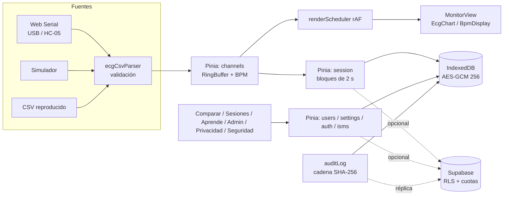
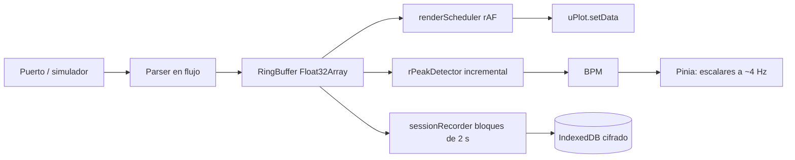
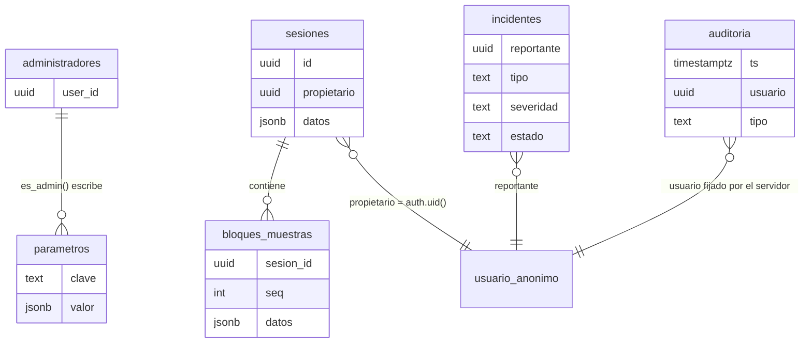

# Monitor cardíaco web (ECG y PPG): desarrollo en Vue 3 y gestión de la seguridad de la información según ISO/IEC 27001:2013

**Informe técnico-académico**

**Universidad de Santiago de Chile**

**Asignatura:** Programación Web

**Integrantes:** [completar]

**Profesor:** [completar]

**Fecha:** octubre de 2026 (actualizado el 20 de octubre)

**Aplicación publicada:** https://monitor-ecg1.vercel.app/

**Repositorio:** https://github.com/mariajose920/monitor-ecg

*Uso educativo. El sistema no es un dispositivo médico ni realiza diagnósticos.*

<!-- FIN-PORTADA -->

## Resumen

El presente informe documenta el análisis, el diseño, la implementación, la verificación y la gestión de la seguridad de la información de un monitor de electrocardiograma (ECG) web, desarrollado como proyecto de la asignatura Programación Web de la Universidad de Santiago de Chile. El sistema original consistía en una página HTML con JavaScript que graficaba, mediante la Web Serial API, la señal de un sensor AD8232 conectado a un Arduino; era monocanal, no contaba con usuarios ni persistencia y presentaba diecisiete problemas técnicos documentados. A partir de él se construyó una aplicación de página única (SPA) en Vue 3 que cubre los 27 requerimientos funcionales (RF01–RF27) y los 9 no funcionales (RNF01–RNF09) del encargo: hasta cinco canales simultáneos, simulador, comparación con una señal de referencia, administración de rangos, alertas, contenido educativo y almacenamiento local cifrado, con sincronización opcional con Supabase y despliegue en Vercel. Con posterioridad se añadieron la medición por fotopletismografía (PPG) con la cámara del celular y con un sensor MAX30100 conectado a un ESP32 (el sensor real del prototipo es óptico, no un ECG), una aplicación web progresiva (PWA), cuentas de usuario con correo y contraseña, un mantenedor de pacientes por cuenta, monitoreos guardables con informes en PDF e historial, y visibilidad privada o pública (visible solo para cuentas registradas, como «Paciente anónimo» y con consentimiento por monitoreo) con retención definida. En octubre de 2026 una auditoría de sistema de solo lectura (30 hallazgos y 29 cambios propuestos) dio lugar a dos tandas de endurecimiento: servidor (TANDA 1: lo público por funciones, privilegio del administrador con TOTP reciente, administrador sin lectura masiva, auditoría de la nube con hash encadenado, incidentes de extremo a extremo, cuotas con la hora del servidor) y privacidad en la aplicación (TANDA 2: nube opcional apagada por defecto, borradores que no se suben, consentimiento 2.0, equipo compartido e inactividad). Este informe declara qué quedó implementado, qué se difirió y qué **no está verificado** en el entorno real.

La seguridad se abordó con un Sistema de Gestión de Seguridad de la Información (SGSI) alineado con la norma ISO/IEC 27001:2013 (UNE-EN ISO/IEC 27001:2017): contexto, alcance, política, roles, apreciación de 38 riesgos (R01–R38, con riesgo residual), Declaración de Aplicabilidad de los 114 controles del Anexo A (71 aplicables, 27 aplicables parcialmente y 16 excluidos; por estado: 31 Implementado, 31 Documentado, 36 Parcial y 16 N/A), controles técnicos con evidencia en el código, procedimiento de incidentes, plan de continuidad, plantillas de auditoría interna y registro de 18 no conformidades. La verificación automatizada arrojó 0 problemas de lint, 343 de 343 pruebas unitarias aprobadas (28 archivos), 75 de 75 pruebas de extremo a extremo (Playwright, 16 archivos; las de nube con Supabase simulado), compilación exitosa y 0 vulnerabilidades en las dependencias de producción. El SQL se probó en un PostgreSQL embebido (PGlite), **no** en Supabase real: la prueba de RLS con cuentas reales, la verificación del claim `amr` del segundo factor, la configuración del panel y las actas de auditoría interna y de revisión por la dirección siguen pendientes. La aplicación está publicada en https://monitor-ecg1.vercel.app/ y el código en https://github.com/mariajose920/monitor-ecg.

El informe declara con transparencia lo que no se ha podido demostrar: la prueba con hardware real, la conexión inalámbrica BLE con ESP32, la activación del CAPTCHA, las mediciones de rendimiento, la presentación y la firma docente del plan de tratamiento de riesgos. El sistema es de uso educativo y no constituye un dispositivo médico.

**Palabras clave:** electrocardiograma, fotopletismografía, MAX30100, AD8232, Web Serial API, Vue 3, Supabase, ISO/IEC 27001:2013, seguridad de la información, protección de datos personales.

## Abstract

This report documents the analysis, design, implementation, verification and information security management of a web-based electrocardiogram (ECG) monitor developed for the Web Programming course at Universidad de Santiago de Chile. The original system was a plain HTML/JavaScript page that plotted, through the Web Serial API, the signal of an AD8232 sensor attached to an Arduino; it was single-channel, had no users or persistence, and exhibited seventeen documented technical defects. It was rebuilt as a Vue 3 single-page application that covers the 27 functional (RF01–RF27) and 9 non-functional (RNF01–RNF09) requirements: up to five simultaneous channels, a simulator, comparison against a reference signal, administrative range settings, alerts, educational content, encrypted local storage, optional Supabase synchronization and deployment on Vercel.

Security was addressed through an Information Security Management System (ISMS) aligned with ISO/IEC 27001:2013 (UNE-EN ISO/IEC 27001:2017): context, scope, policy, roles, a 38-item risk assessment with residual risk, a Statement of Applicability covering the 114 Annex A controls (71 applicable, 27 partially applicable, 16 excluded; by status 31 implemented, 31 documented, 36 partial, 16 not applicable), technical controls backed by code evidence, an incident procedure, a continuity plan, internal audit templates and a register of 18 nonconformities. After a read-only system audit and two hardening batches, automated verification produced 0 lint problems, 343/343 unit tests, 75/75 end-to-end tests (Playwright; cloud tests use a simulated Supabase), a successful build and 0 production-dependency vulnerabilities. The SQL was tested in an embedded PostgreSQL (PGlite), not in the real Supabase project: the real RLS test with actual accounts, the check of the second-factor `amr` claim, the dashboard configuration and the signed internal audit and management review records remain pending. The application is deployed at https://monitor-ecg1.vercel.app/.

The report states openly what has not been demonstrated: testing with the real MAX30100/ESP32 sensor and the phone camera on people, ESP32 BLE connectivity, CAPTCHA activation, performance measurements, the presentation and the instructor's signature on the risk treatment plan. The system is for educational use and is not a medical device.

**Keywords:** electrocardiogram, photoplethysmography, MAX30100, AD8232, Web Serial API, Vue 3, Supabase, ISO/IEC 27001:2013, information security, personal data protection.

<!-- INDICE-INICIO -->
## Índice

- Resumen
- Abstract
- 1 Introducción
- 2 Objetivos
- 3 Marco teórico
- 4 Análisis del sistema original
- 5 Requerimientos
- 6 Diseño y arquitectura
- 7 Implementación
- 8 Sistema de gestión de seguridad de la información
- 9 Pruebas y verificación
- 10 Cambios realizados
- 11 Limitaciones y trabajo futuro
- 12 Conclusiones
- Referencias
- Anexo A. Declaración de Aplicabilidad completa
- Anexo B. Matriz de trazabilidad
- Anexo C. Índice de documentos del SGSI
- Anexo D. Instrucciones de ejecución y despliegue
<!-- INDICE-FIN -->

## 1 Introducción

### 1.1 Contexto y motivación

El electrocardiograma registra la actividad eléctrica del corazón y constituye una de las señales biomédicas más estudiadas. En el ámbito académico, los módulos de adquisición de bajo costo, como el AD8232, permiten que estudiantes de ingeniería construyan un sensor funcional, pero rara vez se complementan con una plataforma de software que gestione usuarios, sesiones, comparaciones y seguridad. El proyecto aborda esa brecha: dotar a un sensor ECG de una aplicación web usable, verificable y segura.

El punto de partida fue un prototipo mínimo (`index.html`, `app.js`, `style.css`) que recibía por Web Serial el flujo CSV `t_ms,ecg_raw,leads_off,bpm` emitido por el firmware `sensor_ecg_ad8232.ino` y lo graficaba. Dicho prototipo servía como prueba de concepto, pero no satisfacía los requerimientos del encargo ni consideraba que la señal electrocardiográfica asociada a una persona es un dato de salud, y por ello un dato personal sensible según la legislación chilena.

### 1.2 Problema

Se requiere una plataforma web que: (a) reciba y visualice en tiempo real la señal de hasta cinco sensores; (b) identifique a los participantes sin exigir contraseña; (c) compare la señal con una referencia validada; (d) evalúe la frecuencia cardíaca contra rangos configurables por un administrador; (e) entregue información educativa; y (f) proteja la información de los usuarios y restrinja las funciones administrativas (RNF06), de manera demostrable frente a un estándar reconocido.

### 1.3 Alcance del trabajo

El trabajo comprende el diagnóstico del sistema original, la especificación y trazabilidad de requerimientos, el diseño de la arquitectura, la implementación de la SPA Vue 3, el esquema de base de datos en Supabase, el despliegue en Vercel, la integración continua, el SGSI conforme a ISO/IEC 27001:2013, la verificación y la declaración de limitaciones. Quedan fuera la certificación eléctrica o médica (IEC 60601), el uso clínico, la seguridad física de las instalaciones universitarias y la infraestructura interna de los proveedores, que se gestiona como proveedor (A.15).

### 1.4 Estructura del documento

El capítulo 2 presenta los objetivos; el 3, el marco teórico; el 4, el análisis del sistema original; el 5, los requerimientos y su trazabilidad; el 6, el diseño y la arquitectura; el 7, la implementación; el 8, el SGSI; el 9, las pruebas; el 10, la cronología de cambios; el 11, las limitaciones y el trabajo futuro; y el 12, las conclusiones. Los anexos incluyen la Declaración de Aplicabilidad completa, la matriz de trazabilidad, el índice de documentos del SGSI y las instrucciones de ejecución y despliegue.

### 1.5 Convenciones

Los requerimientos se identifican como RF (funcionales) y RNF (no funcionales). Los requisitos de seguridad se identifican como SEC-xx y las sugerencias de mejora como SUG-xx. Los controles del Anexo A de ISO/IEC 27001:2013 se citan solo por su número y nombre (por ejemplo, A.9.4.1). Por restricciones de licencia de la norma (AENOR), no se reproduce su texto.

## 2 Objetivos

### 2.1 Objetivo general

Desarrollar y desplegar una plataforma web de monitoreo ECG, basada en un sensor AD8232, que satisfaga los requerimientos funcionales y no funcionales del encargo y cuya seguridad se gestione y evidencie conforme a ISO/IEC 27001:2013.

### 2.2 Objetivos específicos

1. Diagnosticar el sistema original, identificando sus defectos técnicos y sus inconsistencias entre hardware y documentación.
2. Reescribir la aplicación como SPA en Vue 3, con arquitectura por capas y un pipeline de adquisición capaz de sostener cinco canales a 250 Hz.
3. Implementar la identificación de participantes sin contraseña, el consentimiento informado y la minimización de datos.
4. Implementar la comparación de señales, la evaluación por rangos, las alertas y el perfil de administrador.
5. Almacenar los datos de forma cifrada en el navegador y sincronizarlos de manera opcional con Supabase mediante políticas de seguridad a nivel de fila (RLS).
6. Establecer un SGSI con alcance, política, apreciación y tratamiento de riesgos, Declaración de Aplicabilidad de 114 controles, gestión de incidentes, continuidad, auditoría interna y mejora continua.
7. Verificar el sistema con pruebas automatizadas y revisiones independientes, y declarar sus limitaciones sin sobrestimar los resultados.

## 3 Marco teórico

### 3.1 Electrocardiograma y frecuencia cardíaca

El electrocardiograma (ECG) es el registro, en función del tiempo, de la diferencia de potencial eléctrico generada por la actividad cardíaca y captada mediante electrodos sobre la piel. Un latido típico se descompone en las ondas P (despolarización auricular), el complejo QRS (despolarización ventricular) y la onda T (repolarización ventricular). El pico R, de mayor amplitud, es la referencia habitual para detectar latidos.

La frecuencia cardíaca (FC) se expresa en latidos por minuto (BPM) y se obtiene a partir del intervalo entre picos R consecutivos (intervalo RR): BPM = 60 000 / RR, con RR en milisegundos. En reposo, el rango habitual en adultos es de 60 a 100 BPM; valores inferiores a 60 BPM se denominan bradicardia y superiores a 100 BPM, taquicardia, sin que ello implique por sí mismo una condición patológica (por ejemplo, personas entrenadas pueden presentar 40 a 60 BPM). La fórmula «220 menos la edad» para la FC máxima es solo una aproximación imprecisa. La plataforma no realiza diagnósticos: el rango predeterminado en reposo (50–100 BPM) es configurable por el administrador.

### 3.2 Sensor AD8232

El AD8232 (Analog Devices) es un módulo integrado de acondicionamiento de señal para biopotenciales. Incorpora un amplificador de instrumentación, filtros paso alto (aproximadamente 0,5 Hz) y paso bajo (aproximadamente 40 Hz) y un circuito de detección de electrodos desconectados (*leads-off*, señales LO+ y LO−). Se conecta mediante tres electrodos (RA, LA y RL) y entrega una salida analógica centrada aproximadamente en 1,65 V cuando se alimenta con 3,3 V. Con un convertidor analógico-digital (ADC) de 10 bits referido a 5 V, como el de Arduino UNO, esa línea base equivale a unas 338 cuentas; un ESP32 utiliza un ADC de 12 bits (0–4095).

El firmware `sensor_ecg_ad8232.ino` conecta OUTPUT a A0, LO+ a D10 y LO− a D11, alimenta el módulo con 3,3 V, comunica a 115 200 baudios y emite líneas CSV con el formato `t_ms,ecg_raw,leads_off,bpm`. Detecta el pico R con un umbral adaptativo (60 % del máximo reciente con decaimiento de 0,995), un período refractario de 300 ms y un filtro de plausibilidad de 30 a 220 BPM, y suaviza el resultado con una media móvil exponencial (0,75/0,25).

### 3.3 Muestreo y criterio de Nyquist

El teorema de muestreo de Nyquist–Shannon establece que una señal limitada en banda puede reconstruirse si se muestrea a una frecuencia superior al doble de su componente máxima (Nyquist, 1928; Shannon, 1949). Con una banda efectiva del AD8232 de aproximadamente 40 Hz, el mínimo absoluto es de 80 Hz. Por convención en procesamiento de ECG (Tompkins, 1993) se utilizan entre 250 y 500 Hz para obtener buena resolución temporal en la ubicación del pico R. El firmware muestrea a 250 Hz (período de 4 ms), valor que cumple con holgura el criterio y que resulta alcanzable para el ADC de un Arduino UNO.

### 3.4 Web Serial API

La Web Serial API permite que una página web, con autorización expresa del usuario, lea y escriba en puertos serie, incluidos los dispositivos USB y los módulos Bluetooth clásico emparejados como puerto COM virtual. Requiere un contexto seguro (HTTPS), un gesto del usuario para invocar la selección del puerto y está disponible solo en navegadores basados en Chromium de escritorio (Chrome, Edge, Opera); no existe en Safari, Firefox ni en iOS. En consecuencia, la plataforma debe ofrecer alternativas (simulador y reproducción de archivos) en los entornos sin soporte. El control de acceso a esta capacidad se refuerza con la cabecera `Permissions-Policy: serial=(self)`.

### 3.5 Vue 3 y aplicaciones de página única

Una aplicación de página única (SPA) carga un documento HTML inicial y actualiza la interfaz en el cliente sin recargar la página, delegando la navegación a un enrutador. Vue 3 es un marco reactivo progresivo; en este proyecto se emplea la Composition API con `<script setup>`, Vue Router 4 para la navegación con carga diferida de vistas, Pinia 3 para el estado global, Vite 7 como herramienta de compilación y uPlot para el trazado de series temporales de alto rendimiento. Una SPA estática se despliega como conjunto de archivos, lo que simplifica el alojamiento pero traslada al cliente el cumplimiento de los controles, hecho que condiciona el modelo de amenazas (sección 8.5).

### 3.6 Supabase y Vercel

Supabase es una plataforma que ofrece una base de datos PostgreSQL gestionada, un servicio de autenticación (correo y contraseña; el inicio de sesión anónimo se eliminó del proyecto) y una API generada. Su modelo de seguridad se apoya en las políticas de seguridad a nivel de fila (*Row Level Security*, RLS) de PostgreSQL: el servidor decide qué filas puede leer o modificar cada identidad, de modo que la clave «publicable» incluida en el cliente no concede por sí sola acceso irrestricto. Vercel es una plataforma de alojamiento para aplicaciones web que sirve activos estáticos mediante una red de distribución de contenidos (CDN), permite definir cabeceras HTTP de seguridad y ejecuta compilaciones desde un repositorio.

### 3.7 ISO/IEC 27001:2013

La norma ISO/IEC 27001:2013, con sus corrigendos Cor 1:2014 y Cor 2:2015, y su versión española UNE-EN ISO/IEC 27001:2017, especifica los requisitos de un Sistema de Gestión de Seguridad de la Información (SGSI). Se estructura en cláusulas obligatorias y en un anexo normativo de controles.

**Cláusulas 4 a 10.** La cláusula 4 (Contexto de la organización) exige comprender cuestiones internas y externas, partes interesadas y determinar el alcance. La 5 (Liderazgo) trata el compromiso de la dirección, la política y los roles. La 6 (Planificación) incluye la apreciación y el tratamiento de riesgos, la Declaración de Aplicabilidad y los objetivos de seguridad. La 7 (Soporte) comprende recursos, competencia, concienciación, comunicación e información documentada. La 8 (Operación) se refiere a la planificación y el control operacional y a la ejecución de la apreciación y el tratamiento de riesgos. La 9 (Evaluación del desempeño) abarca el seguimiento y la medición (9.1), la auditoría interna (9.2) y la revisión por la dirección (9.3). La 10 (Mejora) trata las no conformidades, las acciones correctivas y la mejora continua.

**Anexo A.** Contiene 114 controles agrupados en 14 dominios, A.5 a A.18, como se detalla en la tabla 3.1. La organización selecciona los controles aplicables según su apreciación de riesgos y los justifica en la Declaración de Aplicabilidad (6.1.3 d).

**Tabla 3.1.** Dominios del Anexo A de ISO/IEC 27001:2013

| Dominio | Nombre | Controles |
|---|---|---|
| A.5 | Políticas de seguridad de la información | 2 |
| A.6 | Organización de la seguridad de la información | 7 |
| A.7 | Seguridad relativa a los recursos humanos | 6 |
| A.8 | Gestión de activos | 10 |
| A.9 | Control de acceso | 14 |
| A.10 | Criptografía | 2 |
| A.11 | Seguridad física y del entorno | 15 |
| A.12 | Seguridad de las operaciones | 14 |
| A.13 | Seguridad de las comunicaciones | 7 |
| A.14 | Adquisición, desarrollo y mantenimiento de los sistemas de información | 13 |
| A.15 | Relación con proveedores | 5 |
| A.16 | Gestión de incidentes de seguridad de la información | 7 |
| A.17 | Aspectos de seguridad de la información para la gestión de la continuidad del negocio | 4 |
| A.18 | Cumplimiento | 8 |
| | **Total** | **114** |

### 3.8 Marco legal de protección de datos

La señal ECG asociada a una persona identificable es un dato de salud. En Chile rige la Ley 19.628 sobre protección de la vida privada; la Ley 21.719, que regula la protección y el tratamiento de los datos personales y crea la Agencia de Protección de Datos Personales, tiene una entrada en vigencia programada para diciembre de 2026 y califica los datos de salud como sensibles; la Ley 20.584 sobre derechos y deberes de los pacientes se utiliza como referencia. Estos instrumentos fundamentan los requisitos de consentimiento, minimización, derechos del titular y transferencia internacional que se incorporan en la plataforma (control A.18.1.4).

## 4 Análisis del sistema original

### 4.1 Inventario

**Tabla 4.1.** Archivos del sistema original

| Archivo | Contenido | Observación |
|---|---|---|
| `sensor_ecg_ad8232.ino` | Firmware Arduino UNO/Nano + AD8232: muestreo a 250 Hz, leads-off, pico R, BPM, CSV a 115 200 baudios | Razonable; única fuente real de datos |
| `index.html` | Botones conectar/desconectar, aviso eléctrico, alerta leads-off, tarjetas BPM/estado, gráfico | Carga uPlot desde un CDN sin versión fija ni integridad de subrecurso |
| `app.js` | Web Serial, parser, ventana de 1000 puntos (4 s), uPlot | Monocanal, sin usuarios ni persistencia |
| `style.css` | Tema oscuro y tarjetas | Sin media queries; gráfico de alto fijo (400 px) |
| `ANALISIS_PROYECTO.md` | Análisis preliminar con 6 RF propios | Superado por el documento de requerimientos oficial |
| `esquema_circuito.svg` | Diagrama de un sensor de lactato (LMP91000 + ESP32 + BLE) | No corresponde al ECG |

### 4.2 Cumplimiento de requerimientos por el sistema original

Contrastado con los 27 RF y 9 RNF, el sistema original no cumplía plenamente ninguno: 22 RF y 3 RNF no se satisfacían y 5 RF y 6 RNF se satisfacían solo de forma parcial. Los RF parciales eran RF04, RF05, RF06, RF08 y RF10 (existía recepción y visualización monocanal, pero sin validación, sin sesión y con estados insuficientes). Los RNF parciales eran RNF01, RNF02, RNF03, RNF04, RNF05 y RNF09; los no cumplidos, RNF06, RNF07 y RNF08. No existían usuarios, comparación, rangos, alertas por rango, contenido educativo ni administración.

### 4.3 Defectos técnicos de `app.js`

Se identificaron y documentaron diecisiete problemas, que se resumen a continuación junto con su resolución en la nueva implementación.

**Tabla 4.2.** Defectos del sistema original y su corrección

| N.º | Defecto | Efecto | Corrección en la nueva versión |
|---|---|---|---|
| 1 | `push()` y `shift()` sobre arreglos por cada muestra (costo O(n)) | Unos 500 000 movimientos por segundo por canal | Buffer circular tipado (`RingBuffer`) |
| 2 | `setData()` en cada fragmento de lectura | Redibujado irregular, ligado al controlador USB | Un único `requestAnimationFrame` (`renderScheduler`) |
| 3 | Actualización del DOM por muestra | Hasta 250 actualizaciones por segundo | Escalares en Pinia a unos 4 Hz y solo si cambian |
| 4 | Sin manejo de desconexión física | La interfaz queda en «Conectado» | Evento `disconnect` y error de lectura finalizan la medición (RF09) |
| 5 | `pipeTo` no se espera al cerrar | `port.close()` puede fallar por flujo bloqueado | Cierre ordenado: cancelar, esperar, liberar, cerrar |
| 6 | Condición de carrera en `disconnect()` | Segundo clic opera sobre objetos cerrados | Cierre idempotente |
| 7 | `startTime` no se reinicia al reconectar | Tiempo negativo y eje X no monótono | Reinicio de la base de tiempo (`DEVICE_RESET`) |
| 8 | Ventana inicial rellena con ceros | Eje X no monótono al inicio | Sin relleno inicial |
| 9 | Valores `NaN` y líneas truncadas sin validar | Datos incorrectos en el gráfico | Parser estricto con rangos y descarte |
| 10 | Leads-off forzado a 512 | Dato falseado; la línea base real es ~338 | Dato crudo conservado y hueco en el gráfico |
| 11 | Escala Y contradictoria (`auto` con `range` fijo) | Escala incorrecta con ADC de 12 bits | Escala por perfil de dispositivo |
| 12 | uPlot por CDN sin versión ni integridad | Riesgo de cadena de suministro; sin conexión no hay gráfico | uPlot por npm, sin CDN |
| 13 | Errores solo en consola | El usuario no ve las fallas | Mensajes visibles (avisos y estados) |
| 14 | `bufferSize` por defecto de 255 bytes | Posible pérdida de datos | `bufferSize` de 8192 |
| 15 | BPM obsoleto indefinidamente | Muestra un valor viejo con leads-off | Muestra «--» |
| 16 | Redimensionado frágil | Gráfico no responde a cambios del contenedor | `ResizeObserver` |
| 17 | Sin separación de responsabilidades | Imposible probar | Capas separadas y probadas |

### 4.4 Inconsistencias entre hardware y documentación

**Tabla 4.3.** Inconsistencias detectadas y decisión de software

| N.º | Inconsistencia | Decisión |
|---|---|---|
| I1 | `esquema_circuito.svg` describe un sensor de lactato | Se produjo `docs/esquema_circuito_ad8232.svg` con el circuito real; el archivo original no se modificó |
| I2 | RF04 y RNF08 mencionan ESP32, pero el firmware es para Arduino UNO/Nano | Perfiles de dispositivo (10 bits/5 V y 12 bits/3,3 V) en `deviceProfiles.js` |
| I3 | RF23 habla de un «sensor infrarrojo» (fotopletismografía), pero el sensor es el AD8232 (biopotencial) | Contenido educativo sobre el AD8232 con un recuadro que explica la diferencia; erratas registradas en la trazabilidad |
| I4 | El firmware recomienda HC-05 (Bluetooth clásico), el esquema de lactato usa BLE | El HC-05 se usa como puerto COM con `SerialSource`; BLE queda como extensión futura |
| I5 | Web Serial no existe en iOS, Safari ni Firefox, pero RNF01/RNF02 exigen móviles | Detección de capacidades; simulador, reproducción y comparación disponibles en todo navegador |
| I6 | Riesgo eléctrico al conectar el equipo a la red con electrodos puestos | Acuse obligatorio y auditado antes de usar Web Serial |
| I7 | RF07 pide 5 sensores, pero solo hay un Arduino | `SimulatorSource` genera hasta 5 señales independientes |
| I8 | Umbral inicial del firmware (550) sobre la línea base real (~338) | Recalculo del BPM en el cliente y visualización de ambos valores |

## 5 Requerimientos

### 5.1 Fuente y erratas

Los requerimientos provienen del documento «Requerimientos funcionales» del encargo (27 RF y 9 RNF), que no se modificó. Tres puntos se interpretaron de forma distinta a su redacción literal, y su justificación consta en la matriz de trazabilidad: RF04 y RNF08 (se entiende «ESP32 con sensor óptico PPG MAX30100», la cámara del celular y, opcionalmente, el AD8232 con Arduino UNO/Nano o ESP32); RF23 (el texto original, «sensor infrarrojo», es correcto para el MAX30100; la interpretación anterior en favor del AD8232 solo describe el ECG, y PPG no es ECG); y el esquema de circuito (el de lactato de la raíz es ajeno al proyecto; falta un esquema ESP32 + MAX30100). La redacción corregida propuesta consta en `docs/ERRATAS_REQUERIMIENTOS.md`.

### 5.2 Requerimientos funcionales

El estado corresponde a la verificación independiente sobre el código, con las precisiones posteriores indicadas en la sección 9. Totales: 25 RF cumplen y 2 cumplen parcialmente (RF11 y RF23); ninguno queda sin cumplir.

**Tabla 5.1.** Requerimientos funcionales, estado y trazabilidad

| RF | Requerimiento | Estado | Componentes principales | Pruebas |
|---|---|---|---|---|
| RF01 | Identificación de usuario | Cumple | `stores/users.js`, `UserSelectView.vue`, `router/guards.js` | E2E admin |
| RF02 | Inicio de sesión sin contraseña | Cumple | `stores/users.js`; en la nube, cuentas con Supabase Auth (`authService.js`) | U abuseControls |
| RF03 | Información opcional con consentimiento | Cumple | `ConsentDialog.vue`, `OptionalDataForm.vue`, `PrivacyView.vue` | E2E inicio |
| RF04 | Recepción de datos | Cumple | `SerialSource.js`, `SimulatorSource.js`, `ReplaySource.js`, `ecgCsvParser.js` | U parser |
| RF05 | Señal en tiempo real | Cumple | `EcgChart.vue`, `renderScheduler.js`, `RingBuffer.js` | U ringBuffer, E2E simulador |
| RF06 | Valor de frecuencia | Cumple | `rPeakDetector.js`, `BpmDisplay.vue` | U rPeakDetector, E2E simulador |
| RF07 | Hasta cinco mediciones simultáneas | Cumple | `stores/channels.js`, `ChannelGrid.vue` | Manual |
| RF08 | Inicio de medición | Cumple | `stores/session.js`, `SessionControls.vue` | Manual |
| RF09 | Fin por desconexión o pérdida de comunicación | Cumple | `SerialSource.js`, `SessionControls.vue` | Manual (simulador) |
| RF10 | Estado de conexión | Cumple | `ConnectionStatus.vue`, `LeadsOffAlert.vue` | Manual |
| RF11 | Señal validada como referencia | Parcial | `CompareView.vue`, `csvImporter.js`, `referenceEcg.js` | U parser |
| RF12 | Comparación de señales | Cumple | `compareSignals.js`, `CompareMetrics.vue` | U crossCorrelation |
| RF13 | Visualización comparativa | Cumple | `SignalChart.vue`, `CompareView.vue` | Manual |
| RF14 | Sincronización | Cumple | `SyncControls.vue`, `rPeakDetector.js`, `crossCorrelation.js` | U crossCorrelation |
| RF15 | Configuración de parámetros mínimo y máximo | Cumple | `RangeSettingsForm.vue`, `stores/settings.js` | U rangeEvaluator |
| RF16 | Comparación con parámetros | Cumple | `stores/settings.js`, `rangeEvaluator.js` | U rangeEvaluator |
| RF17 | Indicación de dentro o fuera de rango | Cumple | `RangeIndicator.vue`, `rangeEvaluator.js` | U rangeEvaluator |
| RF18 | Clasificación de actividad | Cumple | `ActivitySelector.vue`, `data/activities.js` | Manual |
| RF19 | Contexto asociado a la medición | Cumple | `stores/session.js`, `SessionDetailView.vue` | Manual |
| RF20 | Alerta por valor fuera de rango | Cumple | `stores/alerts.js`, `stores/channels.js` | U rangeEvaluator |
| RF21 | Información sobre posibles causas | Cumple | `data/learn/variationFactors.js`, `LearnView.vue` | Manual |
| RF22 | Información sobre frecuencia cardíaca | Cumple | `data/learn/heartRate.js` | Manual |
| RF23 | Información sobre el sensor | Parcial | `data/learn/sensorAd8232.js` | Manual |
| RF24 | Información de ingeniería | Cumple | `data/learn/engineering.js` | Manual |
| RF25 | Perfil de administrador | Cumple | `adminAuth.js`, `pinHash.js`, `lockout.js`, `views/admin/*` | U security, E2E admin |
| RF26 | Administración de parámetros | Cumple | `RangeSettingsForm.vue`, `stores/settings.js` (`assertAdmin`) | U rangeEvaluator |
| RF27 | Configuración de sincronización | Cumple | `SyncSettingsForm.vue`, `stores/settings.js` | Manual |

Las dos calificaciones parciales se explican así. RF11: la referencia incluida en la aplicación es sintética y así lo declara su cabecera; no es un registro clínico validado, por lo que el requisito se cumple por completo solo cuando se incorpore un registro validado (por ejemplo, de PhysioNet) con su licencia. RF23: el requisito menciona un sensor infrarrojo, mientras el prototipo usa el AD8232; la aplicación explica la diferencia y se recomienda corregir la redacción del requisito.

### 5.3 Requerimientos no funcionales

Totales según la verificación: 6 RNF cumplen y 3 cumplen parcialmente (RNF02, RNF05 y RNF08).

**Tabla 5.2.** Requerimientos no funcionales, estado y trazabilidad

| RNF | Requerimiento | Estado | Implementación | Observación |
|---|---|---|---|---|
| RNF01 | Responsividad | Cumple | Estilos mobile-first, objetivos táctiles de 44 px | No probado en dispositivos reales |
| RNF02 | Accesibilidad multiplataforma | Parcial | `useCapabilities.js`, `CapabilityNotice.vue` | Web Serial solo en Chrome/Edge de escritorio; en el resto hay simulador y reproducción |
| RNF03 | Visualización en tiempo real | Cumple | `renderScheduler.js` (un único rAF), buffers tipados | Sin medición formal de rendimiento (SUG-21 pendiente) |
| RNF04 | Usabilidad | Cumple | Vistas y componentes; WCAG 2.1 AA: `aria-live`, foco, contraste | Evaluación cualitativa; sin informe Lighthouse/axe |
| RNF05 | Disponibilidad | Parcial | Local-first (IndexedDB), nube opcional, sin CDN | Sin PWA ni service worker |
| RNF06 | Seguridad | Cumple | Cabeceras, RLS, cifrado, auditoría, SGSI | Limitaciones de una SPA (sección 8.5) |
| RNF07 | Escalabilidad | Cumple | Constante `MAX_CHANNELS`, fuentes intercambiables, cuotas parametrizadas | Más de 5 canales requiere validar rendimiento |
| RNF08 | Compatibilidad con ESP32 | Parcial | Perfil `esp32-ad8232` por USB | `BleSource` es un esqueleto; sin hardware real |
| RNF09 | Despliegue | Cumple | `vercel.json`, CI de GitHub Actions | Publicada en https://monitor-ecg1.vercel.app/ |

### 5.4 Trazabilidad con pruebas y controles

La matriz completa que vincula cada requerimiento con sus componentes, sus pruebas y los controles del Anexo A figura en el Anexo B. Cada sugerencia de mejora de seguridad (SUG) se trazó de igual forma. De las 28 sugerencias registradas, 10 se encontraban ya resueltas, 16 se implementaron y 2 permanecen pendientes (SUG-21, medición de rendimiento, y SUG-27, material de presentación).

## 6 Diseño y arquitectura

### 6.1 Decisiones de base

Se adoptó Vue 3 con Composition API y `<script setup>` en JavaScript, Vue Router 4 con vistas de carga diferida, Pinia 3 para el estado, Vite 7 como herramienta de compilación y uPlot (instalado por npm) para el gráfico. La aplicación es exclusivamente de cliente, con persistencia local en IndexedDB y una capa de sincronización opcional con Supabase; se despliega como sitio estático en Vercel. Los objetos de alto volumen (buffers, instancias de uPlot, fuentes de datos) viven fuera de la reactividad de Vue para evitar sobrecarga.

### 6.2 Arquitectura general

**Figura 6.1.** Arquitectura general del sistema



*Descripción del diagrama (figura 6.1).* Tres fuentes de datos (puerto serie mediante Web Serial, simulador y reproducción de un CSV) alimentan un mismo analizador sintáctico estricto (`ecgCsvParser`), que valida cada línea. Las muestras válidas se escriben en un buffer circular por canal gestionado desde el almacén `channels`, que también calcula el BPM. De allí parten dos caminos: el planificador de dibujo (un único `requestAnimationFrame`) que actualiza el gráfico y los indicadores del monitor, y el almacén `session`, que agrupa las muestras en bloques de aproximadamente dos segundos y los guarda en IndexedDB mediante cifrado AES-GCM de 256 bits; opcionalmente, esos bloques se replican en Supabase, donde las políticas RLS y las cuotas controlan el acceso y el abuso. Los almacenes de usuarios, parámetros, autenticación y SGSI persisten también en IndexedDB y pueden sincronizarse. El registro de auditoría, encadenado con SHA-256, se guarda localmente y se replica en la nube. Las vistas de comparación, sesiones, contenido educativo, administración, privacidad y seguridad dependen de esos almacenes.

### 6.3 Capa de fuentes de datos

Todas las fuentes implementan la interfaz `DataSource`, basada en eventos (`samples`, `status`, `error`) y sin dependencia de Vue. `SerialSource` atiende Arduino UNO/Nano (por USB o HC-05 como puerto COM) y ESP32 por USB, con un `bufferSize` de 8192, un perro guardián de inactividad y el evento `disconnect`. `SimulatorSource` genera hasta cinco señales PQRST de 250 Hz con BPM, ruido, interferencia y episodios de leads-off configurables. `ReplaySource` reproduce sesiones guardadas o archivos CSV. `BleSource` es un esqueleto para una extensión futura con ESP32 mediante BLE. Los perfiles de dispositivo (`arduino-uno-ad8232`, `esp32-ad8232` y `simulador`) fijan resolución del ADC, tensión de referencia, frecuencia de muestreo, velocidad (115 200 baudios) y rango del eje Y.

### 6.4 Pipeline de adquisición y rendimiento

**Figura 6.2.** Pipeline de adquisición y render



*Descripción del diagrama (figura 6.2).* El flujo de texto del puerto pasa por un analizador en flujo que valida cada campo y descarta líneas inválidas (que se cuentan). Las muestras válidas se escriben en un buffer circular de tipos numéricos fijos, operación de costo constante que reemplaza al `shift()` del sistema original. Desde el buffer, el planificador de dibujo, con un único `requestAnimationFrame` global, copia la ventana visible a arreglos preasignados y actualiza uPlot. Un detector incremental de picos R calcula el BPM, y un grabador agrupa las muestras en bloques de unos dos segundos para IndexedDB. Solo los valores escalares (BPM, estado, leads-off, estado del rango) llegan a la reactividad de Pinia, a una frecuencia de unos 4 Hz y únicamente cuando cambian. La carga prevista es de 1250 muestras por segundo con cinco canales a 250 Hz; el objetivo de diseño es mantener el uso del hilo principal por debajo del 20 %, objetivo que no se ha medido formalmente (sección 11).

### 6.5 Modelo de datos

Los datos locales residen en IndexedDB (usuarios, sesiones, bloques de muestras, referencias, configuración y auditoría) a través de `secureStorage`; localStorage se reserva para preferencias de interfaz no sensibles. Las muestras se guardan en bloques cifrados y no una por una (cinco canales a 250 Hz durante 10 minutos generarían 750 000 filas). En la nube, el esquema comprende seis tablas:

**Figura 6.3.** Modelo de datos de la nube (Supabase)



*Descripción del diagrama (figura 6.3).* Las sesiones pertenecen a una cuenta de Supabase (en la primera entrega, a una identidad anónima) (`propietario = auth.uid()`) y contienen bloques de muestras. La auditoría y los incidentes también se asocian a la identidad que los generó. La tabla `administradores` enumera las cuentas con privilegios; la función `es_admin()` la consulta para autorizar la escritura en `parametros`, la lectura de la auditoría de la nube, la moderación de contenido y el acceso excepcional con motivo; desde la TANDA 1 el administrador **ya no lee de forma masiva** los datos de otras cuentas. Además de las seis tablas del diagrama existen `pacientes`, `uso_cuenta`, `tipos_evento`, `reportes_contenido`, `retiros_contenido` y `accesos_admin`. El diagrama es esquemático: el detalle de columnas, restricciones `CHECK` y políticas se encuentra en `supabase/schema.sql`.

### 6.6 Modelo de seguridad por capas

La seguridad se diseñó como defensa en profundidad con tres niveles. Primero, el cliente aplica un guard de rutas (con lista blanca de redirecciones), la verificación `assertAdmin()` en toda acción privilegiada del almacén, validación de entradas, cifrado en reposo y auditoría encadenada. Segundo, el servidor de datos impone RLS en todas las tablas, restricciones `CHECK`, cuotas por usuario y fijación de hora y autor en la auditoría. Tercero, la entrega aplica cabeceras HTTP restrictivas (CSP sin `unsafe-inline` ni `unsafe-eval`, HSTS, Permissions-Policy). Desde la TANDA 1 el servidor también calcula el actor y la hora de la auditoría (`registrar_evento`), exige un código TOTP reciente al administrador (`es_admin()` y `es_admin_reciente()`) y fija el tiempo de las cuotas (`creado_en`). Como todo control del cliente puede eludirse por quien controla el navegador, la autorización real sobre los datos en la nube la determina RLS; este límite se declara como riesgo residual (sección 8.5). Esa autorización se probó en PGlite y **no** con cuentas reales (sección 9.5).

## 7 Implementación

### 7.1 Estructura del código

El proyecto `monitor-ecg-vue/` se organiza en `src/views` (vistas), `src/components` (componentes por dominio: admin, common, compare, layout, learn, monitor, security, users), `src/stores` (estado), `src/services` (acquisition, audit, cloud, compare, export, notifications, parsing, security, sources, storage), `src/utils` (anillo, filtros digitales y utilidades), `src/data` (perfiles, actividades, parámetros por defecto, contenido educativo), `tests/` (pruebas unitarias) y `e2e/` (pruebas de extremo a extremo).

### 7.2 Vistas y rutas

**Tabla 7.1.** Rutas de la aplicación

| Ruta | Vista | Acceso |
|---|---|---|
| `/` | Inicio | Público |
| `/pacientes` (`/usuarios` redirige) | Pacientes (alta con declaración de mayoría de edad, consentimiento 2.0, datos opcionales, alias solo en el dispositivo) | Público |
| `/acceso`, `/registro`, `/recuperar`, `/restablecer` | Inicio de sesión (con casilla de equipo compartido), alta de cuenta, recuperación y nueva contraseña | Público |
| `/cuenta` | Mi cuenta: interruptor «Guardar mis datos en la nube» (apagado por defecto), vincular datos, borrar mis datos y eliminar mi cuenta | Requiere cuenta |
| `/monitor` | Monitor de hasta 5 canales | Requiere participante elegido |
| `/comparar` | Comparación con señal de referencia | Público |
| `/monitoreos`, `/monitoreos/:id` (`/sesiones*` redirige) | Historial y detalle de monitoreos, exportación CSV y PDF, visibilidad | Requiere paciente elegido |
| `/aprende/:tema?` | Contenido educativo | Público |
| `/privacidad` | Aviso de privacidad, derechos y borrado en la nube | Público |
| `/seguridad` | Política de seguridad, uso aceptable, notificación de incidentes | Público |
| `/admin/setup`, `/admin/acceso` | Configuración inicial del PIN e inicio de sesión del administrador local (con nube redirigen a `/acceso`) | Público, solo sin nube |
| `/admin/mfa` | Inscripción y verificación del segundo factor TOTP | Cuenta con rol |
| `/admin`, `/admin/auditoria` | Administración (parámetros, sincronización, nube, administradores, soporte y moderación, SGSI) y auditoría local y de la nube | Requiere administrador (rol, `aal2` y TOTP reciente) |

### 7.3 Almacenes (Pinia)

Existen nueve almacenes: `users` (participantes y consentimiento), `session` (sesiones y grabación), `channels` (canales, buffers y BPM), `settings` (parámetros y sincronización, con `assertAdmin`), `alerts` (alertas por rango), `auth` (rol y sesión de administrador), `admin` (exportación, borrado y auditoría), `isms` (incidentes, política, revisión de accesos e indicadores) y `toasts` (avisos).

### 7.4 Servicios y procesamiento de señal

Los servicios agrupan: adquisición (`channelRegistry`, `renderScheduler`, `sessionRecorder`); auditoría (`auditLog` con cadena SHA-256); nube (`cloudSync`, `supabaseClient`, `captcha`); comparación (`compareSignals`); exportación e importación CSV; análisis de CSV serial; seguridad (`adminAuth`, `pinHash`, `lockout`, `incidents`, `isms`); fuentes de datos; y almacenamiento (`db`, `secureStorage`, repositorios y `wipe`). El procesamiento de señal (`utils/dsp`) incluye detección incremental de picos R, filtros, normalización, remuestreo, correlación cruzada y métricas. La comparación admite alineación por pico R, correlación cruzada o ajuste manual, y calcula el coeficiente de Pearson, el error cuadrático medio (RMSE y NRMSE), la diferencia de BPM y el desfase.

### 7.5 Base de datos y políticas RLS

El proyecto de Supabase está alojado en la región us-east-1 (Estados Unidos). En la primera entrega las seis tablas tenían RLS activa y sumaban 16 políticas; la tabla siguiente describe ese estado inicial y las secciones 7.5b a 7.5d lo actualizan (la tabla `sesiones`, por ejemplo, ya no se lee por el administrador).

**Tabla 7.2.** Tablas y políticas RLS (`supabase/schema.sql`)

| Tabla | Políticas | Regla resumida |
|---|---|---|
| `administradores` | 1 | Solo el administrador ve la lista |
| `parametros` | 3 | Todos leen; solo el administrador inserta y modifica |
| `sesiones` | 4 | El dueño o el administrador lee; el dueño inserta y modifica; el dueño o el administrador borra |
| `bloques_muestras` | 3 | El dueño o el administrador lee; el dueño inserta y borra |
| `auditoria` | 2 | Los autenticados registran; el administrador lee; sin actualización ni borrado |
| `incidentes` | 3 | Cualquiera notifica; el reportante o el administrador lee; solo el administrador gestiona; sin borrado |

Además, el esquema contiene: restricciones `CHECK` de tamaño y consistencia (JSON de sesión de hasta 64 KB, `seq` de hasta 5400, BPM consistente); la función `cuota()` y disparadores de cuota por usuario (50 sesiones por día, 300 bloques por minuto, 200 eventos de auditoría por hora, 10 incidentes por día); una lista blanca de tipos de evento de auditoría; un disparador que fija `ts = now()` y `usuario = auth.uid()` en la auditoría; la función `borrar_mis_datos()` para el ejercicio del derecho de supresión; `hora_servidor()` para contrastar el reloj; y `purgar_sesiones()`, programable con `pg_cron`. El script es idempotente. Conforme a la verificación realizada sobre la base, los avisos de seguridad y rendimiento del asesor de Supabase fueron corregidos. (Nota histórica: la primera entrega usaba inicio de sesión anónimo, que ya no existe.)

### 7.5b Cuentas, pacientes y visibilidad (actualización)

El esquema fue ampliado (`supabase/migracion_cuentas_pacientes.sql` y `schema.sql`; en total 7 tablas y 26 políticas según los scripts, no revalidadas contra la base real tras la ampliación). Cada cuenta (Supabase Auth, correo y contraseña de al menos 10 caracteres, con confirmación) es dueña de sus pacientes y monitoreos mediante RLS; el administrador no tiene política sobre `pacientes`. Un monitoreo es `privado` por defecto o `publico`; lo público solo se expone por las funciones RPC `listar_monitoreos_publicos()` y `monitoreo_publico()` (`security definer`, `search_path` fijo, solo columnas permitidas, «Paciente anónimo», máximo 100 filas, sin acceso para `anon`), que sustituyen a la vista `monitoreos_publicos`, señalada por el asesor de Supabase como `security_definer_view`. Los cambios están en `supabase/migracion_endurecimiento.sql`, **ya aplicada en el proyecto real**; su comportamiento se probó en PGlite y con pruebas de texto, no con cuentas reales.

**Retención.** Las sesiones locales se purgan según el plazo del administrador (30 días por defecto, máximo 180). Los monitoreos en la nube se conservan 365 días desde su inicio salvo borrado previo del titular, mediante la tarea diaria `purga-ecg` (pg_cron, `purgar_sesiones(365)`, ahora por `creado_en` del servidor); la auditoría de la nube se conserva 2 años (`purga-auditoria`). Que ambas tareas estén activas en el proyecto real **no se ha verificado** (`select jobname from cron.job`). Las cuentas sin acceso en 24 meses se avisan y se eliminan por un procedimiento manual (sin automatizar).

### 7.5c TANDA 1: endurecimiento del servidor

La TANDA 1 (`supabase/migracion_endurecimiento_2.sql`, integrada en `schema.sql`; detalle y lo diferido en `docs/CAMBIOS_TANDA1.md`) respondió a los hallazgos de la auditoría de sistema. Las migraciones anteriores 1 a 4 se neutralizaron para que no puedan reabrir lo cerrado.

**Tabla 7.3.** Cambios de la TANDA 1 y su estado

| Cambio | Qué hace | Estado |
|---|---|---|
| Lo público solo por funciones (C-04) | Se eliminó la política pública de `bloques_muestras`; `senal_publica` (máx. 60 bloques por llamada), `listar_monitoreos_publicos` y `monitoreo_publico` excluyen cuentas anónimas y entregan el inicio truncado al día y la duración; reportes de contenido y retiro por el administrador, sin posibilidad de volver a publicar lo retirado | Implementado; probado en PGlite; sin prueba real |
| Privilegio del administrador con caducidad (C-05) | `es_admin()` = rol + `aal2` + código TOTP de ≤ 15 min leído de `amr`; `es_admin_reciente(300)` para conceder o retirar el rol, retirar publicaciones y leer contenido; la app pide un código nuevo cuando el servidor lo exige; al cambiar la contraseña se cierran las demás sesiones | Parcial: **el claim `amr` no se verificó con un JWT real** |
| Mínimo privilegio (C-06) | El administrador no lee `sesiones` ni `bloques_muestras` ajenos; `admin_leer_sesion(id, motivo)` exige un motivo de 10 a 300 caracteres, lo registra antes de leer, entrega solo `datos` y el titular lo ve en «Monitoreos» | Implementado |
| Auditoría de la nube fiable (C-08) | `tipos_evento` como única lista blanca, `registrar_evento` con actor y hora del servidor, hash encadenado, `verificar_cadena_auditoria()`, lectura paginada para el administrador, purga a 2 años, cola persistente con reintento exponencial en el cliente | Parcial: sin anclaje externo ni eventos de fallo (`ACCOUNT_LOGIN_FAILED`, `CLOUD_SYNC_FAILED`, etc.) |
| Incidentes de extremo a extremo (C-09) | Alta restringida, disparador que rechaza RUT, correos y valores de salud, ciclo validado en el servidor, el reportante ve estado y respuesta | Implementado |
| Cuotas y hora del servidor (C-11) | `creado_en` del servidor, CHECK de coherencia de `inicio`, topes de 32 KB por bloque, 25 MB por sesión, 50 MB por cuenta, 1000 sesiones y 200 pacientes | Implementado; concurrencia real no probada |
| Etiquetas únicas (C-21) | Expresiones regulares corregidas, índice único por cuenta, reintento ante duplicado | Implementado |

### 7.5d TANDA 2: privacidad en la aplicación

La TANDA 2 (`supabase/migracion_tanda2.sql` y cambios del cliente; detalle en `docs/CAMBIOS_TANDA2.md`) alineó lo que la aplicación hace con lo que informa.

**Tabla 7.4.** Cambios de la TANDA 2 y su estado

| Cambio | Qué hace | Estado |
|---|---|---|
| Consentimiento 2.0 y textos veraces (C-02) | `CONSENT_VERSION = '2.0'`; textos de consentimiento y privacidad leen de un único origen de hechos (`src/data/privacidad.js`) vigilado por `tests/privacy.spec.js`; responsable configurable con `VITE_RESPONSABLE_NOMBRE` y `VITE_RESPONSABLE_CORREO` | Implementado; revisión legal y variables en Vercel pendientes |
| Nube opcional (C-03) | Apagada por defecto por cuenta; los borradores no se suben; se sube solo al «Guardar»; alias, nombre, notas, parámetros, eventos y datos del dispositivo nunca salen del equipo | Implementado |
| Sesión de cuenta (C-07) | «Equipo compartido» con token en `sessionStorage`; cierre por inactividad de 15 min con aviso; cerrar sesión quita los datos del equipo compartido | Implementado; *time-box* de Supabase manual |
| Reautenticación y contraseñas (C-13) | Contraseña actual para cambiar la contraseña, borrar datos de la nube y eliminar la cuenta; política de contraseñas en el cliente | Parcial: el servidor no exige la reautenticación |
| Vincular, mayoría de edad, minimización (C-15 a C-18) | Vincular con selección por paciente; declaración de mayoría de edad (autodeclarada); heurística que rechaza nombres y números de documento en el alias; el servidor exige consentimiento de publicación 2.0 por monitoreo | Implementado; peso por rangos diferido |
| Evidencias del SGSI (C-10, parte de la app) | Registro de fecha y responsable de auditoría interna y revisión por la dirección | Implementado; **las actas no existen** |

**Diferido por decisión:** bóveda local con frase y clave por espacio (cambiaría la clave de los datos existentes), reautenticación impuesta por el servidor, restauración de monitoreos propios desde la nube, `exportar_mis_datos()`, conciliación de bloques subidos, validación completa de `sesiones.datos` en el servidor, retirar el modo PIN local.

### 7.6 Despliegue

La aplicación se publica en https://monitor-ecg1.vercel.app/ desde el repositorio https://github.com/mariajose920/monitor-ecg. El archivo `vercel.json` define la reescritura de la SPA y las cabeceras: CSP con `default-src 'self'`, `connect-src` limitada al origen y al proyecto de Supabase, `object-src 'none'` y `frame-ancestors 'none'`; `Strict-Transport-Security` de dos años con precarga; `X-Content-Type-Options: nosniff`; `X-Frame-Options: DENY`; `Referrer-Policy: no-referrer`; `Permissions-Policy` con `serial=(self)` y sin USB, Bluetooth, cámara, micrófono ni geolocalización; y COOP/CORP del mismo origen. La compilación no genera mapas de código fuente ni conserva llamadas a `console`. Las variables `VITE_SUPABASE_URL` y `VITE_SUPABASE_PUBLISHABLE_KEY` contienen solo la clave publicable. La integración continua (`.github/workflows/ci.yml`) ejecuta lint, pruebas unitarias, compilación, `npm audit --audit-level=high` sobre producción, pruebas E2E con Playwright y un escaneo de secretos con gitleaks; Dependabot revisa semanalmente npm y GitHub Actions.

### 7.7 Evolución posterior a la primera entrega

**Tabla 7.x.** Funcionalidades añadidas y su estado de verificación

| Funcionalidad | Descripción | Verificación |
|---|---|---|
| Cámara PPG | Asistente con consentimiento; extrae promedios R/G/B de una zona central (los fotogramas no se guardan ni envían); apaga cámara y flash al desconectar, ocultar la pestaña o perder la pista; eventos `CAMERA_*` en la auditoría | Pruebas unitarias (`ppgCamera.spec.js`) y E2E con cámara simulada (`camara.spec.js`); no se midió con personas reales ni se validó la precisión del BPM |
| Sensor MAX30100 con ESP32 | Firmware `sensor_ppg_max30100_esp32` que emite `t_ms,ecg_raw,leads_off,bpm` a 115 200 baudios por USB | Compila el formato en el analizador; **no se ha demostrado en esta revisión con el hardware ni con Web Serial real** |
| PWA | Service worker escrito a mano (app shell sin conexión, `/assets` en caché); manifiesto e iconos | E2E `pwa.spec.js`; no cubre la nube ni reintentos de sincronización |
| Mantenedor de pacientes | Pacientes propios de cada cuenta con perfil y consentimiento, cuota de 200 | Pruebas unitarias y E2E `cuentas.spec.js`; RLS no probada con dos cuentas reales |
| Monitoreos guardables, informes e historial | Guardar, nombrar, descartar o decidir después; informe en PDF; historial por paciente | Pruebas unitarias (`informes.spec.js`, `historial.spec.js`) y E2E `monitoreos.spec.js` |
| Cuentas | Alta, acceso y baja con auditoría; `eliminar_mi_cuenta()` | Pruebas unitarias; SMTP propio, MFA y protección de contraseñas filtradas pendientes (manual) |
| Visibilidad pública y comunidad | Casilla de consentimiento; lectura por RPC solo de contenido anónimo, solo para cuentas autenticadas; pestaña Comunidad | `visibilidad.spec.js`; funciones aplicadas en la base real, sin prueba con cuentas reales |
| Hallazgos ISO del 20 de octubre | R22–R26, NC-05 a NC-07, retención de 365 días, `PENDIENTES_MANUALES.md` | Documentación revisada; sin auditoría independiente |
| Auditoría de sistema y TANDAS 1 y 2 | 30 hallazgos y 29 cambios; ver 7.5c y 7.5d | 343 unitarias y 75 E2E (nube simulada); SQL en PGlite y `supabase/pruebas_rls.sql` (101 casos, 0 fallos en PGlite); **sin prueba real de RLS ni del claim `amr`** |
| Documentación del SGSI v3.0 | SoA con estados reales, riesgos R01–R38 con residual, objetivos OBJ-1 a OBJ-12, NC-01 a NC-18, `PENDIENTES_MANUALES.md` priorizado | Verificada con un script de consistencia cruzada; sin auditoría independiente |

El sensor real del prototipo es óptico (PPG), no un ECG: ver `docs/ERRATAS_REQUERIMIENTOS.md`.

## 8 Sistema de gestión de seguridad de la información

Este capítulo resume el SGSI documentado en `docs/ISO27001_controles.md` (versión 3.0, actualizada el 20 de octubre de 2026 tras las TANDAS 1 y 2) y en `docs/sgsi/`. El texto de la norma no se reproduce; solo se citan números y nombres de cláusulas y controles.

### 8.1 Contexto y alcance (cláusula 4)

**Cuestiones y partes interesadas (4.1, 4.2).** Entre las cuestiones externas figuran la Ley 19.628 y la Ley 21.719, los proveedores en la nube (Vercel, Supabase, GitHub, npm), el uso de navegadores con Web Serial y equipos de laboratorio compartidos. Entre las internas, un equipo estudiantil pequeño con plazo semestral y la condición de sistema educativo que no es dispositivo médico. Las partes interesadas son los participantes (titulares de los datos), el docente supervisor, el administrador, el equipo de desarrollo, la universidad y los proveedores.

**Alcance (4.3).** El SGSI cubre el diseño, desarrollo, despliegue y operación de la aplicación «Monitor ECG»: captura de hasta cinco sensores (Web Serial y simulador), visualización y comparación, identificación seudonimizada, datos opcionales con consentimiento, configuración administrativa, exportación CSV, almacenamiento cifrado en el navegador, auditoría encadenada, sincronización opcional con Supabase, notificación de incidentes y despliegue en Vercel; incluye el firmware en lo que respecta a la integridad del flujo de datos. Se excluyen la seguridad física y de red de las instalaciones universitarias, la infraestructura interna de los proveedores, la certificación eléctrica o médica y el uso clínico.

**Inventario y clasificación de activos (A.8.1.1, A.8.2.1).** Se inventariaron 19 activos (A01–A19, incluidos el registro de accesos del administrador y la copia de respaldo temporal `respaldo_20261020`) con propietario y valoración de confidencialidad, integridad y disponibilidad. Se clasifican en cuatro niveles: Público, Interno, Confidencial y Confidencial-Sensible (datos de salud). Son Confidencial-Sensible la señal ECG y el BPM por sesión (A01), los datos opcionales (A03) y los CSV exportados (A14).

### 8.2 Liderazgo, política y roles (cláusula 5)

El docente supervisor actúa como alta dirección: aprueba la política, asigna recursos y acepta los riesgos residuales (5.1). La política de seguridad (SGSI-POL-01, versión 1.0-2013) establece los principios de privacidad desde el diseño, mínimo privilegio, defensa en profundidad y fallo seguro, trazabilidad y transparencia; incluye el marco de objetivos y los compromisos de cumplimiento y mejora continua (5.2). Está publicada en la ruta `/seguridad` de la aplicación y el administrador debe aceptarla antes de operar (evento `POLICY_ACCEPTED`).

**Tabla 8.1.** Roles del SGSI (SGSI-ROL-01)

| Rol | Responsable | Funciones principales |
|---|---|---|
| Alta dirección | Docente supervisor | Aprobar política y SoA; aceptar riesgos residuales; revisión por la dirección |
| Responsable de seguridad (RS) | Integrante designado del equipo [completar] | Mantener la documentación del SGSI; gestionar incidentes; informar a la dirección |
| Administrador de la plataforma | Docente o ayudante | Configurar parámetros; revisar accesos cada 90 días; revisar la auditoría |
| Desarrolladores | Equipo | Desarrollo seguro, pruebas, revisión cruzada de cambios |
| Auditor interno | Integrante de otro grupo | Auditoría interna objetiva |
| Participante | Persona medida | Dar o retirar consentimiento; notificar incidentes |

La matriz RACI, la segregación de tareas (quien desarrolla un cambio no lo aprueba) y el compromiso de confidencialidad de los integrantes con acceso a datos están en `docs/sgsi/roles_responsabilidades.md`.

### 8.3 Apreciación y tratamiento de riesgos (cláusulas 6 y 8)

**Metodología (6.1.2).** Cada riesgo se valora por probabilidad (P) e impacto (I) en una escala de 1 a 3; el nivel es P × I (1–2 Bajo, 3–4 Medio, 6–9 Alto). Se aceptan los riesgos Bajos; los Medios y Altos se tratan, y el riesgo residual lo acepta el dueño del riesgo. La apreciación se repite en cada hito y ante cambios significativos, como la incorporación de Supabase.

**Tabla 8.2.** Registro de riesgos (R01–R38). El nivel es el inicial; el residual tras las TANDAS 1 y 2 se resume después de la tabla

| N.º | Amenaza | I | P | Nivel | Tratamiento principal (controles del Anexo A) |
|---|---|---|---|---|---|
| R01 | Acceso no autorizado a datos de salud en equipo compartido | 3 | 3 | 9 Alto | Cifrado AES-GCM (alcance limitado), retención, borrado, equipo compartido con token en `sessionStorage` e inactividad de 15 min, nube apagada por defecto (A.10.1.1, A.8.3.2, A.18.1.4, A.11.2.8, A.11.2.9) |
| R02 | Un participante modifica rangos o sincronización | 2 | 3 | 6 Alto | Con nube, `parametros` solo con `es_admin()` (rol, `aal2`, TOTP reciente); sin nube, PIN con PBKDF2, bloqueo y auditoría (A.9.1.1, A.9.2.3, A.9.4.2, A.12.4.1) |
| R03 | Ejecución de código malicioso (XSS) | 3 | 2 | 6 Alto | CSP, sin `v-html`, dependencias empaquetadas (A.14.1.2, A.14.2.5, A.14.2.1) |
| R04 | Datos seriales malformados o maliciosos | 2 | 3 | 6 Alto | Parser estricto, límite de buffer (A.14.1.3, A.12.2.1) |
| R05 | Cadena de suministro comprometida | 3 | 2 | 6 Alto | Sin CDN, lockfile, `npm audit` (A.15.1.3, A.12.6.1, A.14.2.4) |
| R06 | Fuga por CSV exportado | 3 | 2 | 6 Alto | Seudonimización, advertencia, auditoría, neutralización de fórmulas (A.13.2.1, A.8.2.3, A.8.3.1) |
| R07 | Reidentificación del participante | 3 | 2 | 6 Alto | Seudónimos, edad por rangos (A.18.1.4) |
| R08 | Tratamiento sin base legal | 3 | 2 | 6 Alto | Consentimiento, aviso, retiro y supresión (A.18.1.1, A.18.1.4) |
| R09 | Clickjacking, sniffing MIME, degradación a HTTP | 2 | 2 | 4 Medio | Cabeceras de `vercel.json` (A.13.1.1, A.13.1.2, A.14.1.2) |
| R10 | Pérdida de datos por borrado del navegador | 2 | 2 | 4 Medio | Copia opcional en Supabase y exportación; **no hay restauración desde la nube** (A.12.3.1, A.17.2.1) |
| R11 | Manipulación del registro de auditoría | 2 | 2 | 4 Medio | Cadena SHA-256 local; en la nube, actor y hora del servidor, hash encadenado y verificación (A.12.4.2, A.18.1.3) |
| R12 | Secretos en el bundle o mapas de código | 2 | 2 | 4 Medio | Solo clave publicable, sin source maps (A.9.4.5, A.10.1.2, A.14.2.6) |
| R13 | Indisponibilidad durante una sesión | 2 | 1 | 2 Bajo | Aceptar: detección de desconexión, simulador, local-first (A.17.1.2) |
| R14 | Descarga eléctrica al participante | 3 | 2 | 6 Alto | Aviso obligatorio, batería o Bluetooth (A.11.2.1, A.11.2.2) |
| R15 | Fuga entre participantes en la nube | 3 | 2 | 6 Alto | RLS en todas las tablas, sin lectura masiva del administrador, `pruebas_rls.sql`; prueba con cuentas reales pendiente (A.9.4.1, A.14.2.8, A.18.2.3) |
| R16 | Abuso del registro de cuentas | 2 | 2 | 4 Medio | Confirmación de correo, límites de Auth, `CHECK`, cuotas por cuenta, purga; CAPTCHA solo en el registro y desactivado (A.13.1.2, A.12.1.3, A.9.2.1) |
| R17 | Compromiso de la cuenta administradora de Supabase o de `service_role` | 3 | 1 | 3 Medio | Contraseña robusta, MFA, tabla `administradores` (A.9.2.3, A.9.2.4, A.9.4.2, A.10.1.2) |
| R18 | Transferencia internacional de datos de salud | 3 | 2 | 6 Alto | Nube opcional apagada por defecto, consentimiento informado, seudonimización sin alias ni notas, DPA pendiente, opción local (A.15.1.1, A.15.1.2, A.18.1.4) |
| R19 | Incidente no notificado o no gestionado | 2 | 2 | 4 Medio | Formulario, tabla `incidentes`, procedimiento (A.16.1.1–A.16.1.6) |
| R20 | Marcas de tiempo inconsistentes | 1 | 2 | 2 Bajo | UTC y comparación con `hora_servidor()` (A.12.4.4) |
| R21 | Uso indebido de la cámara del celular | 3 | 2 | 6 Alto | Solo promedios RGB, consentimiento, apagado automático, auditoría (A.18.1.4, A.14.2.5) |
| R22 | Publicación de datos de salud | 3 | 2 | 6 Alto | Privado por defecto; el servidor exige consentimiento de publicación 2.0 por monitoreo y declaración de mayoría de edad; solo cuentas registradas, fecha truncada; reporte y retiro (A.8.2.3, A.13.2.1, A.18.1.4) |
| R23 | Compromiso de cuentas y credenciales | 3 | 2 | 6 Alto | Política de contraseñas, confirmación de correo, RLS, cierre de otras sesiones al cambiar la contraseña; SMTP propio, contraseñas filtradas y desactivar inicios anónimos pendientes (A.9.2.1, A.9.2.4, A.9.4.3) |
| R24 | Exposición por la vista/función pública | 3 | 2 | 6 Alto | Vista sustituida por funciones RPC solo para cuentas registradas (migraciones aplicadas; sin prueba real) (A.9.4.1, A.14.2.5) |
| R25 | Datos conservados más de lo necesario | 2 | 2 | 4 Medio | `purga-ecg` (365 días) y `purga-auditoria` (2 años), por verificar en `cron.job`; cuentas inactivas manual (A.18.1.3, A.8.3.2) |
| R26 | Señal PPG tomada como diagnóstico | 2 | 2 | 4 Medio | Aviso de no dispositivo médico, rótulo de la fuente, erratas (A.18.1.1) |
| R27 | Cuenta privilegiada comprometida | 3 | 2 | 6 Alto | TOTP obligatorio y reciente, restablecimiento por correo sin privilegios, recuperación con regla de dos personas, auditoría `ADMIN_*` (A.9.2.3–A.9.2.6, A.9.4.2) |
| R28 | El claim `amr` no se comporta como se supone (ningún administrador con privilegios) | 2 | 2 | 4 Medio | Caso 0 de `pruebas_rls.sql`; contingencia por SQL del dueño (A.9.2.3, A.9.4.2) |
| R29 | Divergencia entre lo probado (PGlite) y lo desplegado | 3 | 2 | 6 Alto | Ejecutar `pruebas_rls.sql` con cuentas reales y los Advisors (A.14.2.8, A.18.2.3) |
| R30 | Reautenticación solo en el cliente | 3 | 1 | 3 Medio | Diálogo de contraseña; exigirla en el servidor está diferido (A.9.4.2, A.9.4.3) |
| R31 | Cifrado local de alcance limitado | 3 | 2 | 6 Alto | Aviso del alcance real y equipo compartido; bóveda con frase diferida (A.10.1.1, A.10.1.2) |
| R32 | Copia de respaldo temporal olvidada | 3 | 2 | 6 Alto | Eliminar el esquema `respaldo_20261020` tras validar (A.8.3.2, A.18.1.3) |
| R33 | Monitoreos públicos previos sin consentimiento 2.0 | 3 | 2 | 6 Alto | Decisión de la responsable; reporte y retiro disponibles (A.18.1.1, A.18.1.4) |
| R34 | Declaración de mayoría de edad falsa | 3 | 1 | 3 Medio | Casillas; sin declaración no se sube ni se publica; autodeclarada (A.18.1.1) |
| R35 | Fallas de auditoría no detectadas | 2 | 1 | 2 Bajo | Revisión trimestral de los registros de Auth y verificación de la cadena (A.12.4.1, A.12.4.2) |
| R36 | Configuración manual del panel sin verificar | 2 | 3 | 6 Alto | `PENDIENTES_MANUALES.md` priorizado (A.9.2.4, A.9.4.2, A.12.1.2) |
| R37 | Incumplimiento de la Ley 21.719 | 3 | 2 | 6 Alto | Revisión legal, registro de tratamientos, DPA (A.18.1.1, A.15.1.2) |
| R38 | Abuso del acceso excepcional del administrador | 3 | 1 | 3 Medio | Motivo escrito, TOTP ≤ 5 min, registro previo y aviso al titular (A.9.4.1, A.12.4.3) |

**Tratamiento (6.1.3, 8.3).** El plan de tratamiento (SGSI-RSK-02) asigna a cada riesgo una opción (mitigar, evitar o aceptar), las acciones, los controles, el responsable y el estado. Según la versión 2.0 del plan, el riesgo residual con lo **implementado en el código** queda en nivel Alto para R01 y R31 (el cifrado local no protege frente a quien controla el equipo), R15 y R29 (RLS probada solo en PGlite) y R23 y R36 (configuración manual pendiente); Medio para R02, R03, R05, R06, R10, R14, R16, R18, R22, R24, R25, R27 y R37; y Bajo para el resto. Los residuales Altos requieren una decisión documentada de la dirección, que **no existe**. Los riesgos residuales aceptados explícitamente son: (1) quien controla el navegador y las herramientas de desarrollo puede eludir los controles del cliente, inherente a una SPA y mitigado con RLS y con reglas de uso del laboratorio; (2) la integración continua y Dependabot existen en el repositorio, pero falta la protección de la rama `main`; y (3) la región del proveedor (us-east-1) fuera de Chile, mitigada con datos seudonimizados, consentimiento informado y la opción de operar solo en local. **La aprobación del plan por el docente (6.1.3 f) está pendiente de firma.**

**Objetivos de seguridad (6.2).** Doce objetivos medibles. Los seis primeros (OBJ-1 a OBJ-6) los calcula la aplicación en Administración → SGSI sobre la auditoría local: integridad de la auditoría al 100 %; cero incidentes graves abiertos al cierre de cada hito; no más de 10 inicios de sesión fallidos de administrador en 30 días; revisión de accesos con menos de 90 días; política vigente aceptada; cero errores de integridad de datos cifrados. OBJ-7 a OBJ-12 se miden fuera de la aplicación y **no tienen aún una primera medición**: prueba de restauración en los últimos 90 días, consentimiento vigente, cierre de incidentes en plazo, revisión trimestral de los registros de Auth, verificación trimestral de la cadena de auditoría de la nube y 0 vulnerabilidades de producción (esta última medida: 0 el 20 de octubre).

### 8.4 Declaración de Aplicabilidad por dominio (A.5–A.18)

La Declaración de Aplicabilidad (6.1.3 d) evalúa los 114 controles del Anexo A. Resultado: 71 aplican plenamente, 27 aplican con alcance parcial y 16 se excluyen con justificación; en total 98 controles aplican y 16 se excluyen. Por estado de implementación (recalculado con script tras las TANDAS 1 y 2): 31 Implementado, 31 Documentado, 36 Parcial y 16 N/A. La tabla 8.3 muestra el resumen por dominio y el Anexo A, la declaración completa con justificación, estado y evidencia.

**Tabla 8.3.** Resumen de la Declaración de Aplicabilidad por dominio

| Dominio | Nombre | Controles | Sí | Parcial | No |
|---|---|---|---|---|---|
| A.5 | Políticas de seguridad de la información | 2 | 2 | 0 | 0 |
| A.6 | Organización de la seguridad de la información | 7 | 2 | 5 | 0 |
| A.7 | Seguridad relativa a los recursos humanos | 6 | 2 | 1 | 3 |
| A.8 | Gestión de activos | 10 | 7 | 3 | 0 |
| A.9 | Control de acceso | 14 | 12 | 1 | 1 |
| A.10 | Criptografía | 2 | 2 | 0 | 0 |
| A.11 | Seguridad física y del entorno | 15 | 3 | 6 | 6 |
| A.12 | Seguridad de las operaciones | 14 | 10 | 2 | 2 |
| A.13 | Seguridad de las comunicaciones | 7 | 3 | 2 | 2 |
| A.14 | Adquisición, desarrollo y mantenimiento de los sistemas de información | 13 | 11 | 0 | 2 |
| A.15 | Relación con proveedores | 5 | 2 | 3 | 0 |
| A.16 | Gestión de incidentes de seguridad de la información | 7 | 7 | 0 | 0 |
| A.17 | Aspectos de seguridad de la información para la gestión de la continuidad de negocio | 4 | 1 | 3 | 0 |
| A.18 | Cumplimiento | 8 | 7 | 1 | 0 |
| | **Total** | **114** | **71** | **27** | **16** |

Los 16 controles excluidos corresponden a: A.7.1.1, A.7.1.2 y A.7.2.3 (recursos humanos, sin contratación ni proceso disciplinario propio); A.9.4.4 (utilidades privilegiadas); seis controles de seguridad física de instalaciones, A.11.1.1 a A.11.1.6, fuera del alcance; A.12.6.2 y A.12.7.1; A.13.1.3 y A.13.2.3; y A.14.2.3 y A.14.2.7. Cada exclusión se justifica en el Anexo A. El estado de implementación (Implementado, Documentado, Parcial) permite distinguir los controles ejecutados en el sistema de aquellos que solo cuentan con procedimiento escrito. Criterio de esta versión: no se declara «Implementado» un control que dependa de una verificación o de una configuración manual aún no hecha en el entorno real; por eso los controles de acceso (A.9.1.1, A.9.2.x, A.9.4.x), criptografía (A.10), equipo desatendido (A.11.2.8), registros (A.12.4.1 a A.12.4.3), intercambio (A.13.2.1), pruebas (A.14.2.8 y A.14.2.9), parte de la gestión de incidentes (A.16.1.4 a A.16.1.7) y privacidad y registros (A.18.1.3, A.18.1.4, A.18.2.2) figuran como «Parcial», y la v2.0 de la SoA los declaraba «Implementado».

### 8.5 Controles técnicos implementados y su evidencia

**Tabla 8.4.** Controles técnicos seleccionados con su evidencia en el repositorio

| Control | Medida implementada | Evidencia |
|---|---|---|
| A.9.1.1, A.9.2.3, A.9.4.1 | Dos roles; guard de rutas con lista blanca de redirecciones; `assertAdmin()` en acciones privilegiadas; RLS por propietario; el administrador sin lectura masiva (acceso excepcional con motivo, visible para el titular) | `stores/auth.js:63`, `router/guards.js:17`, `supabase/schema.sql` (`admin_leer_sesion`, línea 1522) |
| A.9.2.3, A.9.4.2 (nube) | `es_admin()` = rol + `aal2` + TOTP de ≤ 15 min; `es_admin_reciente(300)` para acciones sensibles; concesión y retiro del rol desde la app (máx. 5); renovación de TOTP en el cliente. **Sin verificar con un JWT real** | `supabase/schema.sql:623-672`, `services/security/adminTotp.js`, `adminRenovacion.js` |
| A.9.2.4, A.9.4.3 | PIN sin valor por defecto, mínimo 8 caracteres, rechazo de triviales y secuencias; PBKDF2-SHA-256 con 600 000 iteraciones y sal de 16 bytes | `services/security/pinHash.js` |
| A.9.4.2 | Sin nube: comparación en tiempo constante, bloqueo tras 5 fallos (5 a 60 min, persistente), expiración tras 10 min de inactividad o 60 min absolutos. Cuentas: cierre por inactividad de 15 min con aviso, token en `sessionStorage` en equipo compartido, límite de intentos; CAPTCHA opcional solo en el registro | `lockout.js`, `services/security/inactividad.js:5`, `services/cloud/almacenSesion.js:55`, `captcha.js`, `rateLimiter.js` |
| A.9.4.3, A.9.2.4 (cuentas) | Contraseña de al menos 10 caracteres con letras y números, sin el correo ni contraseñas comunes; contraseña actual para cambiarla, borrar datos de la nube y eliminar la cuenta (control del cliente; el servidor no lo exige) | `services/accounts/validation.js:5`, `services/security/reauth.js:5` |
| A.10.1.1, A.10.1.2 | AES-GCM de 256 bits, IV aleatorio de 12 bytes, clave no extraíble, *crypto-shredding* al borrar. Alcance real: lectura casual de los archivos del navegador; una sola clave para todos los espacios; no protege frente a quien controla el equipo ni frente a XSS | `services/storage/secureStorage.js:20`, `wipe.js:15`, `src/data/privacidad.js` |
| A.12.4.1–A.12.4.4 | Auditoría local encadenada con SHA-256, JSON canónico y ancla de rotación; verificación y exportación; sin datos de salud ni credenciales. En la nube: `registrar_evento` con actor y hora del servidor, `tipos_evento` como lista blanca, hash encadenado en servidor, `verificar_cadena_auditoria()`, cola persistente en el cliente, purga a 2 años. Faltan eventos de fallo y anclaje externo | `services/audit/auditLog.js`, `services/cloud/auditOutbox.js:43`, `supabase/schema.sql:758-967` |
| A.14.1.3, A.14.2.5, A.12.2.1 | Parser serial estricto (línea de hasta 64 caracteres, rangos por campo, tiempo monótono); sin `v-html`, `eval` ni `new Function`; ESLint con `eslint-plugin-security` | `ecgCsvParser.js`, `eslint.config.js` |
| A.13.2.1, A.8.2.2, A.8.2.3 | CSV seudonimizado con línea de clasificación, advertencia previa, neutralización de inyección de fórmulas y auditoría de la exportación | `csvExporter.js`, `ExportWarningDialog.vue` |
| A.13.1.1, A.13.1.2, A.14.1.2 | CSP, HSTS, Permissions-Policy, nosniff, X-Frame-Options, COOP y CORP; verificadas por prueba E2E | `vercel.json`, `e2e/seguridad.spec.js` |
| A.14.2.1, A.14.2.8, A.14.2.9 | Pruebas unitarias y E2E en integración continua; lista de aceptación | `tests/`, `e2e/`, `.github/workflows/ci.yml` |
| A.12.6.1, A.15.1.3, A.14.2.4 | Sin CDN, `package-lock.json`, versiones con `~`, `npm audit`, Dependabot | `package.json`, `.github/dependabot.yml` |
| A.18.1.4, A.8.3.2 | Nube opcional apagada por defecto y borradores que no se suben; consentimiento 2.0 expreso, edad por rangos, actividad de lista cerrada, alias, nombre y notas solo en el dispositivo, declaración de mayoría de edad, consentimiento de publicación por monitoreo exigido por el servidor, retiro con borrado inmediato y retiro de lo público, «Eliminar mis datos» local y en la nube (`borrar_mis_datos()`) | `nubeOptIn.js:30`, `datosNube.js:26`, `consentimiento.js:8`, `ConsentDialog.vue`, `PrivacyView.vue`, `schema.sql:1678`, `schema.sql:1807` |
| A.13.2.1, A.18.1.4 | Lo público solo por funciones para cuentas registradas, con fecha truncada y «Paciente anónimo»; reporte de contenido y retiro por el administrador; service worker que no cachea datos | `schema.sql:1268-1503`, `CommunityPicker.vue`, `SoportePanel.vue`, `public/sw.js:10` |
| A.16.1.2–A.16.1.6 | Incidentes de extremo a extremo: alta restringida, disparador de privacidad, ciclo validado en el servidor, el reportante ve estado y respuesta | `schema.sql:1590-1660`, `MisIncidentes.vue` |
| A.11.2.1 | Acuse obligatorio de seguridad eléctrica antes de Web Serial, registrado como `ELECTRICAL_SAFETY_ACK` | `MonitorView.vue`, `SafetyBanner.vue` |
| A.12.1.3, A.12.4.4 | Máximo de 5 canales; estimación de cuota de almacenamiento; cuotas del servidor con la hora del servidor (32 KB por bloque, 25 MB por sesión, 50 MB por cuenta, 1000 sesiones, 200 pacientes) | `stores/channels.js:50`, `main.js:49`, `schema.sql:576`, `schema.sql:984` |

**Limitaciones intrínsecas.** (1) El PIN local disuade el uso casual pero no es seguridad real frente a quien controla el equipo; para la nube, la autenticación del administrador sí es real (Supabase Auth con RLS). (2) El cifrado en IndexedDB protege la lectura casual de los archivos del navegador, no frente a XSS, extensiones ni a quien controla el equipo o copia el perfil (la clave convive con los datos y es una sola; la bóveda con frase está diferida). (3) Sin nube no hay respaldo central ni auditoría inalterable. (4) Todo lo que está en el bundle es público; solo se usa la clave publicable de Supabase. (5) Solo con una cuenta y con «Guardar mis datos en la nube» activado (apagado por defecto), y solo al guardar, los datos seudonimizados salen del equipo hacia el proveedor (R18). (6) La reautenticación con contraseña es del cliente; el servidor no la exige. Estas limitaciones se informan a los usuarios en `/privacidad` y en el README (A.18.1.4).

### 8.6 Gestión de incidentes (A.16)

El procedimiento SGSI-INC-01 cubre las responsabilidades (A.16.1.1), la notificación (A.16.1.2 y A.16.1.3), la evaluación (A.16.1.4), la respuesta (A.16.1.5), el aprendizaje (A.16.1.6) y la recopilación de evidencias (A.16.1.7). Cualquier persona puede notificar un evento o un punto débil mediante el formulario de `/seguridad`; la descripción (10 a 500 caracteres) rechaza RUT, correos y valores de salud. El ciclo de vida es abierto, en análisis, y cerrado o descartado; el cierre exige respuesta y lección aprendida. Se guarda cifrado en el equipo, se audita como `INCIDENT_REPORTED` y, con nube, se inserta en la tabla `incidentes` (sin borrado) mediante un alta restringida (solo estado abierto, sin respuesta ni lección, con disparador que rechaza RUT, correos y valores de salud); el administrador ve todos los incidentes y los gestiona con un ciclo validado en el servidor, y el reportante ve el estado y la respuesta en «Mis notificaciones». Cualquier cuenta puede además reportar un monitoreo público, y el administrador lo revisa y puede retirarlo con motivo. No hay aviso automático al responsable ni plantilla de notificación a la Agencia, y el simulacro de incidente no se ha ejecutado. Los plazos orientativos son menos de 24 horas para severidad alta y menos de 72 horas para media. Si hay datos personales afectados, el docente evalúa la notificación a los titulares y a la Agencia de Protección de Datos Personales (Ley 21.719). Hasta la fecha del informe no se ha registrado ningún incidente real en las fuentes revisadas.

### 8.7 Continuidad (A.17)

El plan SGSI-BCP-01 define como proceso crítico las sesiones de medición en clase, con un tiempo máximo tolerable equivalente a la duración de una sesión (unos 15 minutos) y la regla de que la seguridad no se relaja en los modos de respaldo. Los escenarios cubiertos son: desconexión del sensor, sensor averiado (uso del simulador), pérdida de Internet o caída de Vercel, caída de Supabase (continuidad en modo local), borrado del almacenamiento del navegador (recuperación desde la última exportación: la aplicación no restaura monitoreos propios desde la nube), pérdida del TOTP o del claim `amr` (procedimiento de recuperación con regla de dos personas), equipo robado (borrado con *crypto-shredding*) y pérdida del PIN (restablecimiento que borra los datos locales, por diseño). Se prevé un simulacro por hito, que **no se ha ejecutado**. La PWA (SEC-62) cubre el app shell sin conexión pero no la nube. Existe una copia de respaldo temporal en el esquema privado `respaldo_20261020`, que debe eliminarse al validar la migración; no se ha realizado ninguna prueba de restauración ni se han medido RPO y RTO (propuestos: 7 días y 1 día).

### 8.8 Proveedores (A.15)

La política (A.15.1.1) y las fichas de proveedores (SGSI-REG-03) cubren Supabase, Vercel y GitHub: servicio, datos tratados, región, garantías declaradas, límites, controles propios y vía de salida. Supabase trata sesiones y señales seudonimizadas (datos de salud) y se aloja en la región us-east-1; las garantías declaradas por el proveedor incluyen informe SOC 2 y DPA disponible. La aceptación de los términos y del DPA por el docente está pendiente de registrar con fecha, y la decisión sobre la región (us-east-1) sigue abierta. Se mantiene un registro de vulnerabilidades técnicas: al 15 de octubre de 2026 constan una vulnerabilidad crítica en `tinypool` (dependencia transitiva de `vitest` 3, solo de desarrollo y fuera del bundle) y una moderada en `@vitest/mocker`; se aceptaron temporalmente y se migrará a una versión superior de `vitest` cuando Dependabot lo proponga. La revisión de proveedores es semestral.

### 8.9 Protección de datos personales (A.18.1.4)

Las medidas incluyen: seudónimos «Paciente N» y alias que se queda solo en el dispositivo (con heurística que rechaza nombres y números de documento), sin solicitar nombre, RUT, correo ni fecha de nacimiento; nube opcional apagada por defecto, borradores que nunca se suben y subida solo al guardar; consentimiento informado no premarcado, versionado (2.0) y revocable, con declaración de mayoría de edad y consentimiento de publicación por monitoreo; edad por rangos, peso acotado y actividad de lista cerrada; cifrado en reposo; supresión local y en la nube; retención de 30 días por defecto (máximo 180) en el equipo, 365 días en la nube y 2 años para la auditoría de la nube, con purga automática (por verificar en la base real); y la ruta pública `/privacidad`, que informa la base legal (consentimiento expreso), la finalidad, la transferencia internacional (Supabase en us-east-1, Estados Unidos), los derechos de acceso, rectificación, supresión, oposición y portabilidad, los plazos y las limitaciones. Dado que el proyecto de Supabase está fuera de Chile, existe una transferencia internacional de datos de salud seudonimizados que debe tratarse conforme a la Ley 19.628 y a la Ley 21.719 una vez vigente; el riesgo se registra como R18 y se mitiga con consentimiento informado, seudonimización, el DPA del proveedor y la posibilidad de operar solo en modo local.

### 8.10 Seguimiento y medición (9.1)

Los indicadores OBJ-1 a OBJ-6 se calculan en la propia aplicación (Administración → SGSI), sobre la auditoría local; OBJ-7 a OBJ-12 se miden fuera de ella y están pendientes de primera medición. Indicadores de la aplicación: inicios de sesión fallidos y bloqueos en 30 días, integridad de la auditoría, incidentes abiertos y de severidad alta, exportaciones, desfase del reloj, revisión de accesos y aceptación de la política. Se complementan con indicadores manuales: resultado de `npm test`, `npm run lint`, `npm audit` (0 vulnerabilidades en producción), nota de securityheaders.com (objetivo A, no registrada) y la lista de aceptación. Las funciones de cálculo son puras y cuentan con pruebas (`tests/isms.spec.js`).

### 8.11 Auditoría interna (9.2)

El programa prevé una auditoría por hito, con un auditor de otro grupo, criterios basados en las cláusulas 4–10, la Declaración de Aplicabilidad y los documentos del SGSI, y una plantilla de informe. La auditoría AI-01 está planificada para el hito 3 y **aún no se ha ejecutado**; por tanto, no existen hallazgos de auditoría interna que informar. La auditoría de sistema de octubre de 2026 (`docs/AUDITORIA_SISTEMA.md`) fue una revisión independiente de solo lectura, con 30 hallazgos y 29 cambios propuestos; sirve de insumo para AI-01, pero **no es un acta de auditoría interna firmada**.

### 8.12 Revisión por la dirección (9.3)

Se dispone de una plantilla de acta con las entradas 9.3 a) a f) (acciones previas, cambios de contexto, desempeño, comentarios de partes interesadas, riesgos y oportunidades) y sus salidas (decisiones, cambios, recursos y aceptación de riesgos). La revisión RD-01 está planificada para el cierre del hito 3 y **aún no se ha realizado**; tampoco se han firmado la política, la política criptográfica ni el plan de tratamiento, ni se han aceptado los residuales Altos. La aplicación permite registrar que una auditoría o revisión se hizo (fecha y responsable), pero no guarda resultados.

### 8.13 No conformidades y mejora continua (cláusula 10)

**Tabla 8.5.** No conformidades registradas (SGSI-NC-01)

| ID | Origen | Descripción | Corrección | Estado |
|---|---|---|---|---|
| NC-01 | Revisión de documentación | La SoA y el código citaban la edición 2022 (93 controles) en lugar de ISO/IEC 27001:2013 (114 controles) | Reescritura de la SoA y renumeración en el código y el esquema | Corregida, pendiente de verificación de eficacia |
| NC-02 | Revisión de documentación | Faltaba información documentada exigida por las cláusulas (política, roles, plan de tratamiento, objetivos, auditoría, revisión) | Creación de `docs/sgsi/` | Corregida, pendiente de verificación de eficacia |
| NC-03 | Revisión de código | La aplicación no permitía notificar incidentes, revisar accesos ni registrar la aceptación de la política | Implementación de `/seguridad`, del panel SGSI y de la tabla `incidentes` | Corregida, pendiente de verificación de eficacia |
| NC-04 | Revisión de código | `/privacidad` indicaba que no había servidor remoto, aunque existe sincronización con Supabase | Texto actualizado; consentimiento 2.0 y prueba que vigila frases falsas | Cerrada el 20 de octubre (revisión legal pendiente) |
| NC-05 | Revisión de documentación | SoA, plan de tratamiento y continuidad desactualizados | Actualización de la SoA (v3.0) y de `docs/sgsi/` | Corregida, pendiente de verificación |
| NC-06 | Revisión de configuración | Purga de la nube no programada | `purga-ecg` y `purga-auditoria` en las migraciones, ya aplicadas | Corregida en código; verificar `cron.job` |
| NC-07 | Asesor de Supabase | Vista con `security_definer` | Funciones RPC; política pública de bloques eliminada | Corregida en código; verificar el asesor |
| NC-08 | Auditoría de sistema | Claim `amr` no verificado con un JWT real | Contingencia documentada | Abierta |
| NC-09 | Auditoría de sistema | `pruebas_rls.sql` solo ejecutado en PGlite | — | Abierta |
| NC-10 | Migración | Copia de respaldo temporal `respaldo_20261020` con datos de salud | — | Abierta |
| NC-11 | TANDA 2 | Monitoreos públicos previos sin consentimiento 2.0 | Servidor exige 2.0 para nuevas publicaciones | Abierta (decisión) |
| NC-12 | Auditoría de sistema | Configuración del panel de Supabase sin verificar | — | Abierta |
| NC-13 | Auditoría de sistema | Rama `main` sin protección; MFA en GitHub y Vercel sin verificar | — | Abierta |
| NC-14 | Auditoría de sistema | Sin actas de auditoría interna ni de revisión; documentos sin firma | Plantillas | Abierta |
| NC-15 | Auditoría de sistema | Reautenticación solo en el cliente | Diálogo de contraseña | Abierta (diferida) |
| NC-16 | Auditoría de sistema | Eventos de auditoría de fallo no emitidos; sin anclaje | — | Abierta (diferida) |
| NC-17 | Auditoría de sistema | DPA, región y requisitos de la Ley 21.719 sin formalizar | Aviso de transferencia internacional | Abierta |
| NC-18 | TANDA 2 | Variables `VITE_RESPONSABLE_*` sin confirmar en Vercel | El aviso lo declara | Abierta |

Se cierra solo lo que se pudo verificar con evidencia reproducible (NC-01, con el script de consistencia; NC-03 en código y NC-04, con las pruebas automáticas); lo demás queda «corregida en código» o abierta. La verificación independiente de eficacia corresponde a la auditoría AI-01 (aún no ejecutada). Las oportunidades de mejora (10.2) son: MC-01, integración continua con `npm audit` y Dependabot (flujo definido en el repositorio; falta activar la protección de rama); MC-02, PWA sin conexión (implementada para el app shell; no cubre la nube); MC-03, protección del registro de cuentas (la autenticación anónima se eliminó; CAPTCHA opcional no activado); y MC-04, prueba automatizada de las políticas RLS (`pruebas_rls.sql` corre en PGlite y a mano, no en CI). Se añadieron MC-05 a MC-11: bóveda local con frase, reautenticación y `amr` en el servidor, restauración desde la nube y `exportar_mis_datos()`, conciliación de bloques, validación de `sesiones.datos`, indicadores OBJ-7 a OBJ-12 en el panel y verificación de documentación en CI, y retirar el modo PIN local.

## 9 Pruebas y verificación

### 9.1 Resultados

**Tabla 9.1.** Resultados de verificación

| Verificación | Resultado |
|---|---|
| `npm run lint` (ESLint con `eslint-plugin-vue` y `eslint-plugin-security`) | 0 problemas |
| `npm test` (Vitest, 28 archivos) | 343 de 343 pruebas aprobadas (20 de octubre, tras las TANDAS 1 y 2) |
| `npm run test:e2e` (Playwright, Chromium, 16 archivos) | 75 de 75 pruebas aprobadas (proyecto sin nube y proyecto «nube» con toda la red a Supabase simulada) |
| `npm run build` | Compilación exitosa |
| `npm audit --omit=dev` (producción) | 0 vulnerabilidades (20 de octubre) |
| `npm audit` (desarrollo) | 1 crítica (`tinypool` vía `vitest` 3) y 1 moderada, registradas; no llegan al bundle |
| Base de datos de Supabase | En la primera entrega: 6 tablas con RLS y 16 políticas, avisos del asesor corregidos. Después: las migraciones de las TANDAS 1 y 2 se aplicaron al proyecto real; **no** se reejecutó el asesor ni se probó la RLS con cuentas reales |
| `supabase/pruebas_rls.sql` (101 casos) en PGlite | 0 fallos en tres rutas: base antigua migrada, migraciones 1 a 4 más la 5, y `schema.sql` nuevo; no cubre concurrencia real ni `pg_cron` ni el JWT real de Supabase |
| `schema.sql` en PostgreSQL embebido (PGlite) | Ejecutado dos veces (idempotente); cuota de 50 sesiones bloquea la 51.ª; lista blanca y supresión verificadas |

### 9.2 Pruebas unitarias

Las pruebas unitarias cubren el anillo de datos, el analizador CSV serial (líneas truncadas, valores fuera de rango, reinicio de tiempo, cabecera), el evaluador de rangos, la exportación CSV (incluida la neutralización de fórmulas), el detector de pico R, la correlación cruzada con desfase conocido, la seguridad (PBKDF2, política de PIN, bloqueo, expiración de sesión, redirección segura, cifrado y auditoría encadenada), los controles de abuso (límites de tasa, CAPTCHA y coherencia de la lista blanca de eventos con la del esquema) y el SGSI (incidentes, política, revisión de accesos, desfase de reloj, indicadores y objetivos). La verificación independiente del 5 de octubre de 2026 registró 84 pruebas en 7 archivos; la suite actual tiene **343 pruebas en 28 archivos** (20 de octubre), con las TANDAS 1 y 2 incorporando, entre otros, `adminTotp` (10), `auditOutbox` (10), `cloudSyncNube` (11), `incidentesNube` (9), `etiquetas` (6), `nubeOptIn` (7), `privacy` (4) y `privacidadTanda2` (34), y ampliaciones de `schema` (20) y `visibilidad` (23). Los archivos más numerosos son `privacidadTanda2` (34), `ppgCamera` (31) y `ecgCsvParser` (30). Las pruebas con `Supabase` usan un cliente simulado: comprueban qué se envía, no cómo responde el servidor real.

### 9.3 Pruebas de extremo a extremo

**Tabla 9.2.** Pruebas E2E con Playwright (Chromium): 75 pruebas en 16 archivos

| Archivo | Prueba | Pruebas |
|---|---|---|
| `inicio.spec.js` | Carga de la portada sin errores de CSP ni de consola; enlace «Saltar al contenido» accesible por teclado; `/privacidad` con base legal, derechos y transferencia internacional | 3 |
| `admin.spec.js` | `/admin` y `/admin/auditoria` no accesibles sin sesión; rutas de participante exigen elegir paciente | 5 |
| `seguridad.spec.js` | `/seguridad` publica la política y el formulario de incidentes; las cabeceras de `vercel.json` se aplican | 2 |
| `simulador.spec.js` | El simulador muestra BPM en vivo con alternativa textual del gráfico | 1 |
| `monitoreos.spec.js` | Guardar y descartar monitoreos, filtros y detalle | 3 |
| `monitor-sin-usuario.spec.js` | El monitor sin paciente elegido | 3 |
| `canal-acciones.spec.js` | Acciones sobre los canales | 5 |
| `camara.spec.js` | Asistente de cámara PPG con cámara simulada | 1 |
| `pwa.spec.js` | Instalación y uso sin conexión del app shell | 3 |
| `encabezado.spec.js` | Encabezado adaptable, sin desbordes en seis anchos de pantalla | 13 |
| `cuentas.spec.js` | Cuentas, pacientes y visibilidad (sin nube real) | 9 |
| `admin-cuenta.nube.spec.js` | Administrador con cuenta y TOTP, gestión de administradores (nube simulada) | 9 |
| `admin-soporte.nube.spec.js` | Soporte y moderación, renovación de TOTP, acceso excepcional con motivo (nube simulada) | 6 |
| `auditoria.nube.spec.js` | Pestaña «Nube» de la auditoría, verificación de la cadena (nube simulada) | 4 |
| `comunidad.nube.spec.js` | Comunidad, lectura pública por funciones y reporte de contenido (nube simulada) | 3 |
| `privacidad.nube.spec.js` | Nube apagada: nada se envía; borrador no se sube; guardado sin nombre, notas ni alias; interruptor con borrado y contraseña; equipo compartido y personal (nube simulada) | 5 |
| **Total** | **16 archivos** | **75** |

Las pruebas E2E se ejecutan sobre dos copias compiladas con las mismas cabeceras que producción: una sin nube (`dist-e2e/`) y otra con nube cuyo tráfico a Supabase se simula con `page.route` (`dist-e2e-nube/`, archivos `*.nube.spec.js`). Por eso **no** demuestran el comportamiento del Supabase real.

### 9.4 Verificación independiente y manual

La verificación independiente (5 de octubre de 2026) revisó el código sin apoyarse en informes previos: confirmó los parámetros criptográficos (PBKDF2 de 600 000 iteraciones, AES-GCM de 256 bits), las cabeceras, la ausencia de `v-html`, `eval`, CDN, mapas de código y secretos, la corrección del contenido educativo y la ausencia de errores de lógica en la gestión del puerto y de los temporizadores; corrigió la falta de la definición explícita de bradicardia y taquicardia. La prueba manual con `vite preview` y la CSP real incluyó: alta de usuario y consentimiento, simulador con gráfico en vivo, sesión con cambio de actividad, leads-off y desconexión simulada (finalización automática, RF09), detalle de sesión, comprobación de que IndexedDB contiene solo datos cifrados (`{v, iv, ct}`) y clave no extraíble, comparación (correlación aproximada de 0,89 con desfase de 176 ms recuperado), configuración de administrador, cambio de parámetro auditado, detección de alteración de la auditoría y bloqueo tras 5 intentos, sin errores en consola.

### 9.5 Lo que no se ha verificado

No se probó la aplicación con un puerto serie físico, con el módulo AD8232 real, con un HC-05 ni, en esta revisión, con el MAX30100 y el ESP32 reales ni con la cámara sobre personas; no se ejecutaron las pruebas de dispositivos móviles reales; no se adjuntó informe Lighthouse o axe; no se midieron FPS ni uso de CPU con cinco canales; no se realizó una prueba funcional de RLS con cuentas reales (`pruebas_rls.sql` solo en PGlite; pendiente en `PENDIENTES_MANUALES.md`); no se verificó con un JWT real que el claim `amr` traiga el TOTP reciente; las migraciones se aplicaron a la base real, pero no se comprobó allí que `purga-ecg` y `purga-auditoria` estén activas ni se reejecutó el asesor de Supabase; no se probó concurrencia real de las cuotas; no se verificó la configuración del panel (inicios anónimos, SMTP, CAPTCHA, contraseñas filtradas, *time-box*); no se ejecutaron la auditoría interna, la revisión por la dirección, el simulacro de incidente ni la prueba de restauración; y las no conformidades no han pasado por una auditoría de eficacia independiente. Estas brechas se retoman en el capítulo 11.

## 10 Cambios realizados

**Tabla 10.1.** Cronología de cambios

| Hito | Cambio | Resultado |
|---|---|---|
| Diagnóstico | Análisis del sistema original; 17 defectos y 8 inconsistencias de hardware/documentación | Documento de arquitectura (`docs/ARQUITECTURA_VUE.md`) |
| Fases 0 a 2 | Andamiaje Vite + Vue Router + Pinia; capa de adquisición (Serial, simulador, reproducción, parser, anillo); monitor de un canal con rAF único y detector de pico R | Base técnica y corrección de los defectos 1–9 y 12–17 |
| Fases 3 y 4 | Usuarios y consentimiento; sesiones con grabación cifrada; multicanal de hasta 5 canales | RF01–RF03, RF07–RF10, RF18–RF19 |
| Fases 5 y 6 | Administración con PIN; rangos, alertas y auditoría encadenada; almacenamiento cifrado AES-GCM; comparación con referencia | RF11–RF17, RF20, RF25–RF27 |
| Fases 7 a 10 | Exportación CSV segura; contenido educativo; 84 pruebas Vitest | RF21–RF24; cobertura RF01–RF27 |
| 5 de octubre de 2026 | Verificación independiente sobre el código; se añadió la definición de bradicardia y taquicardia | 25 RF cumplen, 2 parciales; 84/84 pruebas |
| Octubre de 2026 | Alineación de documentación y código desde la edición 2022 a ISO/IEC 27001:2013: SoA de 114 controles, riesgos R01–R20, 11 documentos del SGSI, ruta `/seguridad`, panel SGSI, incidentes, `hora_servidor()` | 94 pruebas (+10); NC-01 a NC-04 |
| 15 de octubre de 2026 | Implementación de las sugerencias SUG-01 a SUG-28: CAPTCHA opcional y límites de tasa, `CHECK`, cuotas, lista blanca y disparadores en Supabase (con corrección de dos errores de sintaxis del script), privacidad y borrado en la nube, acuse eléctrico auditado, accesibilidad, CI, Dependabot, Playwright, trazabilidad, esquema AD8232 | 103 pruebas unitarias y 9 E2E; lint 0 |
| Octubre de 2026 (fecha no registrada en las fuentes) | Publicación en Vercel y en GitHub; configuración del proyecto de Supabase (región us-east-1), 6 tablas con RLS y 16 políticas, corrección de los avisos del asesor | Aplicación en línea; sesión anónima aún desactivada |
| 16 de octubre de 2026 | Elaboración del presente informe | Entregable `INFORME_FORMAL` |
| Octubre de 2026 (posterior) | Cámara PPG, sensor MAX30100 con ESP32, PWA, cuentas con Supabase Auth (se eliminó el inicio de sesión anónimo), mantenedor de pacientes, monitoreos guardables, informes PDF e historial, visibilidad pública | 212 pruebas unitarias y 33 E2E (20 de octubre) |
| 20 de octubre de 2026 | Endurecimiento: funciones RPC en lugar de la vista pública, retención de 365 días con `purga-ecg`, riesgos R22–R26, NC-05 a NC-07, erratas RF04/RF23, `PENDIENTES_MANUALES.md` | Migración escrita (luego aplicada); documentación actualizada |
| 20 de octubre de 2026 | Auditoría de sistema de solo lectura frente a ISO/IEC 27001:2013 (`docs/AUDITORIA_SISTEMA.md`) | 30 hallazgos (H-01 a H-30) y 29 cambios propuestos (C-01 a C-29); 232 pruebas unitarias al momento de la auditoría |
| 20 de octubre de 2026 | TANDA 1 (servidor): lo público por funciones, `es_admin()` con TOTP reciente, administrador sin lectura masiva, auditoría de la nube, incidentes, cuotas con hora del servidor, etiquetas únicas | `migracion_endurecimiento_2.sql`; `pruebas_rls.sql` (101 casos) en PGlite |
| 20 de octubre de 2026 | TANDA 2 (privacidad en la aplicación): nube opcional, borradores locales, consentimiento 2.0, equipo compartido, inactividad, reautenticación, mayoría de edad, alias local | `migracion_tanda2.sql`; 343 pruebas unitarias y 75 E2E |
| 20 de octubre de 2026 | Documentación del SGSI v3.0 y verificación cruzada; migraciones aplicadas al proyecto real con copia temporal `respaldo_20261020` | SoA con 31 Implementado, 31 Documentado, 36 Parcial y 16 N/A; riesgos R01–R38; NC-01 a NC-18 |

## 11 Limitaciones y trabajo futuro

Se enumeran, sin atenuar, los pendientes que impiden afirmar un cumplimiento completo.

1. **Hardware real.** `SerialSource` sigue la API documentada, pero no se probó con un puerto físico; el comportamiento con Arduino, AD8232 y HC-05 reales (incluida la estabilización del BPM y el acuse eléctrico) queda por demostrar. El simulador reemplaza al sensor en las pruebas.
2. **Conexión BLE con ESP32.** `BleSource` es solo un esqueleto; falta definir el servicio GATT y el formato. Mientras tanto, el ESP32 se soporta únicamente por USB, y la Permissions-Policy mantiene Bluetooth deshabilitado (RNF08 parcial).
3. **CAPTCHA.** Está implementado en el código (Turnstile o hCaptcha mediante variables públicas), pero no está activado ni en el proveedor ni en la CSP; hasta entonces el riesgo R16 (registro de cuentas) se trata con confirmación de correo, límites de tasa de Auth y cuotas. **Advertencia:** el código envía el token solo al crear la cuenta; activar el CAPTCHA en el panel de Supabase sin que el inicio de sesión y la recuperación lo envíen impediría entrar.
4. **Firma docente.** El plan de tratamiento de riesgos, la política criptográfica y la aceptación de los riesgos residuales requieren la aprobación firmada del docente; también falta registrar la fecha de aceptación del DPA de los proveedores.
5. **Presentación.** El material de presentación (SUG-27) no está elaborado.
6. **Rendimiento.** No se han medido FPS ni uso de CPU con cinco canales (SUG-21); los objetivos de la sección 6.4 son de diseño, no resultados.
7. **Accesibilidad y responsividad.** Faltan la auditoría con Lighthouse o axe y las pruebas en dispositivos móviles reales.
8. **Región us-east-1** (aplica también a las cuentas y a los monitoreos públicos). El proyecto de Supabase está en Estados Unidos, lo que constituye una transferencia internacional de datos de salud seudonimizados (Ley 19.628 y Ley 21.719); no se evaluó una región más cercana ni se ha registrado el DPA.
9. **Cuentas, administrador y migraciones en Supabase.** Las migraciones ya están aplicadas, pero falta: verificar con un JWT real el claim `amr` (de lo que depende `es_admin()`), crear un segundo administrador, ejecutar `pruebas_rls.sql` con cuentas reales, comprobar `cron.job`, desactivar los inicios anónimos, configurar SMTP propio, la protección de contraseñas filtradas y el *time-box* de sesiones, y eliminar la copia temporal `respaldo_20261020` (ver `docs/PENDIENTES_MANUALES.md`).
10. **Referencia validada (RF11).** La señal de referencia es sintética; incorporar un registro validado (por ejemplo, de PhysioNet) con su licencia.
11. **Procesos del SGSI.** Ejecutar la auditoría interna AI-01 y la revisión por la dirección RD-01 con actas firmadas (hoy solo hay plantillas), firmar la política, la política criptográfica y el plan de tratamiento, decidir sobre los residuales Altos, verificar la eficacia de NC-01 a NC-18, hacer un simulacro de incidente, activar la protección de la rama `main` y probar una restauración en un proyecto aparte.
12. **Diferido por las TANDAS 1 y 2.** Bóveda local con frase y clave por espacio; reautenticación y `amr` con contraseña exigidos por el servidor; restauración de monitoreos propios desde la nube y `exportar_mis_datos()`; conciliación de bloques subidos; validación de `sesiones.datos` con lista blanca; peso por rangos; eventos de auditoría de fallo y anclaje de la cadena; retirar el modo PIN local; aislamiento galvánico y CRC por línea para los sensores.
13. **Legal.** Revisión por asesoría legal de los textos de privacidad y del consentimiento, registro de actividades de tratamiento, evaluación de impacto y procedimiento de notificación de brechas conforme a la Ley 21.719 (vigencia prevista para diciembre de 2026); decisión sobre los monitoreos públicos publicados antes del consentimiento 2.0.
14. **Otros.** Ampliar la PWA para cubrir la nube con cola de reintentos (SEC-62 cubre solo el app shell), ficha educativa de PPG, esquema ESP32 + MAX30100, Web Worker para la correlación cruzada, persistencia de la referencia entre vistas y migración a una versión superior de `vitest`. Como trabajo futuro se proponen el canal de lactato mediante la abstracción de fuentes, más de cinco canales y el cálculo de la variabilidad de la frecuencia cardíaca.

## 12 Conclusiones

Se cumplió el objetivo principal de transformar un prototipo monocanal en una plataforma web completa que implementa los 27 requerimientos funcionales y los 9 no funcionales, con dos calificaciones parciales en RF y tres en RNF que se declaran y se explican. La nueva arquitectura corrige los diecisiete defectos del sistema original y resuelve, mediante perfiles de dispositivo, simulador y detección de capacidades, las inconsistencias entre el hardware y la documentación.

La aplicación se verificó con 343 pruebas unitarias, 75 pruebas de extremo a extremo (las de nube con Supabase simulado), lint sin problemas, compilación exitosa y ninguna vulnerabilidad en las dependencias de producción, y se publicó en Vercel con una política de cabeceras restrictiva y una base de datos con RLS activa en todas sus tablas. Tras una auditoría de sistema se aplicaron dos tandas de endurecimiento que cerraron los hallazgos de mayor gravedad en el código (nube opcional, lo público por funciones, administrador sin lectura masiva, auditoría de la nube fiable), con 8 de 30 hallazgos y 11 de 29 cambios resueltos, y el resto parcial, diferido o dependiente de acciones manuales.

El SGSI aporta, de forma coherente con ISO/IEC 27001:2013, la documentación de las cláusulas 4 a 10, una apreciación de 38 riesgos con su riesgo residual, una Declaración de Aplicabilidad de 114 controles (71 aplicables, 27 parciales y 16 excluidos; 31 Implementado, 31 Documentado, 36 Parcial y 16 N/A) trazada a evidencias del código con archivo y línea, y procedimientos de incidentes y continuidad. Su principal debilidad es que los procesos de evaluación y mejora (auditoría interna, revisión por la dirección y verificación de las no conformidades) están planificados pero no ejecutados, y que la aprobación docente está pendiente. Asimismo, por tratarse de una aplicación de cliente, los controles locales disuaden pero no impiden el acceso a quien controla el navegador; la autorización efectiva sobre los datos en la nube recae en RLS, cuya prueba funcional con cuentas reales aún debe realizarse, igual que la verificación del claim `amr` del que depende el privilegio del administrador. Por honestidad con esas brechas, la Declaración de Aplicabilidad v3.0 no declara «Implementado» ningún control que dependa de esas verificaciones.

Como aprendizaje, el trabajo evidenció que la seguridad de un sistema que maneja datos de salud no se agota en el cifrado o en las cabeceras: exige base legal, minimización, gestión de proveedores y transferencia internacional, gobierno y mejora continua. Se recomienda a futuro priorizar la prueba con hardware real, la activación y verificación de la nube, la medición de rendimiento y la ejecución de la primera auditoría interna.

## Referencias

Analog Devices. (s. f.). *AD8232: Single-lead, heart rate monitor front end* [Hoja de datos]. https://www.analog.com

International Organization for Standardization & International Electrotechnical Commission. (2013). *Information technology — Security techniques — Information security management systems — Requirements* (ISO/IEC 27001:2013). ISO/IEC.

International Organization for Standardization & International Electrotechnical Commission. (2013). *Information technology — Security techniques — Code of practice for information security controls* (ISO/IEC 27002:2013). ISO/IEC.

International Organization for Standardization. (2009). *Risk management — Principles and guidelines* (ISO 31000:2009). ISO.

Asociación Española de Normalización. (2017). *Tecnología de la información. Técnicas de seguridad. Sistemas de gestión de la seguridad de la información. Requisitos* (UNE-EN ISO/IEC 27001:2017). AENOR.

Ley 19.628. Sobre protección de la vida privada. Diario Oficial de la República de Chile (1999). https://www.bcn.cl

Ley 20.584. Regula los derechos y deberes que tienen las personas en relación con acciones vinculadas a su atención en salud. Diario Oficial de la República de Chile (2012). https://www.bcn.cl

Ley 21.719. Regula la protección y el tratamiento de los datos personales y crea la Agencia de Protección de Datos Personales. Diario Oficial de la República de Chile (2024). https://www.bcn.cl

Nyquist, H. (1928). Certain topics in telegraph transmission theory. *Transactions of the American Institute of Electrical Engineers, 47*(2), 617–644.

Pan, J., & Tompkins, W. J. (1985). A real-time QRS detection algorithm. *IEEE Transactions on Biomedical Engineering, 32*(3), 230–236.

PostgreSQL Global Development Group. (s. f.). *Row security policies*. En *PostgreSQL documentation*. https://www.postgresql.org/docs/current/ddl-rowsecurity.html

Shannon, C. E. (1949). Communication in the presence of noise. *Proceedings of the IRE, 37*(1), 10–21.

SparkFun Electronics. (s. f.). *AD8232 heart rate monitor hookup guide*. https://learn.sparkfun.com/tutorials/ad8232-heart-rate-monitor-hookup-guide

Supabase. (s. f.). *Supabase documentation*. https://supabase.com/docs

Tompkins, W. J. (Ed.). (1993). *Biomedical digital signal processing*. Prentice Hall.

Vercel. (s. f.). *Vercel documentation*. https://vercel.com/docs

Vue.js. (s. f.). *Vue.js documentation*. https://vuejs.org

World Wide Web Consortium. (2018). *Web Content Accessibility Guidelines (WCAG) 2.1*. https://www.w3.org/TR/WCAG21/

Web Platform Incubator Community Group. (s. f.). *Web Serial API*. https://wicg.github.io/serial/

## Anexo A. Declaración de Aplicabilidad completa

Se presentan los 114 controles del Anexo A de ISO/IEC 27001:2013 con su aplicabilidad, justificación, estado y evidencia (rutas relativas a `monitor-ecg-vue/`, salvo `supabase/` y `docs/`). Fuente: `docs/ISO27001_controles.md`, sección 8.

### A.5 Políticas de seguridad de la información

| Control | Nombre | Aplica | Justificación | Estado | Evidencia |
|---|---|---|---|---|---|
| A.5.1.1 | Políticas para la seguridad de la información | Sí | Exigida por 5.2; marco para RNF06 | Implementado | `docs/sgsi/politica_seguridad.md`; `/seguridad` (`src/views/SecurityView.vue`) |
| A.5.1.2 | Revisión de las políticas para la seguridad de la información | Sí | Cambios de arquitectura (nube) obligan a revisar | Documentado | Revisión por hito, `sgsi/auditoria_interna_y_revision.md`; `POLICY_VERSION` (`src/services/security/isms.js:11`) |

### A.6 Organización de la seguridad de la información

| Control | Nombre | Aplica | Justificación | Estado | Evidencia |
|---|---|---|---|---|---|
| A.6.1.1 | Roles y responsabilidades en seguridad de la información | Sí | Distinguir docente, responsable, admin, participante, desarrollador | Documentado | `sgsi/roles_responsabilidades.md`; tabla de roles en `/seguridad` |
| A.6.1.2 | Segregación de tareas | Parcial | Equipo pequeño | Parcial | Participante no configura; admin no aprueba su propio PR (`SEC-58`, protección de rama pendiente); auditor interno de otro grupo (no designado) |
| A.6.1.3 | Contacto con las autoridades | Parcial | Ley 21.719 puede exigir notificar brechas | Documentado | `sgsi/procedimiento_incidentes.md` §5 (Agencia de Protección de Datos Personales, CSIRT de Gobierno) |
| A.6.1.4 | Contacto con grupos de interés especial | Parcial | Avisos de vulnerabilidades del ecosistema | Documentado | GitHub Security Advisories, avisos de Supabase/Vercel (`sgsi/roles_responsabilidades.md`) |
| A.6.1.5 | Seguridad de la información en la gestión de proyectos | Sí | Seguridad desde el inicio del proyecto | Implementado | Requisitos SEC en el backlog (sección 5) |
| A.6.2.1 | Política de dispositivos móviles | Parcial | UI mobile-first; tablets/portátiles en el laboratorio | Documentado | `sgsi/uso_aceptable_y_clasificacion.md` §2 (bloqueo de pantalla, sin perfiles compartidos) |
| A.6.2.2 | Teletrabajo | Parcial | Desarrollo remoto del equipo | Documentado | Sin datos reales fuera del laboratorio (`SEC-56`); MFA en cuentas (`SEC-50`) |

### A.7 Seguridad relativa a los recursos humanos

| Control | Nombre | Aplica | Justificación | Estado | Evidencia |
|---|---|---|---|---|---|
| A.7.1.1 | Investigación de antecedentes | No | Equipo estudiantil, sin contratación | N/A | — |
| A.7.1.2 | Términos y condiciones del empleo | No | Sin relación laboral; el compromiso de confidencialidad se cubre en A.13.2.4 | N/A | — |
| A.7.2.1 | Responsabilidades de gestión | Sí | El docente exige aplicar la política | Documentado | `sgsi/roles_responsabilidades.md` |
| A.7.2.2 | Concienciación, educación y capacitación en seguridad de la información | Sí | Administrador y equipo manejan datos de salud | Implementado | Aceptación de política en la app (`src/stores/isms.js:108`); Aprende → Seguridad de la información (`src/data/learn/informationSecurity.js`) |
| A.7.2.3 | Proceso disciplinario | No | Lo cubre el reglamento universitario | N/A | Referencia en la política §6 |
| A.7.3.1 | Responsabilidades ante la finalización o cambio | Parcial | Fin de semestre o cambio de administrador | Documentado | Rotar PIN, revocar admin en `administradores`, borrar datos locales (`sgsi/control_acceso.md` §5) |

### A.8 Gestión de activos

| Control | Nombre | Aplica | Justificación | Estado | Evidencia |
|---|---|---|---|---|---|
| A.8.1.1 | Inventario de activos | Sí | Base del análisis de riesgos | Implementado | Tabla 1.4 (A01–A17) |
| A.8.1.2 | Propiedad de los activos | Sí | Cada activo con dueño | Implementado | Columna "Propietario" de la tabla 1.4 |
| A.8.1.3 | Uso aceptable de los activos | Sí | Datos de salud y equipos compartidos | Implementado | `sgsi/uso_aceptable_y_clasificacion.md`; `/seguridad` (`src/data/securityPolicy.js`) |
| A.8.1.4 | Devolución de activos | Parcial | Sensores prestados por el laboratorio | Documentado | Registro de préstamo (`sgsi/uso_aceptable_y_clasificacion.md` §5) |
| A.8.2.1 | Clasificación de la información | Sí | Datos sensibles junto a públicos | Implementado | Esquema de 4 niveles; tabla 1.4 |
| A.8.2.2 | Etiquetado de la información | Sí | El usuario debe ver qué es sensible | Implementado | `src/components/common/DataClassBadge.vue`; cabecera CSV (`src/services/export/csvExporter.js:12`) |
| A.8.2.3 | Manipulado de la información | Sí | Reglas por nivel (exportar, compartir, borrar) | Implementado | Diálogo de exportación, seudonimización, `sgsi/uso_aceptable_y_clasificacion.md` §4 |
| A.8.3.1 | Gestión de soportes extraíbles | Parcial | CSV en USB | Documentado | Regla: USB cifrado o borrado tras uso (§4 de uso aceptable) |
| A.8.3.2 | Eliminación de soportes | Sí | Derecho de supresión y fin del curso | Parcial | *Crypto-shredding* (`src/services/storage/secureStorage.js:91`, `src/services/storage/wipe.js:15`); nube: `borrar_mis_datos()` (`supabase/schema.sql:1678`) y purga a 365 días (`:1192`, verificar `cron.job`); la copia temporal `respaldo_20261020` debe eliminarse (R32) |
| A.8.3.3 | Soportes físicos en tránsito | Parcial | Portátiles/USB fuera del laboratorio | Documentado | Prohibido trasladar CSV sin cifrar (uso aceptable §4) |

### A.9 Control de acceso

| Control | Nombre | Aplica | Justificación | Estado | Evidencia |
|---|---|---|---|---|---|
| A.9.1.1 | Política de control de acceso | Sí | RNF06: limitar funciones administrativas | Parcial | `sgsi/control_acceso.md` v2.0; RBAC (`src/stores/auth.js:63`); RLS en todas las tablas y `es_admin()` (`supabase/schema.sql:645`). Probado en PGlite (`supabase/pruebas_rls.sql`, 101 casos, 0 fallos); **no** ejecutado con dos cuentas reales |
| A.9.1.2 | Acceso a las redes y a los servicios de red | Parcial | Solo el proyecto Supabase y el propio origen | Implementado | CSP `connect-src` (`vercel.json:11`; incluye `wss://` del proyecto aunque no se usa Realtime, H-25); solo clave publicable (`src/services/cloud/supabaseClient.js:13`) |
| A.9.2.1 | Registro y baja de usuario | Sí | Cuentas de usuario con correo y contraseña; pacientes propios | Parcial | Supabase Auth (`src/services/accounts/authService.js:40`, `:51`); declaración de mayoría de edad (`src/services/accounts/validation.js:6`); alta, acceso y baja auditados (`ACCOUNT_*`); `eliminar_mi_cuenta()` (`supabase/schema.sql:547`). **Manual pendiente:** desactivar inicios anónimos, SMTP propio y CAPTCHA (el código lo envía solo en el registro, `authService.js:56`, y solo con `VITE_CAPTCHA_*`) |
| A.9.2.2 | Provisión de acceso de usuario | Sí | Rol admin solo por alta explícita | Parcial | Rol de administrador concedido por otro administrador desde la app: `admin_conceder_rol` (`supabase/schema.sql:675`, exige `es_admin_reciente(300)`, máx. 5, cuenta confirmada, respuesta genérica); el SQL del dueño del proyecto es solo contingencia (`sgsi/recuperacion_acceso_admin.md` §3); sin nube, setup único de PIN (`src/router/guards.js:64`). Depende de verificar `amr` (R28) |
| A.9.2.3 | Gestión de privilegios de acceso | Sí | Acciones privilegiadas restringidas | Parcial | `assertAdmin()` (`src/stores/auth.js:63`); `es_admin()` = rol + `aal2` + TOTP ≤ 15 min (`supabase/schema.sql:645`) y `es_admin_reciente(300)` (`:660`); renovación de TOTP en el cliente (`src/services/security/adminRenovacion.js:26`); `administradores` sin escritura directa (SEC-77/79/83/87). **Sin verificar** con un JWT real (caso 0 de `pruebas_rls.sql`) |
| A.9.2.4 | Gestión de la información secreta de autenticación de los usuarios | Sí | Contraseña de la cuenta, secreto TOTP y PIN local (sin nube) | Parcial | Sin PIN por defecto, PBKDF2 (`src/services/security/pinHash.js:7`); contraseña ≥ 10 con letras y números, sin correo ni contraseñas comunes (`src/services/accounts/validation.js:5`); TOTP del administrador (SEC-78); `signOut({scope:'others'})` al cambiar la contraseña (`authService.js:98`); recuperación formal `docs/sgsi/recuperacion_acceso_admin.md`. Pendiente (manual): protección de contraseñas filtradas, SMTP propio, MFA del panel de Supabase (`SEC-50`) |
| A.9.2.5 | Revisión de los derechos de acceso de usuario | Sí | Administradores (nube) y admin local (sin nube) | Parcial | Administración → Administradores y SGSI → Revisión con `admin_listar_administradores()` (`supabase/schema.sql:102`) y «Registrar revisión» (`src/stores/isms.js:116`, `src/services/security/isms.js:22`; SEC-81). No consta una revisión ejecutada: la primera está pendiente |
| A.9.2.6 | Retirada o reasignación de los derechos de acceso | Sí | Cambio de administrador o baja de participante | Parcial | «Retirar rol» (`admin_retirar_rol`, `supabase/schema.sql:717`: TOTP reciente, no a uno mismo, mínimo 1); contingencia: `delete` del dueño del proyecto (`docs/sgsi/recuperacion_acceso_admin.md` §4); cerrar la sesión de la cuenta cierra el modo admin; «Eliminar mis datos» (`src/stores/users.js:198`) |
| A.9.3.1 | Uso de la información secreta de autenticación | Sí | El admin no comparte el PIN | Documentado | `sgsi/control_acceso.md` §4; política de uso aceptable |
| A.9.4.1 | Restricción del acceso a la información | Sí | El participante solo ve lo suyo | Parcial | `listSessions` por usuario (`src/services/storage/sessionRepository.js:36`); RLS por propietario sin lectura masiva del administrador: acceso excepcional `admin_leer_sesion` con motivo y aviso al titular (`supabase/schema.sql:1522`, `:1556`); lo público solo por RPC (`:1268`, `:1310`, `:1349`). Probado en PGlite; prueba real con dos cuentas pendiente |
| A.9.4.2 | Procedimientos seguros de inicio de sesión | Sí | Cuentas, administrador con TOTP (nube) y admin local (sin nube) | Parcial | Administrador = cuenta + `aal2` + TOTP ≤ 15 min exigidos por el servidor (SEC-77..82, SEC-87); sin nube: bloqueo del PIN (`src/services/security/lockout.js:20`) y expiración (`lockout.js:8`); cuentas: cierre por inactividad de 15 min (`src/services/security/inactividad.js:5`, `src/App.vue:16`), token en `sessionStorage` en equipo compartido (`src/services/cloud/almacenSesion.js:55`), límite de intentos en el cliente. Pendiente (manual): *time-box* de Supabase, CAPTCHA en el acceso, verificación de `amr` |
| A.9.4.3 | Sistema de gestión de contraseñas | Sí | Calidad del PIN | Parcial | PIN: `validateNewPin` (`src/services/security/pinHash.js:15`); contraseñas de cuentas: política de cliente (`src/services/accounts/validation.js:5`; el servidor aplica la longitud mínima configurada en Supabase Auth, no verificada); protección de contraseñas filtradas pendiente (manual) |
| A.9.4.4 | Uso de utilidades con privilegios del sistema | No | La SPA no usa ni ofrece utilidades privilegiadas; la clave `service_role` no se usa | N/A | — |
| A.9.4.5 | Control de acceso al código fuente de los programas | Sí | Repositorio | Parcial | Repositorio con CI y Dependabot (`.github/workflows/ci.yml`, `.github/dependabot.yml`); **protección de `main` pendiente** (manual, `SEC-58`) |

### A.10 Criptografía

| Control | Nombre | Aplica | Justificación | Estado | Evidencia |
|---|---|---|---|---|---|
| A.10.1.1 | Política de uso de los controles criptográficos | Sí | Datos sensibles en reposo y tránsito | Parcial | AES-GCM 256 (`src/services/storage/secureStorage.js:47`), PBKDF2, SHA-256, TLS; `docs/sgsi/politica_criptografica.md` v2.0. Alcance real: protege la lectura casual de los archivos del navegador, no a quien controle el equipo ni frente a XSS (`src/data/privacidad.js`, `CIFRADO_LOCAL_ALCANCE`); bóveda con frase diferida (R31) |
| A.10.1.2 | Gestión de claves | Sí | Ciclo de vida de la clave AES y de las claves de Supabase | Parcial | Clave no extraíble en IndexedDB (`secureStorage.js:27`), destrucción (`secureStorage.js:91`); una sola clave `aes-gcm-v1` para todos los espacios (`secureStorage.js:20`), sin rotación; Supabase: solo clave publicable, `service_role` jamás en el frontend |

### A.11 Seguridad física y del entorno

| Control | Nombre | Aplica | Justificación | Estado | Evidencia |
|---|---|---|---|---|---|
| A.11.1.1 | Perímetro de seguridad física | No | Instalaciones de la universidad, fuera del alcance | N/A | — |
| A.11.1.2 | Controles físicos de entrada | No | Fuera del alcance | N/A | — |
| A.11.1.3 | Seguridad de oficinas, despachos y recursos | No | Fuera del alcance | N/A | — |
| A.11.1.4 | Protección contra las amenazas externas y ambientales | No | Fuera del alcance (el riesgo eléctrico se trata en A.11.2.1/A.11.2.2) | N/A | — |
| A.11.1.5 | El trabajo en áreas seguras | No | No hay áreas seguras propias | N/A | — |
| A.11.1.6 | Áreas de carga y descarga | No | No aplica a un proyecto de software | N/A | — |
| A.11.2.1 | Emplazamiento y protección de equipos | Parcial | Sensor y PC junto al participante | Implementado | Aviso eléctrico (`src/components/layout/SafetyBanner.vue`, `SEC-21`) |
| A.11.2.2 | Instalaciones de suministro | Parcial | Riesgo de fuga eléctrica por el suministro | Documentado | Alimentación por batería o Bluetooth aislado (`src/data/learn/electricalSafety.js`) |
| A.11.2.3 | Seguridad del cableado | Parcial | Cables de electrodos y USB | Documentado | Revisión de cables antes de cada sesión (`sgsi/plan_continuidad.md`) |
| A.11.2.4 | Mantenimiento de los equipos | Parcial | Electrodos y sensores | Documentado | Reposición de electrodos, prueba con simulador |
| A.11.2.5 | Retirada de materiales propiedad de la empresa | Parcial | Sensores del laboratorio | Documentado | Registro de préstamo (uso aceptable §5) |
| A.11.2.6 | Seguridad de los equipos fuera de las instalaciones | Parcial | Portátiles con datos | Documentado | Cifrado de disco del SO recomendado; bloqueo de pantalla |
| A.11.2.7 | Reutilización o eliminación segura de equipos | Sí | PC prestado devuelto con datos | Implementado | «Borrar todos los datos» con *crypto-shredding* (`src/services/storage/wipe.js:15`); en equipo compartido, cerrar sesión quita el espacio local de la cuenta sin preguntar |
| A.11.2.8 | Equipo de usuario desatendido | Sí | Laboratorio compartido | Parcial | Cuentas: cierre por inactividad de 15 min con aviso 1 min antes (`src/services/security/inactividad.js:5`; una medición en curso cuenta como actividad); «equipo compartido» con token en `sessionStorage` (`almacenSesion.js:55`; marcado por defecto en escritorio, el usuario puede cambiarlo); admin local: 10 min (`lockout.js:8`). En equipo personal el token permanece en `localStorage` |
| A.11.2.9 | Política de puesto de trabajo despejado y pantalla limpia | Sí | Datos de salud en pantalla | Implementado | Datos opcionales ocultos en multisensor (`SEC-05`); regla en uso aceptable §3 |

### A.12 Seguridad de las operaciones

| Control | Nombre | Aplica | Justificación | Estado | Evidencia |
|---|---|---|---|---|---|
| A.12.1.1 | Documentación de procedimientos operacionales | Sí | Sesiones de medición, exportación, borrado | Documentado | README, `sgsi/plan_continuidad.md`, `docs/VERIFICACION.md` |
| A.12.1.2 | Gestión de cambios | Sí | Código y parámetros | Parcial | `PARAM_CHANGED` (`src/stores/settings.js:89`); CAMBIOS.md; orden formal de migraciones en las cabeceras de `supabase/*.sql`; la revisión por PR no está impuesta (protección de rama pendiente) |
| A.12.1.3 | Gestión de capacidades | Sí | 5 sensores × 250 Hz; cuota del navegador | Implementado | `MAX_CHANNELS` (`src/stores/channels.js:50`); `storage.estimate()` (`src/main.js:49`); topes por bloque 32 KB, sesión 25 MB, cuenta 50 MB, 1000 sesiones y 200 pacientes (`public.cuota()`, `supabase/schema.sql:576`; `tg_cuota_bloques`, `:1052`; `uso_cuenta`, `:1028`), error `ECG01`; límites del cliente `rateLimiter.js`. Concurrencia real no probada |
| A.12.1.4 | Separación de los recursos de desarrollo, prueba y operación | Sí | Previews vs producción | Documentado | Vercel Preview/Production; `.env.local` fuera del repositorio |
| A.12.2.1 | Controles contra el código malicioso | Parcial | Entrada serial y CSV externos | Implementado | Parser estricto, sin `eval` (ESLint `no-eval`), CSP |
| A.12.3.1 | Copias de seguridad de la información | Parcial | Local-first con copia opcional en la nube | Parcial | Local-first; copia opcional en la nube solo con «Guardar mis datos en la nube» y al pulsar «Guardar» (`src/services/cloud/subidaMonitoreo.js:23`); **no existe** restauración de monitoreos propios desde la nube; exportación CSV/JSON; respaldo del proveedor según el plan; copia temporal `respaldo_20261020` por eliminar; prueba de restauración pendiente |
| A.12.4.1 | Registro de eventos | Sí | Trazabilidad | Parcial | Log local (`src/services/audit/auditLog.js`); nube: `registrar_evento` con actor y hora del servidor (`supabase/schema.sql:865`), lista blanca `tipos_evento` (`:758`), cola persistente con reintentos (`src/services/cloud/auditOutbox.js:43`). Faltan `ACCOUNT_LOGIN_FAILED`, `CLOUD_SYNC_FAILED`, `QUOTA_EXCEEDED`, `SESSION_EXPIRED` y `CONSENT_UPDATED` |
| A.12.4.2 | Protección de la información del registro | Sí | Evitar manipulación | Parcial | Cadena SHA-256 local y `verify()` (`auditLog.js:154`); nube: hash encadenado en el servidor bajo `pg_advisory_xact_lock` (`supabase/schema.sql:810`), `verificar_cadena_auditoria()` (`:921`), INSERT/UPDATE/DELETE directos revocados, purga a 2 años (`:954`). Sin anclaje externo; cadena local sin clave; verificada solo en PGlite |
| A.12.4.3 | Registros de administración y operación | Sí | Acciones del administrador | Parcial | Eventos `ADMIN_*` emitidos por el servidor (`ADMIN_ROLE_*`; `ADMIN_DATA_ACCESS` en `admin_leer_sesion`, `supabase/schema.sql:1522`), `PARAM_CHANGED`, `ACCESS_REVIEW_DONE`; `/admin/auditoria` con pestaña «Nube» (`admin_leer_auditoria`, `:897`); el titular ve los accesos del administrador (`mis_accesos_admin`, `:1556`). Sin revisión periódica ejecutada |
| A.12.4.4 | Sincronización del reloj | Sí | Correlación de eventos entre equipos | Implementado | UTC ISO-8601 (`src/services/audit/auditLog.js:118`); `hora_servidor()` + `clockSkew` (`src/services/security/isms.js:34`); cuotas, purga y CHECK de `inicio` por `creado_en` del servidor (`supabase/schema.sql:984`) |
| A.12.5.1 | Instalación del software en explotación | Sí | Despliegue | Documentado | Solo desde `main` vía Vercel; `npm ci` |
| A.12.6.1 | Gestión de las vulnerabilidades técnicas | Sí | Dependencias npm | Implementado | `npm audit --audit-level=high --omit=dev` en `.github/workflows/ci.yml` (0 vulnerabilidades de producción el 2026-10-20); `.github/dependabot.yml`; registro en `docs/sgsi/proveedores.md` §2 (`tinypool`, solo desarrollo) — SUG-10/18 |
| A.12.6.2 | Restricción en la instalación de software | No | La app no instala software; los PCs del laboratorio los gestiona la universidad | N/A | — |
| A.12.7.1 | Controles de auditoría de sistemas de información | No | No se auditan sistemas en producción con herramientas intrusivas | N/A | — |

### A.13 Seguridad de las comunicaciones

| Control | Nombre | Aplica | Justificación | Estado | Evidencia |
|---|---|---|---|---|---|
| A.13.1.1 | Controles de red | Parcial | Solo HTTPS | Implementado | HSTS, `upgrade-insecure-requests` (`vercel.json:11`); cuotas del servidor frente a abuso de la API (`supabase/schema.sql`) |
| A.13.1.2 | Seguridad de los servicios de red | Sí | Vercel y Supabase | Parcial | Cabeceras de seguridad (`vercel.json`); TLS de Supabase; límites de tasa de Supabase Auth (configuración del panel, no verificada); CAPTCHA no activado |
| A.13.1.3 | Segregación en redes | No | No hay red propia | N/A | — |
| A.13.2.1 | Políticas y procedimientos de intercambio de información | Sí | Exportación CSV y sincronización | Parcial | Exportación seudonimizada y auditada (`src/stores/admin.js:51`); sincronización solo con la nube activada por la persona y datos filtrados (`src/services/cloud/datosNube.js:26`); publicación por RPC con fecha truncada, consentimiento 2.0 por monitoreo y reporte/retiro (`supabase/schema.sql:1268-1503`); service worker sin datos (`public/sw.js:10`). Probado en PGlite; prueba real pendiente |
| A.13.2.2 | Acuerdos de intercambio de información | Parcial | Entrega de CSV a terceros (docente/investigador) | Documentado | Solo a personal autorizado; uso aceptable §4 |
| A.13.2.3 | Mensajería electrónica | No | La app no envía correos ni mensajes | N/A | — |
| A.13.2.4 | Acuerdos de confidencialidad o no revelación | Sí | Integrantes con acceso a datos | Documentado | Compromiso de confidencialidad (`sgsi/roles_responsabilidades.md` §3) |

### A.14 Adquisición, desarrollo y mantenimiento de los sistemas de información

| Control | Nombre | Aplica | Justificación | Estado | Evidencia |
|---|---|---|---|---|---|
| A.14.1.1 | Análisis de requisitos y especificaciones de seguridad de la información | Sí | RNF06 | Implementado | Sección 5 (SEC-01..SEC-102) |
| A.14.1.2 | Asegurar los servicios de aplicaciones en redes públicas | Sí | SPA pública en Internet | Implementado | CSP, HSTS, RLS en Supabase |
| A.14.1.3 | Protección de las transacciones de servicios de aplicaciones | Sí | Escrituras a Supabase | Implementado | Upsert idempotente por clave primaria, `CHECK` de consistencia, índice único de etiquetas (`supabase/schema.sql:1670`), cola serie (`src/services/cloud/cloudSync.js`); `sesiones.datos` solo se limpia (`schema.sql:1738`), no se valida con lista blanca (C-20 diferido) |
| A.14.2.1 | Política de desarrollo seguro | Sí | Proyecto de desarrollo | Implementado | ESLint seguridad (`eslint.config.js:35`), reglas SEC-53 |
| A.14.2.2 | Procedimiento de control de cambios en sistemas | Sí | Cambios de código y esquema | Documentado | PR + CAMBIOS.md; orden formal de migraciones y esquema idempotente; plantilla de PR (`.github/pull_request_template.md`); la protección de rama no está activa |
| A.14.2.3 | Revisión técnica de las aplicaciones tras efectuar cambios en el sistema operativo | No | La SPA corre en el navegador, no depende del SO del servidor | N/A | Se reemplaza por pruebas tras actualizar el navegador (A.14.2.9) |
| A.14.2.4 | Restricciones a los cambios en los paquetes de software | Sí | No parchear `node_modules` | Implementado | Versiones fijadas `~` y lockfile (`package.json`) |
| A.14.2.5 | Principios de ingeniería de sistemas seguros | Sí | Diseño | Implementado | Defensa en profundidad, mínimo privilegio, fallo seguro (`src/stores/settings.js:53`) |
| A.14.2.6 | Entorno de desarrollo seguro | Sí | Equipos y secretos del equipo | Parcial | `.env.local` ignorado, sin source maps (`vite.config.js:46`) y sin `console` (`vite.config.js:44`); el proyecto vive en OneDrive (excluir `.env.local` y `node_modules` de la sincronización) y no existe `SECURITY.md` |
| A.14.2.7 | Externalización del desarrollo de software | No | Lo desarrolla el propio equipo | N/A | — |
| A.14.2.8 | Pruebas funcionales de seguridad de sistemas | Sí | Verificar controles | Parcial | 343 pruebas unitarias (28 archivos, p. ej. `tests/security.spec.js`, `tests/isms.spec.js`, `tests/schema.spec.js`, `tests/privacy.spec.js`) y 75 E2E (16 archivos) con Supabase simulado; SQL en PGlite y `supabase/pruebas_rls.sql` (101 casos) fuera del CI; CI `.github/workflows/ci.yml`. Falta la prueba real de RLS y del claim `amr` |
| A.14.2.9 | Pruebas de aceptación de sistemas | Sí | Entrega por hito | Parcial | Checklist 5.15 (sin ejecutar contra la nube real); `docs/VERIFICACION.md`; E2E Playwright `e2e/*.spec.js` en CI; matriz `docs/TRAZABILIDAD.md` — SUG-11 |
| A.14.3.1 | Protección de los datos de prueba | Sí | No usar datos reales | Implementado | Simulador (`src/services/sources/SimulatorSource.js`), referencia sintética |

### A.15 Relación con proveedores

| Control | Nombre | Aplica | Justificación | Estado | Evidencia |
|---|---|---|---|---|---|
| A.15.1.1 | Política de seguridad de la información en las relaciones con los proveedores | Sí | Supabase almacena datos de salud seudonimizados; Vercel sirve la app | Documentado | Política §5 (proveedores en la nube); fichas en `docs/sgsi/proveedores.md`; términos y DPA de Supabase/Vercel **sin registrar** (pendiente) — SUG-15 |
| A.15.1.2 | Requisitos de seguridad en contratos con terceros | Parcial | Planes gratuitos con términos estándar | Parcial | Revisión de DPA, región (us-east-1) y certificaciones por registrar con fecha en `docs/sgsi/proveedores.md` (R18, R37) |
| A.15.1.3 | Cadena de suministro de tecnología de la información y de las comunicaciones | Sí | Paquetes npm | Implementado | Sin CDN, lockfile, `npm audit` |
| A.15.2.1 | Control y revisión de la provisión de servicios del proveedor | Parcial | Disponibilidad de Vercel/Supabase | Documentado | Revisión de la página de estado y avisos en cada hito; revisión semestral registrada en `docs/sgsi/proveedores.md` |
| A.15.2.2 | Gestión de cambios en la provisión del servicio del proveedor | Parcial | Cambios de API/planes del proveedor | Documentado | Reapreciación del riesgo ante cambios (8.2) |

### A.16 Gestión de incidentes de seguridad de la información

| Control | Nombre | Aplica | Justificación | Estado | Evidencia |
|---|---|---|---|---|---|
| A.16.1.1 | Responsabilidades y procedimientos | Sí | Fuga de CSV, alteración, acceso indebido | Documentado | `sgsi/procedimiento_incidentes.md` |
| A.16.1.2 | Notificación de los eventos de seguridad de la información | Sí | Canal rápido para cualquier usuario | Implementado | `/seguridad#reportar` (`src/components/security/IncidentReportForm.vue`), `src/stores/isms.js:74`, tabla `incidentes` con trigger que rechaza RUT, correos y valores de salud (`supabase/schema.sql:1590`); reporte de contenido público (`reportar_monitoreo`, `:1387`) |
| A.16.1.3 | Notificación de puntos débiles de la seguridad | Sí | Debilidades observadas | Implementado | Tipo `debilidad` (`src/services/security/incidents.js`) |
| A.16.1.4 | Evaluación y decisión sobre los eventos de seguridad de información | Sí | Clasificar evento vs. incidente | Parcial | Estados `en_analisis`/`descartado` (`src/services/security/incidents.js:88`) y ciclo validado en el servidor (`admin_actualizar_incidente`, `supabase/schema.sql:1625`); sin simulacro ejecutado |
| A.16.1.5 | Respuesta a incidentes de seguridad de la información | Sí | Contención y recuperación | Parcial | Respuesta obligatoria para cerrar (`incidents.js:88`, `schema.sql:1625`); procedimiento §3. Sin aviso automático al responsable ni plantilla de notificación a la Agencia; simulacro pendiente |
| A.16.1.6 | Aprendizaje de los incidentes de seguridad de la información | Sí | Mejora continua | Parcial | Lección aprendida obligatoria para cerrar; entrada a 10.1; no hay lecciones reales registradas en este repositorio |
| A.16.1.7 | Recopilación de evidencias | Sí | Investigación | Parcial | Exportación JSON de la auditoría con verificación (`src/stores/admin.js:34`); en la nube, `admin_leer_auditoria` y `verificar_cadena_auditoria()`; incidentes sin DELETE; cadena sin anclaje externo |

### A.17 Aspectos de seguridad de la información para la gestión de la continuidad de negocio

| Control | Nombre | Aplica | Justificación | Estado | Evidencia |
|---|---|---|---|---|---|
| A.17.1.1 | Planificación de la continuidad de la seguridad de la información | Sí | Sesiones de medición en clase | Documentado | `sgsi/plan_continuidad.md` |
| A.17.1.2 | Implementar la continuidad de la seguridad de la información | Parcial | Fallos de sensor, red o nube | Implementado | Local-first, detección de desconexión (`SEC-59`), simulador como respaldo |
| A.17.1.3 | Verificación, revisión y evaluación de la continuidad de la seguridad de la información | Parcial | Probar el plan | Documentado | Simulacro por hito (plan de continuidad §5) |
| A.17.2.1 | Disponibilidad de los recursos de tratamiento de la información | Parcial | CDN de Vercel, service worker (app shell) y copia en Supabase | Parcial | PWA con app shell sin conexión (`public/sw.js`, `SEC-62`); la nube no está disponible sin red y no hay conmutación por error del proveedor |

### A.18 Cumplimiento

| Control | Nombre | Aplica | Justificación | Estado | Evidencia |
|---|---|---|---|---|---|
| A.18.1.1 | Identificación de la legislación aplicable y de los requisitos contractuales | Sí | Datos de salud | Documentado | Ley 19.628, Ley 21.719, Ley 20.584; `/privacidad`; responsable configurable (`src/services/privacidad/responsable.js:8`). Sin revisión legal ni registro de tratamientos/EIPD (R37) |
| A.18.1.2 | Derechos de Propiedad Intelectual (DPI) | Sí | Librerías y la propia norma | Implementado | Licencias MIT (Vue, uPlot); la norma UNE con licencia no se copia al repositorio |
| A.18.1.3 | Protección de los registros de la organización | Sí | Consentimientos, auditoría, incidentes | Parcial | Cifrado + cadena de hashes; auditoría local 180 días y de la nube 2 años (`purgar_auditoria`, `supabase/schema.sql:954`); monitoreos locales 30 días (configurable) y en la nube 365 días desde el inicio (`:1192`, verificar `cron.job`); cuentas inactivas: procedimiento manual |
| A.18.1.4 | Protección y privacidad de la información de carácter personal | Sí | **Control central**: datos de salud | Parcial | Control central. Nube opcional apagada por defecto (`src/services/cloud/nubeOptIn.js:30`), borradores sin subir, sin alias/nombre/notas en la nube (`datosNube.js:26`), consentimiento v2.0 (`consentimiento.js:8`), declaración de mayoría de edad (autodeclarada), publicación con consentimiento por monitoreo (`supabase/schema.sql:1807`), supresión (`borrar_mis_datos()`, `eliminar_mi_cuenta()`), `src/views/PrivacyView.vue`. Pendiente: revisión legal, DPA, prueba real de RLS, `exportar_mis_datos()` (diferido) |
| A.18.1.5 | Regulación de los controles criptográficos | Sí | Uso de criptografía estándar | Implementado | Web Crypto (algoritmos estándar, sin restricciones de exportación aplicables) |
| A.18.2.1 | Revisión independiente de la seguridad de la información | Parcial | Evaluación académica | Documentado | Auditoría por otro grupo y docente (`sgsi/auditoria_interna_y_revision.md`) |
| A.18.2.2 | Cumplimiento de las políticas y normas de seguridad | Sí | Verificar el SoA | Parcial | Indicadores y objetivos OBJ-1 a OBJ-6 en la app (`src/services/security/isms.js:53`) y registro de evidencias de auditoría/revisión (`src/services/security/evidencias.js:13`); OBJ-7 a OBJ-12 y las revisiones están sin ejecutar |
| A.18.2.3 | Comprobación del cumplimiento técnico | Sí | Pruebas técnicas | Parcial | `npm test` (343), `npm run lint`, CI, securityheaders.com; `supabase/pruebas_rls.sql` (101 casos) probado en PGlite; **la prueba real de RLS con dos cuentas y el claim `amr` siguen pendientes** (docs/PENDIENTES_MANUALES.md) |

## Anexo B. Matriz de trazabilidad

Fuente: `docs/TRAZABILIDAD.md`. Pruebas: U = unitaria (Vitest), E = extremo a extremo (Playwright), M = verificación manual.

### B.1 Erratas de `Requerimientos funcionales.md` (no se modifica el original)

| Punto | Texto original | Interpretación vigente | Motivo |
|---|---|---|---|
| RF04, RNF08 | "sensor … conectado al ESP32"; "compatible con los ESP32" | **ESP32 con sensor óptico PPG MAX30100** (firmware `sensor_ppg_max30100_esp32`), cámara del celular como PPG y, opcionalmente, AD8232 (Arduino UNO/Nano o ESP32) | El sensor real del prototipo es PPG, no ECG; la app admite perfiles de 10 y 12 bits (`src/data/deviceProfiles.js`). Ver `docs/ERRATAS_REQUERIMIENTOS.md` |
| RF23 | "funcionamiento del sensor infrarrojo" | **Sensor óptico infrarrojo PPG (MAX30100) y cámara**; AD8232 (ECG) como contenido complementario | PPG ≠ ECG: el PPG mide volumen sanguíneo por luz, el ECG la actividad eléctrica. El texto original (infrarrojo) es correcto para el MAX30100; el contenido actual `sensorAd8232.js` solo cubre el ECG (pendiente ficha PPG). Ver `docs/ERRATAS_REQUERIMIENTOS.md` |
| Esquema | `esquema_circuito.svg` (raíz) | `docs/esquema_circuito_ad8232.svg` (ECG original); **falta** el esquema ESP32 + MAX30100 | El SVG de la raíz describe un sensor de lactato (LMP91000), ajeno al proyecto; ninguno refleja aún el MAX30100 |

### B.2 Requerimientos funcionales

| RF | Requerimiento (resumen) | Componentes principales | Pruebas | Controles |
|---|---|---|---|---|
| RF01 | Identificación de la persona medida (paciente «Paciente N», con declaración de mayoría de edad) | `stores/users.js`, `views/UserSelectView.vue` (`/pacientes`; `/usuarios` redirige), `router/guards.js` (`requireUser`) | E `admin.spec.js` (redirige a /pacientes), E `simulador.spec.js`, U `etiquetas.spec.js` | A.9.2.1, A.18.1.4 |
| RF02 | Sesión sin contraseña para la persona medida: sin cuenta todo es local; con cuenta (correo y contraseña, Supabase Auth) la nube es opcional. **Ya no existe la sesión anónima** | `stores/users.js`, `stores/account.js`, `services/accounts/authService.js`, `services/cloud/nubeOptIn.js` | U `abuseControls.spec.js` (límite de tasa, CAPTCHA), U `cuentas.spec.js`, U `nubeOptIn.spec.js` | A.9.2.1, A.9.4.2 |
| RF03 | Datos opcionales con consentimiento v2.0 | `components/users/ConsentDialog.vue`, `OptionalDataForm.vue`, `views/PrivacyView.vue`, `services/privacidad/consentimiento.js`, `data/privacidad.js` | E `inicio.spec.js` (privacidad), U `privacy.spec.js`, U `privacidadTanda2.spec.js`, M | A.18.1.4, A.8.2.1 |
| RF04 | Recepción de datos | `services/sources/SerialSource.js`, `SimulatorSource.js`, `ReplaySource.js`, `services/parsing/ecgCsvParser.js` | U `ecgCsvParser.spec.js` | A.14.2.5, A.12.2.1 |
| RF05 | Señal en tiempo real | `components/monitor/EcgChart.vue`, `services/acquisition/renderScheduler.js`, `utils/RingBuffer.js` | U `ringBuffer.spec.js`, E `simulador.spec.js` | A.12.1.3 |
| RF06 | Frecuencia (BPM) | `utils/dsp/rPeakDetector.js`, `components/monitor/BpmDisplay.vue` | U `rPeakDetector.spec.js`, E `simulador.spec.js` | — |
| RF07 | Múltiples mediciones (≤ 5) | `stores/channels.js`, `components/monitor/ChannelGrid.vue`, `ChannelPanel.vue` | M | A.12.1.3 |
| RF08–RF09 | Inicio y fin de medición | `stores/session.js`, `services/acquisition/sessionRecorder.js`, `components/monitor/SessionControls.vue` | M | A.12.4.1 |
| RF10 | Estado de conexión | `components/monitor/ConnectionStatus.vue`, `LeadsOffAlert.vue` | M | A.12.4.1 |
| RF11 | Señal validada | `ecgCsvParser.js` (descarta líneas inválidas, leads-off como hueco) | U `ecgCsvParser.spec.js` | A.14.2.5 |
| RF12–RF14 | Comparación y sincronización | `views/CompareView.vue`, `services/compare/compareSignals.js`, `utils/dsp/crossCorrelation.js` | U `crossCorrelation.spec.js` | — |
| RF15, RF26 | Parámetros del administrador | `components/admin/RangeSettingsForm.vue`, `stores/settings.js`, tabla `parametros` | U `rangeEvaluator.spec.js` (validación) | A.9.2.3, A.9.4.1 |
| RF16–RF17, RF20 | Comparar con rango, estado y alerta | `utils/rangeEvaluator.js`, `RangeIndicator.vue` (texto + icono + `aria-live`), `stores/alerts.js` | U `rangeEvaluator.spec.js` | — |
| RF18–RF19 | Actividad y contexto | `components/monitor/ActivitySelector.vue`, `data/activities.js` | M | A.18.1.4 (minimización) |
| RF21–RF24 | Contenido educativo | `views/LearnView.vue`, `data/learn/*.js` (RF23 → `sensorAd8232.js`) | M | — |
| RF25 | Perfil de administrador | `services/security/adminAuth.js`, `pinHash.js`, `lockout.js`, `views/admin/*` | U `security.spec.js`, E `admin.spec.js` | A.9.2.3, A.9.4.2, A.9.4.3 |
| RF27 | Configuración de sincronización | `components/admin/SyncSettingsForm.vue` | M | — |

### B.3 Requerimientos no funcionales

| RNF | Requerimiento | Implementación | Pruebas | Controles |
|---|---|---|---|---|
| RNF01 | Responsividad | `assets/styles/*.css` (mobile-first, objetivos táctiles de 44 px) | M | — |
| RNF02 | Multiplataforma | `composables/useCapabilities.js`, `CapabilityNotice.vue` | M | — |
| RNF03 | Tiempo real | `renderScheduler.js` (rAF), bloques de 500 muestras / 2 s | E `simulador.spec.js` | A.12.1.3 |
| RNF04 | Usabilidad y accesibilidad (WCAG 2.1 AA) | `aria-live` en BPM/rango, `role="alert"` en leads-off, foco visible, trampa de foco en `BaseDialog.vue`, contraste ≥ 4,5:1 (`tokens.css`), alternativa textual del gráfico | E `inicio.spec.js` (teclado), E `simulador.spec.js` (nombre accesible del gráfico) | — |
| RNF05 | Disponibilidad | Local-first (IndexedDB), nube opcional, `docs/sgsi/plan_continuidad.md` | M | A.17.1.2, A.12.3.1 |
| RNF06 | Seguridad | `vercel.json` (CSP, HSTS, Permissions-Policy), RLS y cuotas en `supabase/schema.sql`, cifrado `secureStorage.js`, auditoría `auditLog.js` | U `security.spec.js`, U `abuseControls.spec.js`, U `isms.spec.js`, E `seguridad.spec.js` | A.9, A.10.1.1, A.12.4, A.13.1.1, A.14.1.2, A.18.1.4 |
| RNF07 | Escalabilidad | `MAX_CHANNELS`, cuotas del servidor parametrizadas (`public.cuota()`) | U `abuseControls.spec.js` | A.12.1.3 |
| RNF08 | Compatibilidad (UNO o ESP32) | `data/deviceProfiles.js`, `docs/esquema_circuito_ad8232.svg` | M (sin hardware en CI) | — |
| RNF09 | Despliegue | `vercel.json`, `.github/workflows/ci.yml`, `.github/dependabot.yml` | CI (lint, unitarias, build, audit, E2E, gitleaks) | A.14.2.8, A.14.2.9, A.12.6.1 |

### B.4 Requisitos de seguridad agregados (sugerencias SUG)

| SUG | Implementación | Pruebas | Controles |
|---|---|---|---|
| SUG-04 | `services/cloud/captcha.js` (el token se envía solo en el registro y solo si hay `VITE_CAPTCHA_*`), `utils/rateLimiter.js`, `services/accounts/authService.js` | U `abuseControls.spec.js` | A.9.2.1, A.9.4.2 |
| SUG-05, SUG-14 | `supabase/schema.sql` (CHECK, lista blanca, triggers de cuota, `ts` y `usuario` del servidor) | U `abuseControls.spec.js`; validado en PostgreSQL embebido (PGlite) | A.12.1.3, A.12.4.2, A.13.1.1 |
| SUG-06 | `views/PrivacyView.vue`, `deleteAllMyCloudData()`, `borrar_mis_datos()` | E `inicio.spec.js` | A.18.1.1, A.18.1.4 |
| SUG-09 | `views/MonitorView.vue` (acuse obligatorio + evento `ELECTRICAL_SAFETY_ACK`) | M (Web Serial requiere hardware) | A.12.4.1 |
| SUG-10/11 | `.github/workflows/ci.yml`, `playwright.config.js`, `e2e/*.spec.js` | CI | A.14.2.8, A.14.2.9 |
| MOVIL-01 (PWA instalable) | `public/manifest.webmanifest`, `public/sw.js`, `composables/usePwaInstall.js`, `components/pwa/PwaPrompt.vue`, `vercel.json` (CSP sin cambios, `camera=(self)`) | E `pwa.spec.js` | A.14.2.5, A.13.1.1 |
| MOVIL-02 (fuente cámara PPG) | `services/sources/CameraSource.js`, `utils/dsp/ppgCamera.js`, `components/camera/CameraWizard.vue`, `data/deviceProfiles.js` | U `ppgCamera.spec.js`; E `camara.spec.js`; M (dedo real) | A.18.1.4, A.14.2.5 |
| MOVIL-03 (auditoría de cámara) | `auditLog.js` (`CAMERA_STARTED`, `CAMERA_STOPPED`, `CAMERA_DENIED`, `TORCH_UNAVAILABLE`), `supabase/schema.sql`, `supabase/migracion_eventos_camara.sql` | U `schema.spec.js` | A.12.4.1, A.12.4.2 |

### B.5 Rediseño visual (oct-2026)

| Requisito de la usuaria | Implementación | Pruebas | Controles |
|---|---|---|---|
| Mantenedor de usuarios (CRUD) | `views/UserSelectView.vue`, `services/users/userList.js`, `stores/users.js` (`updateAlias`, `deleteUserData`) | U `monitoreoCatalog.spec.js`, E `monitoreos.spec.js` | A.9.2.1, A.18.1.4 |
| Guardar / descartar monitoreo | `components/monitoreos/SaveMonitoringDialog.vue`, `stores/session.js`, `services/monitoreos/monitoreoService.js` | U `monitoreoService.spec.js`, E `monitoreos.spec.js` | A.12.4.1, A.8.2.1 |
| Gestión de monitoreos (filtros, editar, eliminar, exportar) | `views/SessionsView.vue`, `SessionDetailView.vue`, `services/monitoreos/catalog.js`, `composables/useExportMonitoreos.js` | U `monitoreoCatalog.spec.js`, `informes.spec.js` | A.9.4.1, A.12.4.1, A.18.1.4 |
| Comparar / Aprende con monitoreos guardados | `components/compare/MonitoreoPicker.vue`, `views/CompareView.vue`, `components/learn/MyMonitorings.vue`, `services/monitoreos/analysis.js` | U `informes.spec.js`, E `monitoreos.spec.js` | — |
| Informes PDF/CSV seudonimizados e historial | `services/report/pdfWriter.js`, `informes.js`, `historial.js` | U `informes.spec.js`, `historial.spec.js` | A.8.2.2, A.18.1.4 |
| Reimportar CSV exportados | `services/export/csvImporter.js` | U `importarExportado.spec.js` | A.14.2.5 |
| Aviso de perfil incorrecto | `services/parsing/ecgCsvParser.js`, `stores/channels.js` | U `ecgCsvParser.spec.js` | A.14.2.5 |
| Nuevos eventos de auditoría | `auditLog.js`, `supabase/schema.sql` | U `schema.spec.js` | A.12.4.1 |
| Navegación y 375 px | `components/layout/AppHeader.vue`, `assets/styles/base.css` | E `monitoreos.spec.js`, `pwa.spec.js` | — |

### B.6 Cuentas, pacientes y visibilidad (oct-2026)

| Requisito | Componente | Prueba | Controles |
|---|---|---|---|
| Iniciar sesión / crear cuenta / recuperar | `views/account/*`, `services/accounts/*`, `stores/account.js` | U `cuentas.spec.js`, E `cuentas.spec.js` | A.9.2.1, A.9.4.2, A.9.4.3 |
| Pacientes propios por cuenta | `stores/users.js`, `cloudSync.js`, tabla `pacientes` (RLS) | U `visibilidad.spec.js` (SQL) | A.9.1.1, A.9.4.1, A.18.1.4 |
| Vincular datos locales / limpiar al salir | `services/accounts/linkLocal.js`, `components/account/LinkLocalBanner.vue`, `storage/index.js` | U `privacidadTanda2.spec.js`; E `privacidad.nube.spec.js` | A.8.3.2, A.11.2.7 |
| Visibilidad privado/público con consentimiento | `services/monitoreos/visibilidad.js`, `SaveMonitoringDialog.vue`, `VisibilityDialog.vue` | U `visibilidad.spec.js`, E `cuentas.spec.js` | A.13.2.1, A.18.1.4 |
| Comunidad (públicos) en Comparar y Aprende | `CommunityPicker.vue`, `stores/comunidad.js`, funciones RPC `listar_monitoreos_publicos`/`monitoreo_publico`/`senal_publica` | U `visibilidad.spec.js`; E `comunidad.nube.spec.js` | A.9.4.1, A.13.2.1 |
| Auditoría de cuentas y visibilidad | `auditLog.js`, `schema.sql` | U `schema.spec.js` | A.12.4.1 |

### B.7 Administrador con cuenta y segundo factor (oct-2026)

| Requisito | Componentes | Pruebas | Controles |
|---|---|---|---|
| RF25 (revisado): el administrador inicia sesión como una cuenta y se activa el botón Admin; recuperación no por cualquier persona | `supabase/schema.sql` (`es_admin_registrado()`, `es_admin()` con `aal2` y TOTP reciente, `admin_listar_administradores()`; origen en `migracion_admin_mfa.sql`), `src/services/security/adminMfa.js`, `src/stores/auth.js`, `src/router/guards.js`, `src/views/admin/AdminMfaView.vue`, `AppHeader.vue`, `IsmsPanel.vue`, `docs/sgsi/recuperacion_acceso_admin.md` | U `tests/adminMfa.spec.js`, `tests/schema.spec.js`; E `e2e/admin-cuenta.nube.spec.js` (copia con nube y red simulada), `e2e/admin.spec.js` | A.9.2.3, A.9.2.4, A.9.2.5, A.9.2.6, A.9.4.2, A.12.4.1 (SEC-77..82) |
| Gestión de administradores desde la app (conceder, retirar, revisar; máx. 5; TOTP nuevo; mensajes genéricos) | `supabase/migracion_admin_roles.sql` (`admin_conceder_rol`, `admin_retirar_rol`, `admin_listar_administradores` con correo), `src/components/admin/AdminRolesPanel.vue`, `src/stores/admin.js`, `src/services/security/adminMfa.js`, `src/views/admin/AdminView.vue` | U `tests/adminRoles.spec.js`; E `e2e/admin-cuenta.nube.spec.js` (lista, conceder con TOTP, retirar con confirmación, error genérico) | A.9.2.3, A.9.2.5, A.9.2.6, A.12.4.1 (SEC-83) |
| RF15, RF26, RF27 con nube: el administrador (aal2) guarda y publica parámetros | `src/stores/settings.js`, `src/services/cloud/cloudSync.js` (`pushCloudParametros`), `src/components/admin/mensajesGuardado.js`, `CloudSettings.vue` | E `e2e/admin-cuenta.nube.spec.js` | A.9.2.3, A.12.1.2 (SEC-84) |
| Encabezado adaptable en 3 niveles (fila con ícono + texto, dos filas compactas, solo íconos con desplegable; objetivos ≥ 44 px, nombre accesible) | `src/components/layout/AppHeader.vue` | E `e2e/encabezado.spec.js` (375, 600, 768, 1024, 1280 y 1440 px, sin desbordes) | RNF01, RNF04 |

### B.8 TANDAS 1 y 2 (auditoría de sistema, 2026-10-20)

Origen: `docs/AUDITORIA_SISTEMA.md` (H-01 a H-30, C-01 a C-29); detalle de lo hecho y diferido: `docs/CAMBIOS_TANDA1.md` y `docs/CAMBIOS_TANDA2.md`; estado fila por fila: sección «Estado de implementación» de la auditoría. Rutas de pantalla nuevas: `/cuenta`, `/acceso`, `/registro`, `/pacientes`, `/monitoreos`, `/admin`, `/admin/auditoria`, `/admin/mfa` (pestañas «Soporte y moderación» y «SGSI», esta con «Evidencias del SGSI», dentro de `/admin`; pestaña «Nube» en `/admin/auditoria`).

### 8.1 Servidor (TANDA 1)

| Cambio | Componentes | Pruebas | Controles | Estado |
|---|---|---|---|---|
| C-04 Lo público solo por RPC, fecha truncada, reportes y retiro | `supabase/schema.sql` (`senal_publica`, `listar_monitoreos_publicos`, `monitoreo_publico`, `reportes_contenido`, `reportar_monitoreo`, `admin_retirar_publicacion`, `retiros_contenido`), `services/cloud/cloudSync.js`, `components/community/CommunityPicker.vue` | U `visibilidad.spec.js`, `schema.spec.js`; E `comunidad.nube.spec.js`; SQL `supabase/pruebas_rls.sql` (PGlite) | A.9.4.1, A.13.2.1, A.18.1.4 | Implementado (prueba real pendiente) |
| C-05 El privilegio del admin caduca en el servidor | `schema.sql` (`totp_reciente`, `es_admin`, `es_admin_reciente`), `services/security/adminTotp.js`, `adminRenovacion.js`, `components/admin/TotpRenovarDialog.vue` | U `adminTotp.spec.js`, `adminRoles.spec.js`; E `admin-soporte.nube.spec.js` | A.9.2.3, A.9.4.2 | Parcial (claim `amr` sin verificar, NC-08) |
| C-06 Mínimo privilegio del administrador | `schema.sql` (`admin_leer_sesion`, `mis_accesos_admin`, `accesos_admin`), `services/security/soporte.js`, `components/admin/SoportePanel.vue`, `components/account/AccesosAdminAviso.vue` | E `admin-soporte.nube.spec.js` | A.9.4.1, A.12.4.3, A.18.1.4 | Implementado |
| C-08 Auditoría de la nube fiable | `schema.sql` (`tipos_evento`, `registrar_evento`, `tg_auditoria_servidor`, `verificar_cadena_auditoria`, `admin_leer_auditoria`, `purgar_auditoria`), `services/cloud/auditOutbox.js`, `views/admin/AuditView.vue` | U `auditOutbox.spec.js`, `schema.spec.js`; E `auditoria.nube.spec.js` | A.12.4.1, A.12.4.2, A.12.4.3 | Parcial (sin anclaje ni eventos de fallo, NC-16) |
| C-09 Incidentes de extremo a extremo | `schema.sql` (`tg_incidentes_servidor`, `admin_actualizar_incidente`), `components/security/MisIncidentes.vue`, `stores/isms.js` | U `incidentesNube.spec.js`, `isms.spec.js` | A.16.1.2–A.16.1.6 | Implementado |
| C-11 Cuotas y hora del servidor | `schema.sql` (`creado_en`, `tg_sesion_tiempo`, `cuota`, `uso_cuenta`, `tg_cuota_bloques`) | U `abuseControls.spec.js`, `schema.spec.js` | A.12.1.3, A.12.4.4 | Implementado (concurrencia no probada) |
| C-21 Etiquetas únicas | `services/users/etiquetas.js`, `schema.sql` (`pacientes_etiqueta_unica`) | U `etiquetas.spec.js` | A.14.1.3 | Implementado |

### 8.2 Privacidad en la app (TANDA 2)

| Cambio | Componentes | Pruebas | Controles | Estado |
|---|---|---|---|---|
| C-02 Consentimiento v2.0 y textos veraces; responsable configurable (`VITE_RESPONSABLE_NOMBRE`, `VITE_RESPONSABLE_CORREO`) | `services/privacidad/consentimiento.js`, `responsable.js`, `data/privacidad.js`, `views/PrivacyView.vue`, `components/users/ConsentDialog.vue` | U `privacy.spec.js`, `privacidadTanda2.spec.js` | A.18.1.1, A.18.1.4 | Implementado (revisión legal pendiente) |
| C-03 Nube opcional, borradores locales, subida al «Guardar» | `services/cloud/nubeOptIn.js`, `subidaMonitoreo.js`, `datosNube.js`, `views/account/CuentaView.vue`, `components/account/CloudOptInBanner.vue` | U `nubeOptIn.spec.js`, `cloudSyncNube.spec.js`; E `privacidad.nube.spec.js` | A.18.1.4, A.13.2.1 | Implementado |
| C-07 Equipo compartido e inactividad de 15 min | `services/cloud/almacenSesion.js`, `services/security/inactividad.js`, `composables/useInactividad.js`, `App.vue` | U `privacidadTanda2.spec.js`; E `privacidad.nube.spec.js` | A.9.4.2, A.11.2.8 | Implementado (*time-box* de Supabase: manual) |
| C-13 Reautenticación (cliente) y política de contraseñas | `services/security/reauth.js`, `components/account/ReauthDialog.vue`, `services/accounts/validation.js` | U `privacidadTanda2.spec.js`, `cuentas.spec.js` | A.9.4.3, A.9.2.4 | Parcial (servidor no la exige, NC-15) |
| C-15 Vincular con selección explícita | `services/accounts/linkLocal.js`, `components/account/LinkLocalBanner.vue` | U `privacidadTanda2.spec.js` | A.9.4.1, A.8.2.3 | Implementado |
| C-16/17/18 Mayoría de edad, alias local, service worker sin datos, retención | `services/privacidad/alias.js`, `public/sw.js`, `services/accounts/validation.js` | U `privacidadTanda2.spec.js`; E `pwa.spec.js` | A.18.1.4, A.13.2.1 | Parcial (peso por rangos y `exportar_mis_datos()` diferidos) |
| C-10 (app) Evidencias del SGSI | `services/security/evidencias.js`, `components/admin/IsmsPanel.vue` | U `privacidadTanda2.spec.js` | 9.2, 9.3 | Implementado (las actas no existen) |

### 8.3 Diferido (ver los dos documentos de cambios)

Bóveda local con frase y clave por espacio (C-14), reautenticación impuesta por el servidor, restauración de monitoreos propios desde la nube, `exportar_mis_datos()`, conciliación de bloques (C-19), `validar_datos_sesion()` (C-20), retirar el modo PIN local (C-27), aislamiento y CRC de los sensores (C-29). Manual: prueba real de RLS con dos cuentas, claim `amr`, SMTP, CAPTCHA, protección de rama, DPA y región, actas de auditoría interna y de revisión por la dirección (`docs/PENDIENTES_MANUALES.md`).


## Anexo C. Índice de documentos del SGSI

**Tabla C.1.** Información documentada (cláusula 7.5)

| Código | Documento | Archivo | Cláusula o control |
|---|---|---|---|
| (principal) | Seguridad de la información: ISO/IEC 27001:2013 aplicada al Monitor ECG (contexto, riesgos, SEC, SoA) | `docs/ISO27001_controles.md` | 4–10; Anexo A |
| SGSI-POL-01 | Política de seguridad de la información | `docs/sgsi/politica_seguridad.md` | 5.2, A.5.1.1, A.5.1.2 |
| SGSI-POL-02 | Política criptográfica y gestión de claves | `docs/sgsi/politica_criptografica.md` | A.10.1.1, A.10.1.2 |
| SGSI-ROL-01 | Roles, responsabilidades y autoridades | `docs/sgsi/roles_responsabilidades.md` | 5.3, A.6.1.1, A.6.1.2 |
| SGSI-RSK-01 | Metodología de apreciación de riesgos | `docs/sgsi/metodologia_riesgos.md` | 6.1.2, 8.2 |
| SGSI-RSK-02 | Plan de tratamiento de riesgos | `docs/sgsi/plan_tratamiento_riesgos.md` | 6.1.3, 8.3 |
| SGSI-OBJ-01 | Objetivos de seguridad e indicadores | `docs/sgsi/objetivos_seguridad.md` | 6.2, 9.1 |
| SGSI-ACC-01 | Política de control de acceso | `docs/sgsi/control_acceso.md` | A.9 |
| SGSI-USO-01 | Uso aceptable y clasificación de la información | `docs/sgsi/uso_aceptable_y_clasificacion.md` | A.8.1.3, A.8.2 |
| SGSI-INC-01 | Procedimiento de gestión de incidentes | `docs/sgsi/procedimiento_incidentes.md` | A.16.1 |
| SGSI-BCP-01 | Plan de continuidad | `docs/sgsi/plan_continuidad.md` | A.17, A.12.3.1 |
| SGSI-AUD-01 | Auditoría interna y revisión por la dirección | `docs/sgsi/auditoria_interna_y_revision.md` | 9.2, 9.3 |
| SGSI-NC-01 | Registro de no conformidades y acciones correctivas | `docs/sgsi/registro_no_conformidades.md` | 10.1, 10.2 |
| SGSI-REG-03 | Evaluación de proveedores y registro de vulnerabilidades | `docs/sgsi/proveedores.md` | A.15, A.12.6.1 |
| SGSI-ADM-01 | Concesión, retiro y recuperación del acceso de administrador | `docs/sgsi/recuperacion_acceso_admin.md` | A.9.2.3–A.9.2.6, A.9.4.2 |
| — | Matriz de trazabilidad | `docs/TRAZABILIDAD.md` | A.14.2.9 |
| — | Auditoría de sistema y estado de implementación (H-01 a H-30, C-01 a C-29) | `docs/AUDITORIA_SISTEMA.md` | 9.2 (insumo), A.18.2.1 |
| — | Cambios de las TANDAS 1 y 2 | `docs/CAMBIOS_TANDA1.md`, `docs/CAMBIOS_TANDA2.md` | A.12.1.2, A.14.2.2 |
| — | Pendientes manuales priorizados | `docs/PENDIENTES_MANUALES.md` | 10.1 |
| — | Verificación independiente | `docs/VERIFICACION.md` | A.14.2.9 |
| — | Sugerencias de cambio y estado | `docs/SUGERENCIAS_CAMBIOS.md` | — |
| — | Arquitectura del sistema | `docs/ARQUITECTURA_VUE.md` | — |
| — | Esquema del circuito AD8232 | `docs/esquema_circuito_ad8232.svg` | — |

## Anexo D. Instrucciones de ejecución y despliegue

### D.1 Requisitos

Node.js 20 o superior y npm. Para las pruebas E2E, Chromium instalado mediante Playwright. Para usar el sensor real: navegador Chrome o Edge de escritorio, ESP32 con MAX30100 (`sensor_ppg_max30100_esp32`) o módulo AD8232 con el firmware `sensor_ecg_ad8232.ino` cargado en un Arduino UNO/Nano (o ESP32 por USB), con alimentación a batería o Bluetooth durante el uso de electrodos.

### D.2 Ejecución local

```bash
cd monitor-ecg-vue
npm ci                      # instalación reproducible
cp .env.example .env.local  # opcional: solo si se usará la nube
npm run dev                 # http://localhost:5173
npm run build               # genera dist/ sin source maps ni console.*
npm run preview             # sirve dist/ con las cabeceras de vercel.json
npm test                    # pruebas unitarias
npm run lint                # ESLint
npm run test:e2e:install    # una vez: instala Chromium
npm run test:e2e            # pruebas E2E
npm run gen:referencia      # regenera la referencia sintética
```

Sin variables de entorno, la aplicación funciona de forma 100 % local (IndexedDB cifrado). En el repositorio de GitHub la aplicación se encuentra en la raíz, junto a `docs/`, `supabase/` y `legacy/` (versión antigua).

### D.3 Configuración de Supabase (opcional)

1. Crear el proyecto y anotar la región (en este caso, us-east-1); registrarla en `docs/sgsi/proveedores.md`.
2. En Authentication → Sign In / Providers, mantener el correo habilitado con «Confirm email» activo y desactivar los inicios de sesión anónimos.
3. En el editor SQL: en una instalación nueva, ejecutar solo `supabase/schema.sql` (idempotente; integra todo). En una base existente, ejecutar en este orden las que falten: `migracion_cuentas_pacientes.sql`, `migracion_endurecimiento.sql`, `migracion_admin_mfa.sql`, `migracion_admin_roles.sql`, `migracion_endurecimiento_2.sql` y `migracion_tanda2.sql` (esta última antes de publicar el cliente nuevo). Probar primero en un proyecto de pruebas y hacer antes una copia temporal en un esquema privado. Para probar las políticas, ejecutar `supabase/pruebas_rls.sql` con tres cuentas de prueba (el caso 0 comprueba el claim `amr`).
4. Crear la cuenta administradora (Authentication → Users, con contraseña robusta y MFA TOTP) e insertar la primera en `public.administradores` a partir de su correo; las demás las concede otro administrador desde Administración → Administradores. Se recomiendan al menos dos.
5. Activar `pg_cron`: las migraciones programan `purga-ecg` (365 días) y `purga-auditoria` (2 años); comprobar con `select jobname from cron.job`.
6. Definir las variables `VITE_SUPABASE_URL` y `VITE_SUPABASE_PUBLISHABLE_KEY` (solo la clave publicable; nunca `service_role`) en `.env.local` y en Vercel, y `VITE_RESPONSABLE_NOMBRE` y `VITE_RESPONSABLE_CORREO` (responsable del tratamiento que muestra `/privacidad`).
7. Opcional: CAPTCHA (Turnstile o hCaptcha) mediante `VITE_CAPTCHA_PROVIDER` y `VITE_CAPTCHA_SITE_KEY`, con la clave secreta en Supabase y la ampliación correspondiente de la CSP en `vercel.json`.

### D.4 Despliegue en Vercel

Importar el repositorio de GitHub como proyecto con el preset Vite; el archivo `vercel.json` define la instalación (`npm ci`), la compilación (`npm run build`), la salida (`dist`), la reescritura de la SPA y las cabeceras de seguridad. Configurar las variables de entorno de Supabase y, si se cambia de proyecto, actualizar el host en `connect-src` de la CSP. Tras cada despliegue, comprobar las cabeceras (`curl -I` o securityheaders.com).

### D.5 Uso básico

1. Pacientes (`/pacientes`): crear o elegir «Paciente N» (con la declaración de que la persona medida es mayor de edad) y, si se desea, aceptar el consentimiento 2.0 para datos opcionales. Con una cuenta (`/acceso`, `/registro`), la nube es opcional y está apagada por defecto: se activa en `/cuenta`.
2. Monitor: elegir hasta cinco canales con fuente (puerto serie, simulador o CSV), perfil y participante; aceptar el aviso de seguridad eléctrica antes de usar Web Serial; iniciar la sesión de medición.
3. Monitoreos (`/monitoreos`): guardar o descartar, revisar el historial y exportar el CSV seudonimizado; publicar solo con consentimiento y nube activa.
4. Comparar: contrastar una señal con la referencia mediante pico R, correlación cruzada o ajuste manual.
5. Administración (`/admin`): con nube, entrar con una cuenta con rol e ingresar el código TOTP; sin nube, crear el PIN en el primer uso. Configurar rangos, sincronización y retención; gestionar administradores; moderar reportes y, de modo excepcional y con motivo, leer una sesión; revisar auditoría (local y de la nube) y panel SGSI.
6. Privacidad (`/privacidad`) y Seguridad (`/seguridad`): consultar los derechos, eliminar los datos en la nube y notificar incidentes.
